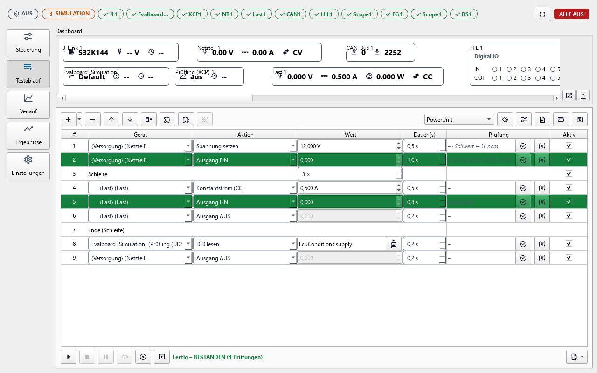

# LabControl

**LabControl** controls hobbyist lab equipment – power supplies, electronic loads, oscilloscopes, function
generators, I/O boxes and CAN devices – from one interface, on a Windows PC and on a Raspberry Pi with a touch
display. On top of that it runs test sequences with checks and reports, talks to an ECU under test (UDS, XCP,
flashing over CAN, rest-bus simulation from DBC with E2E) and can be automated from the command line, over REST
or by an AI assistant through its MCP server.

📖 **Documentation (currently in German): https://danielsimonreinhardt.github.io/LabControl/** –
source in [`docs/de/`](docs/de/index.md). The user interface can be switched to English.

## Highlights

- **One interface for all devices** – vendor-agnostic drivers, live dashboard, presets, recording (CSV/MF4).
- **Test sequences** – loops, conditions, checks with limits, reusable linked blocks, voltage profiles, timing
  checks, variants and parameter sets, debugging with breakpoints, HTML/PDF reports, JUnit and JSON results.
- **ECU under test** – UDS diagnostics from ODX/PDX, XCP measurement and calibration from A2L, flashing over CAN,
  rest-bus simulation from DBC with AUTOSAR E2E profiles 1, 2 and 11.
- **Automation** – `labcontrol run|flash|history|coverage|timing` with exit codes for CI, REST API, MCP server for
  Claude, nightly runs on the Pi, result history with trends and flaky-check detection.
- **Safety first** – limits and watchdog per device, ALL OFF across PC and Pi, interlock between power supply and
  load, remote control only when explicitly allowed.
- **PC + Raspberry Pi** – kiosk mode with touch UI on the Pi, both linked as one test bench with a shared folder.

## Supported devices

MANSON HCS-3xxx power supplies · KORAD KEL102 electronic load · Joy-IT JDS2915 (JDS66xx) function generator ·
PicoScope 2204A/2205A · UNI-T MSO1000HD (SCPI over LAN) · microHIL I/O box · SEGGER J-Link · CAN interfaces
(Vector, PCAN, SLCAN, SocketCAN) · self-built 14-cell battery simulator. Details per device in
[Geräte einrichten](docs/de/geraete.md) and the driver READMEs in [`device-driver/`](device-driver/).

## Related projects

- [microHIL](https://github.com/danielsimonreinhardt/microHIL) – self-built I/O box for simple hardware-in-the-loop
  tests; LabControl drives it as a device and uses its CAN port as an SLCAN interface.

## Installation

- **Windows:** download the `.exe` from the [latest release](https://github.com/danielsimonreinhardt/LabControl/releases/tag/latest)
  (built after every push to `master`) and run it.
- **From source:** Python 3.12, `pip install -r requirements.txt`, then `python lab_gui/main.py`.
- **Raspberry Pi:** see [Raspberry Pi und Verbund](docs/de/pi-verbund.md).

Everything can be tried without hardware when running from source: *Einstellungen → Allgemein →
Simulationsmodus* (the option is hidden in the `.exe`).

## Status

A hobby project in active development. What has been verified on real hardware and what only in simulation is
recorded per change in the [CHANGELOG](CHANGELOG.md) (German).

## Contributing

Contributions, ideas and bug reports are welcome! If you own lab equipment that isn't supported yet, feel free to
open an issue – especially if you're willing to help test a driver for it. See
[Für Entwickler](docs/de/entwickler.md) and [NEUEN_TREIBER_ANLEGEN.md](NEUEN_TREIBER_ANLEGEN.md).
