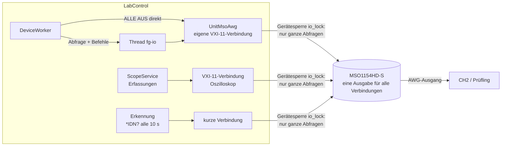

# UNI-T MSO1000HD-S – eingebauter Funktionsgenerator (AWG1)



| Was | Wie |
|---|---|
| Erscheint | automatisch, sobald ein eingetragenes UNI-T-Oszilloskop erreichbar ist und `AWG1:OUTPut?` beantwortet – keine eigene Einstellung |
| Geräte-ID | `fg:<Adresse des Oszilloskops>:AWG1` (Simulation: `fg:SIM:AWG1`) |
| Kanäle | einer (`channel=1`), keine Phase |
| Kurvenformen | Sinus, Rechteck, Puls, Rampe (= `FG_WAVE_TRIANGLE`, Symmetrie 50 %), Rauschen, DC |
| Modulation | `AWG1:MODe` BASe / AM / FM / ASK / FSK / SWEep mit ihren Parametern |
| Last | `AWG1:LOAD`, 50 … 1 000 000 Ω (1 000 000 = hochohmig) |
| ALLE AUS, Watchdog, Abbruch | Ausgang AUS (`AWG1:OUTPut OFF`), Signalparameter bleiben |
| Beim Verbinden | nichts geschaltet – der Zustand wird nur gelesen |

Die Oszilloskope der Reihe MSO1000HD mit „-S“ (z. B. **MSO1154HD-S**) haben einen
einkanaligen Funktionsgenerator. LabControl führt ihn als **eigenen
Funktionsgenerator** (Geräteart `fg`) – mit denselben Aktionen wie der JDS2915,
dazu Modulation und Lastwiderstand. Arbiträrkurven (Dateien) bleiben außen vor.
Grundlage ist das „MSO1000HD Series Programming Manual“ (Kapitel „AWG Command“).

## Befehle (alle am Gerät geprüft)

| Feld / Aktion | Befehl | Bereich im Treiber |
|---|---|---|
| Ausgang `FG_OUT_ON/OFF` | `AWG1:OUTPut ON/OFF`, `AWG1:OUTPut?` → `0`/`1` | – |
| Form `FG_WAVE_*` | `AWG1:BASe:WAVe SINe\|SQUare\|PULSe\|RAMP\|NOISe\|DC` | ARB nur lesen |
| Frequenz `FG_FREQ` | `AWG1:BASe:FREQuency` | 1 µHz … 25 MHz |
| Amplitude `FG_AMPL` | `AWG1:BASe:AMPLitude` (Vss an der Last) | 0 … 20 V, in DC abgelehnt |
| Offset `FG_OFFS` | `AWG1:BASe:OFFSet` (in DC die Spannung) | ±10 V |
| Tastgrad `FG_DUTY` | `AWG1:BASe:DUTY` | 0 … 100 %, nur Rechteck und Puls |
| Art `FG_MODE_BASE/AM/FM/ASK/FSK/SWEEP` | `AWG1:MODe` | – |
| Modulationsform `FG_MOD_WAVE_SINE/SQUARE/UPRAMP/DNRAMP/NOISE` | `AWG1:MODulate:WAVe` | – |
| `FG_MOD_FREQ` | `AWG1:MODulate:FREQuency` | 1 µHz … 25 MHz |
| `FG_AM_DEPTH` | `AWG1:AM:MODulate:DEPTh` | 0 … 120 % |
| `FG_FM_DEV` | `AWG1:FM:FREQuency:DEV` | 0 … 25 MHz |
| `FG_FSK_RATE` (ASK **und** FSK) | `AWG1:FSK:RATio` | 1 µHz … 25 MHz |
| `FG_FSK_FREQ` | `AWG1:FSK:FREQuency` | 1 µHz … 25 MHz |
| `FG_SWEEP_LIN/LOG` | `AWG1:SWEep:TYPe LINe\|LOG` | – |
| `FG_SWEEP_START/STOP` | `AWG1:SWEep:FREQuency:STARt/STOP` | 1 µHz … 25 MHz |
| `FG_SWEEP_TIME` | `AWG1:SWEep:TIMe` | 1 ms … 500 s |
| `FG_LOAD` | `AWG1:LOAD` (ganze Ohm) | 50 … 1 000 000 Ω |

Welche Parameter bei welcher Art wirken (Kachel blendet die übrigen aus):

| Art | Parameter |
|---|---|
| AM | Modulationsform, Modulationsfrequenz, AM-Tiefe |
| FM | Modulationsform, Modulationsfrequenz, FM-Hub |
| ASK | Umtastrate (`FSK:RATio`) |
| FSK | Umtastrate, Sprungfrequenz |
| Wobbeln | Wobbelart, Start-/Stoppfrequenz, Wobbelzeit |

## Am Gerät geprüft (MSO1154HD-S, Firmware V1.01.0081, LAN)

Ausgang an CH2 desselben Oszilloskops, nur kleine Pegel (≤ 2 Vss, |Offset| ≤ 1 V,
≤ 1 MHz). Abweichungen vom Handbuch und Eigenheiten:

| Befund | Folge im Treiber |
|---|---|
| **Eine Ausgabe für alle VXI-11-Verbindungen:** die Antwort auf eine Abfrage über Verbindung B kam beim Lesen auf Verbindung A an (Erfassung brach ab) | Gerätesperre je Host in `unit_mso1000hd.driver.VisaTransport` (`io_lock`): eine Abfrage hält sie bis ihre Antwort gelesen ist. Mit Sperre: drei Erfassungen bei laufender Generator-Abfrage unverfälscht, keine Fehler |
| `pyvisa.ResourceManager.close()` schließt **alle** Verbindungen des Prozesses (ein Manager je Backend) – jede Erkennung (`*IDN?` alle 10 s) beendete so auch die Generator-Verbindung | `VisaTransport.close()` schließt nur die eigene Verbindung (auch im R&S-Treiber) |
| Während eine Erfassung eingerichtet wird (Trigger-Befehle), nimmt das Gerät bis ~1,5 s nichts an | Abfrage und Befehle im eigenen Thread (`ASYNC_IO`), Zeitgrenze 5 s; der DeviceWorker bleibt frei |
| Unbekannter Befehl: I/O-Fehler schon beim Senden, danach `-113,"Undefined header;…"` in `:SYSTem:ERRor?`, Verbindung bleibt | `FunctionGeneratorValueError` mit dem Fehlertext, Fehlerspeicher abgeholt; nur verwendete, geprüfte Befehle |
| Werte außerhalb werden still geklemmt (Tastgrad 150 → 99 %, Frequenz 0 → 1 µHz) | Rahmen im Treiber, zurückgelesener Wert gilt |
| **`AWG1:LOAD`: erst ab 50 Ω** (Handbuch: 1 Ω), kleinere Werte → 50; ganze Ohm (123,4 → 123) | Bereich 50 … 1 000 000 Ω, gerundet |
| Last ändert nur die **Zählweise**: Amplitude/Offset gelten an der angenommenen Last (0,5 Vss hochohmig → 0,25 Vss bei 50 Ω angezeigt), die Spannung am Ausgang bleibt | nach `FG_LOAD` werden Amplitude und Offset zurückgelesen |
| **Tastgrad in RAMP:** `AWG1:BASe:DUTY` schaltet die Ausgabe auf ein Rechteck um, `AWG1:BASe:WAVe?` meldet weiter `RAMP`; erst `AWG1:BASe:WAVe RAMP` stellt die Rampe wieder her | Tastgrad nur bei Rechteck und Puls, sonst abgelehnt (`set_duty_checked`) |
| DC: am Ausgang liegt der Offset (0,5 V → 0,503 V, −0,7 V → −0,708 V), die Amplitude spielt keine Rolle | in DC keine Amplitude (abgelehnt), keine Sonderbehandlung wie beim JDS2915 |
| **ASK:** das Handbuch nennt keinen Befehl; die Umtastrate ist `AWG1:FSK:RATio`, der untere Pegel liegt fest bei der halben Amplitude | ASK zeigt und setzt die Umtastrate |
| Alle Abfragen (auch Modulationsparameter) gehen in jeder Art; Antworten `1.000000e+03`, Formen `SINe`/`RAMP`, Art `BASe`/`SWEep` | Abfrage rollierend, 4 Felder je 0,5 s |
| `*OPT?` gibt es nicht | Erkennung über `AWG1:OUTPut?`; ein Modell ohne Generator wird nur einmal gefragt, bis das Oszilloskop neu erscheint |

Nicht am Gerät geprüft: Frequenz über 1 MHz, Amplitude über 2 Vss, Offset über
1 V, Lasten außer 50/75/123/600/1000 Ω und hochohmig, Rauschen nur angesehen.

## Verwendung

```python
from unit_mso_awg.driver import UnitMsoAwg, WAVE_SQUARE, state_dict

with UnitMsoAwg.open("TCPIP0::<Adresse>::inst0::INSTR") as gen:
    print(gen.identify())                  # Modell Seriennummer Firmware AWG1
    gen.set_waveform(1, WAVE_SQUARE)
    gen.set_frequency(1, 2000.0)           # Hz
    gen.set_amplitude(1, 1.0)              # Vss an der eingestellten Last
    gen.set_param(1, "mode", "AM")         # Modulation
    gen.set_load(1, 1_000_000)             # hochohmig
    gen.set_output(1, True)
    print(state_dict(gen))
```

## Prüfung

`python tools/check_unit_mso_awg.py` – Treiber, Gerätesperre, DeviceWorker,
Ablauf-Modell, Kachel und Verbund gegen den Simulator (`mock.py`, SCPI-Ebene).
Mit `--hardware --address <IP>` zusätzlich am Gerät (Generator an CH2):
Messungen an CH2, Last, Modulation, unbekannter Befehl, DeviceWorker-Erkennung,
Abfrage während Erfassungen, Ablauf-Aktion und ALLE AUS; danach wird der
vorgefundene Zustand wiederhergestellt.
