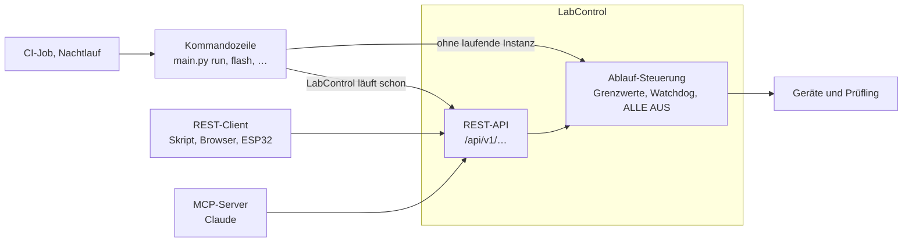
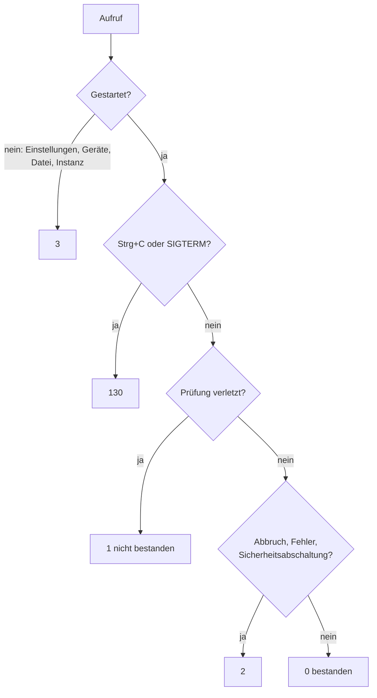
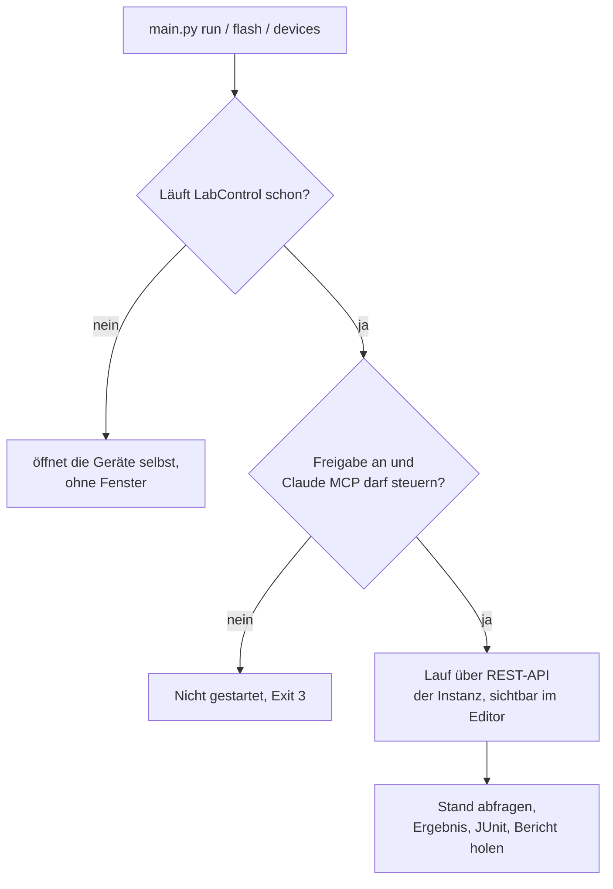
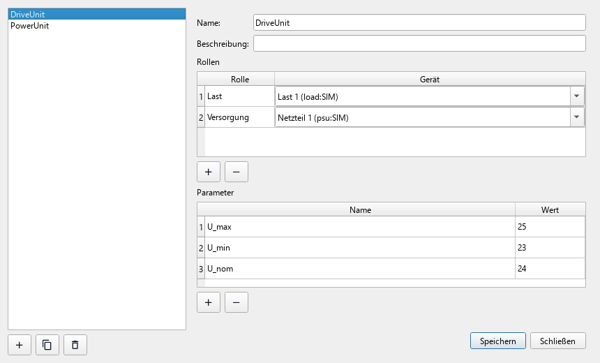
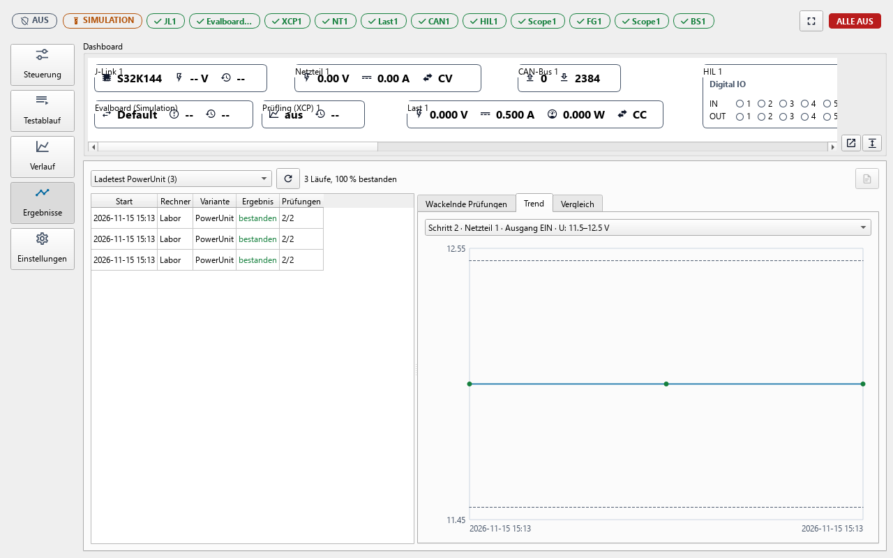
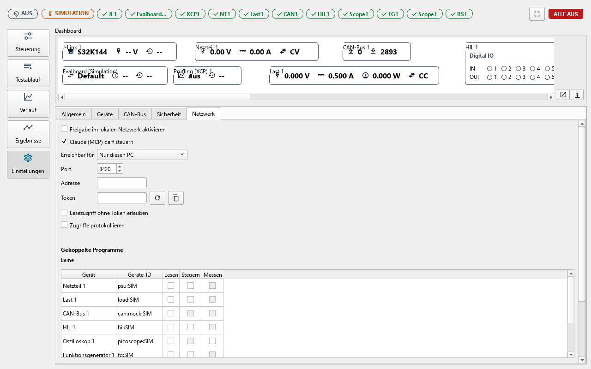
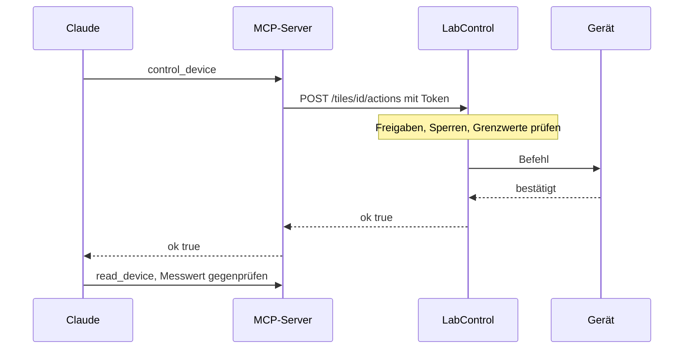
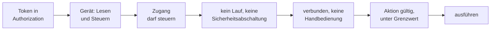
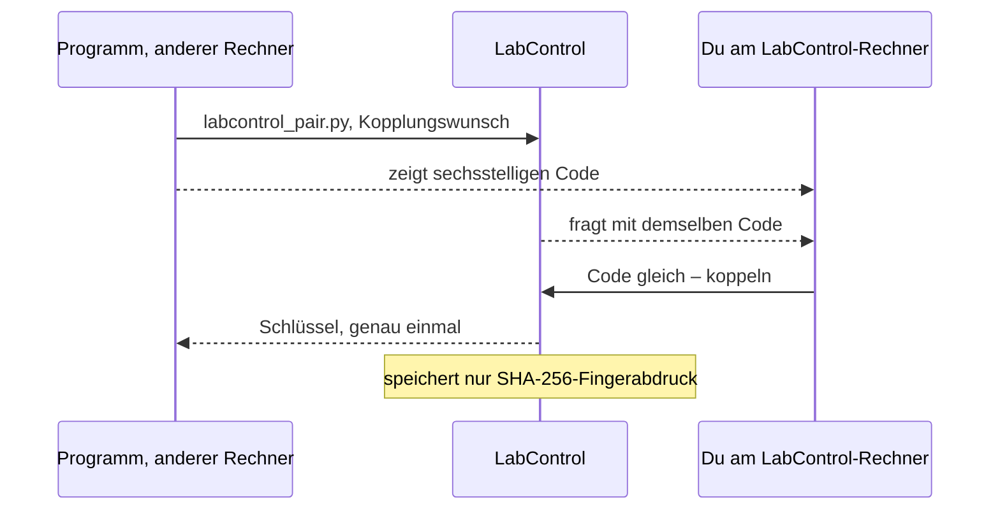

# Automatisierung

LabControl lässt sich ohne Klicken bedienen. Alle Wege gehen durch dieselben Sicherheitsprüfungen wie die
Oberfläche.



## Kommandozeile

```bash
python lab_gui/main.py <befehl> [optionen]      # aus dem Quellcode
LabControl.exe <befehl> …                       # Windows-.exe
```

!!! tip "Für Skripte den Quellcode nehmen"
    Die `.exe` ist ein Fensterprogramm ohne Konsole (Simulationsmodus seit 0.70.0 auch dort). Für Skripte und CI
    ist der Quellcode (Python 3.12, `pip install -r requirements.txt`) der verlässliche Weg.

- Öffnen Geräte: `run` (Testablauf), `flash` (Firmware über CAN), `devices` (Geräte auflisten).
- Lesen nur Dateien: `history` (Trends), `coverage` (Anforderungs-Abdeckung), `timing` (Zeitprüfung).
- `main.py <befehl> --help` zeigt die Optionen.

### `run` – Testablauf ausführen

```bash
python lab_gui/main.py run ablauf.json --junit out/junit.xml --json out/run-result.json --report out/bericht.html
```

| Option | Bedeutung |
|---|---|
| `testcase` | Testablauf-Datei (`.json`), Pflicht |
| `--report`, `--junit`, `--json DATEI` | HTML-Bericht, JUnit-XML, `run-result.json` |
| `--var NAME=WERT` | Laufvariable vorbelegen, mehrfach; Dezimalkomma geht auch |
| `--variant NAME` | Variante (Name im Ordner `varianten` oder Pfad zu `.json`), siehe [Varianten](#varianten-und-matrix) |
| `--matrix CSV` | eine Zeile = ein Lauf, siehe [Matrix](#varianten-und-matrix) |
| `--simulation` | simulierte Geräte statt Hardware |
| `--wait-devices S` | auf die Geräte des Ablaufs warten (Standard 15 s) |
| `--timeout S` | Lauf nach S Sekunden abbrechen (0 = ohne, Standard) |

Ablauf eines Aufrufs:

1. Ablauf laden (verknüpfte Bausteine im aktuellen Stand), Geräte zuordnen wie im Editor.
2. Bis `--wait-devices` auf alle Geräte warten, bei UDS-/XCP-Schritten auch auf das CAN-Interface des Prüflings.
3. Fehlt danach ein Gerät: nicht gestartet (Exit 3).
4. Je Prüfschritt eine Zeile, z. B. „Schritt 3: bestanden (11.98)“.
5. Am Ende **ALLE AUS**, Ergebnisdateien schreiben, „Ergebnis: BESTANDEN (Exit 0)“.

- Ohne Fenster gehen **Geräte eines Verbund-Partners** und **J-Link-Schritte** noch nicht (Exit 3).
- Haltepunkte aus dem Editor gelten für die Kommandozeile nie.

### `flash` – Firmware über CAN

```bash
python lab_gui/main.py flash firmware.hex --wait 10 --ecu mein_projekt --junit out/flash.xml
```

| Option | Bedeutung |
|---|---|
| `firmware` | Firmware-Datei (`.hex`/`.srec`), Pflicht |
| `--wait S` | auf den Bootloader warten (nach Reset/Aus-Ein von Hand) |
| `--ecu NAME` | Projektname bei mehreren Steuergeräten am Bus |
| `--report`, `--junit`, `--json`, `--simulation` | wie bei `run`; `--wait-devices S` wartet aufs CAN-Interface (15 s) |

- Intern ein Lauf mit genau dem Schritt „Firmware flashen (CAN)“: Sperre, laufende Instanz, Bericht, JUnit und
  Exit-Codes wie bei `run`.
- Einrichtung und Kanal-Freigabe: [Prüfling – Flashen über CAN](pruefling.md#flashen-uber-can).
- Am Raspberry Pi über SocketCAN (`can0`) geht Flashen noch nicht, weil canflash eine Kanalnummer erwartet; die
  Erweiterung ist in neXtBSW geplant.

### Auswerte-Befehle

| Befehl | Option | Bedeutung |
|---|---|---|
| `devices` | `--simulation`, `--wait S` | Suchdauer (Standard 5 s); je Zeile Geräteart, Geräte-ID, Name. Läuft LabControl schon: Kacheln der Instanz, getrennte mit „(getrennt)“ |
| `history`, `coverage` | `--results ORDNER` | Ordner mit `run_*.json`, mehrfach; Standard: Berichtsordner aller Rechner |
| `history` | `--testcase NAME` | nur dieser Ablauf (Name wie im Bericht); kein Lauf gefunden = Exit 3, sonst 0 |
| `history` | `--last N` | je Ablauf die letzten N Läufe (Standard 50) |
| `history` | `--html DATEI` | Übersicht mit Trends als HTML |
| `coverage` | `--register DATEI` | Anforderungsregister (`.sdoc`/`.csv`/`.md`), mehrfach; Standard aus den Einstellungen |
| `coverage` | `--csv DATEI`, `--md DATEI` | als CSV bzw. Markdown; ohne beide als Markdown in die Konsole |

- `history` je Ablauf: Zahl der Läufe, Bestanden-Quote, letztes Ergebnis mit Zeit, Rechner, Variante, wackelnde
  Prüfungen.
- `coverage` je Anforderung: Urteil des jüngsten Laufs – bestanden, nicht bestanden oder nicht geprüft.

**`timing`** – Zeitprüfung auf einer Datei

```bash
python lab_gui/main.py timing aufnahme.csv --channel "Netzteil 1/Spannung" --reach ">= 11.5" --within 0.5 --from 2
```

| Option | Bedeutung |
|---|---|
| `file` | LabControl-Aufzeichnung (`.csv`/`.mf4`) oder Oszi-Erfassung (`.csv`) |
| `--list` | Kanäle der Datei auflisten |
| `--channel KANAL` | z. B. `Netzteil 1/Spannung` oder `A`; nötig bei mehreren Kanälen |
| `--band MIN:MAX` | Wert bleibt im Band |
| `--reach 'OP WERT'` + `--within S` | Wert erreicht z. B. `>= 11.5` innerhalb S Sekunden ab `--from` |
| `--from S`, `--to S` | Fenster in Sekunden ab Aufnahmebeginn |
| `--json DATEI` | Ergebnis als JSON |

Genau eine Prüfung (`--band` oder `--reach`), ausgewertet wie der Block „Überwachen“. Exit 0 bestanden,
1 verletzt, 3 Aufruf oder Datei falsch.

### Exit-Codes



- **1** gilt auch, wenn die verletzte Prüfung den Lauf abgebrochen hat.
- Bei `--matrix` zählt der schlimmste Lauf, siehe [Matrix](#varianten-und-matrix).

### Eigenständig oder über die laufende Instanz

Fenster und Kommandozeile holen dieselbe Sperrdatei `labcontrol.lock` im Datenordner, damit nicht zwei Prozesse
dieselben Ports und CAN-Adapter öffnen. Ein abgestürzter Prozess hinterlässt keine gültige Sperre; ein zweites
Fenster meldet „LabControl läuft bereits.“



**Über die laufende Instanz** (z. B. Kiosk am Pi, offenes Fenster am PC):

- An der Instanz nötig: Einstellungen → Netzwerk → **„Freigabe im lokalen Netzwerk aktivieren“** und **„Claude
  (MCP) darf steuern“**. Port und Token liest die Kommandozeile aus derselben `settings.json`.
- Der Ablauf läuft sichtbar im Editor der Instanz; ungespeicherte Änderungen dort → abgelehnt.
- Fehlende Geräte: erneuter Versuch bis `--wait-devices`.
- **Strg+C** oder `--timeout` halten den Lauf an (wie Stop: ALLE AUS).
- `--simulation` nur ohne laufende Instanz (sonst Exit 3).
- Geräte eines Verbund-Partners gehen hier, z. B. ein Netzteil am Pi über eine Rolle der Variante.
- „Nicht gestartet: …“ nennt den Grund, z. B. `remote_control_inactive` („Claude (MCP) darf steuern“ ist aus)
  oder `locked` (es läuft schon ein Ablauf oder eine Sicherheitsabschaltung steht an).

!!! warning "Am Ende immer ALLE AUS"
    Läufe von der Kommandozeile enden immer mit **ALLE AUS**, auch bei Erfolg und unabhängig von der
    Ablauf-Eigenschaft „Am Ende ALLE AUS“. Ohne Fenster gibt LabControl die Netzteile danach mit 1 V / 0 A zur
    Handbedienung frei; über die Instanz schaltet diese nur ihre **eigenen** Geräte ab, nicht die des Partners.

## Varianten und Matrix



Eine **Variante** belegt die Rollen eines Ablaufs mit Geräten und setzt Parameter (Startvariablen). Anlegen im
Editor über **„Varianten bearbeiten…“** ([Testabläufe](testablaeufe.md#varianten-und-parametersatze)), gespeichert
als `<gemeinsamer Ordner>/varianten/<name>.json`.

- Startvariablen = Parameter der Variante, `--var` überschreibt; Bericht und `run-result.json` nennen beides.
- Unbelegte Rolle oder falsche Geräteart: nicht gestartet (Exit 3).

**Matrix:** `--matrix` führt einen Ablauf mehrfach aus, eine CSV-Zeile = ein Lauf. Trennzeichen Komma oder
Semikolon; Spalte `variant` (oder `variante`) optional, alle anderen Spalten sind Parameter.

```text
variant;U_nom;I_max
Board-A;12;2.5
Board-A;13.5;2.5
Board-B;24;1.0
```

```bash
python lab_gui/main.py run ladetest.json --variant Board-A --var I_max=2.0
python lab_gui/main.py run ladetest.json --matrix matrix.csv --junit out/junit.xml
```

- Ausgabedateien mit Zeilennummer (`junit_01.xml` …), am Ende eine Übersicht mit dem Exit-Code jeder Zeile.
- Exit-Code der Matrix = schlimmster Lauf (Reihenfolge 130, 3, 2, 1, 0); Strg+C beendet die ganze Matrix.
- Geht auch über die laufende Instanz.

## CI

Exit-Codes, JUnit-XML und `run-result.json` sind für CI gedacht; Exit ungleich 0 lässt den Job fehlschlagen.

- **Simulation** auf gehostetem Runner: `run … --simulation`, Beispiel unten.
- **Hardware** auf selbst gehostetem Runner am Laborrechner: ohne `--simulation`. Läuft dort LabControl mit
  Fenster, geht der Lauf über die Instanz (Freigabe und „Claude (MCP) darf steuern“ an).

GitHub Actions in der Simulation (nicht im Repository enthalten, Pfade anpassen):

```yaml
name: Testabläufe (Simulation)
on: [push, workflow_dispatch]
jobs:
  simulation:
    runs-on: ubuntu-24.04
    env: {QT_QPA_PLATFORM: offscreen}
    steps:
      - uses: actions/checkout@v4
      - uses: actions/setup-python@v5
        with: {python-version: "3.12"}
      - run: sudo apt-get update && sudo apt-get install -y libegl1 libgl1 libxkbcommon0 libfontconfig1 libdbus-1-3 libglib2.0-0
      - run: python -m pip install -r requirements.txt
      - run: >
          python lab_gui/main.py run tests/ladetest.json --simulation
          --junit out/junit.xml --json out/run-result.json --report out/bericht.html
      - uses: actions/upload-artifact@v4
        if: always()
        with: {name: ergebnis, path: out/}
```

- Qt-Bibliotheken und `offscreen` wie im Linux-Prüfjob des Repositorys; ohne Anzeige schaltet LabControl unter
  Linux ohnehin auf `offscreen`.
- Im eigenen Skript reicht es, `$?` gegen die [Exit-Codes](#exit-codes) zu prüfen, z. B. nach
  `main.py run tests/nacht.json --junit out/junit.xml --wait-devices 60`.

## Nachtlauf am Pi

`tools/pi/nightly_pi.sh` richtet am Raspberry Pi einen systemd-Timer ein:

```bash
bash ~/LabControl/tools/pi/nightly_pi.sh <ablauf.json> [HH:MM]   # Standard 02:00
bash ~/LabControl/tools/pi/nightly_pi.sh --now                   # einmal sofort (Test)
bash ~/LabControl/tools/pi/nightly_pi.sh --off                   # abschalten
```

- Aufruf: `main.py run <ablauf> --wait-devices 60`; läuft der Kiosk, über ihn (Freigabe und „Claude (MCP) darf
  steuern“ dort an).
- Exit-Code in `journalctl --user -u labcontrol-nightly`, Dateien im Berichtsordner. Mehr in
  [Raspberry Pi und Verbund](pi-verbund.md#nachtlauf-am-pi).

## Ergebnisse und Trends



Der Reiter **„Ergebnisse“** sammelt alle Läufe von PC und Pi (`<rechner>/reports/run_*.json` im gemeinsamen
Ordner und der lokale Berichtsordner), auch die von Kommandozeile, REST und MCP.

- Links die Läufe mit **Start**, **Rechner**, **Variante**, **Ergebnis**, **Prüfungen**; rechts **Wackelnde
  Prüfungen**, **Trend**, **Vergleich** – Bedienung in [Bedienung → Ergebnisse](bedienung.md#ergebnisse).
- Eine Prüfung wird über Schrittnummer, Aktion und Messgröße wiedererkannt; verschiebt sich das, gilt sie als neu.
- Als Datei: `main.py history --html uebersicht.html` ([Auswerte-Befehle](#auswerte-befehle)).

Dafür legt jeder Lauf seine Dateien auch ohne `--json`/`--junit`/`--report` im **Berichtsordner** ab, mit
Netzlaufwerk unter `<Netzlaufwerk>/<rechner>/reports/`:

| Datei | Inhalt |
|---|---|
| `run-result.json` | Format `labcontrol-run-result`: Ablauf, Rechner, Start/Ende, `outcome`, `exit_code`, Fehler, je Prüfschritt Werte, Grenzen und Urteil, Geräte, Variante und Parameter, Anforderungen, Messmittel, Zeitprüfungen, Sollwertverläufe |
| JUnit-XML | eine `<testsuite>` je Lauf, ein `<testcase>` je Prüfschritt; Abbruch außerhalb einer Prüfung als eigener `<testcase>` mit `<error>`; Anforderungen und Messmittel als `<property>` |
| HTML-Bericht | derselbe Bericht wie aus dem Fenster |

## REST-API



Ein kleiner HTTP-Server in LabControl, eingeschaltet unter **Einstellungen → Netzwerk**:

| Einstellung | Bedeutung |
|---|---|
| **Freigabe im lokalen Netzwerk aktivieren** | Server an; beim ersten Einschalten entsteht ein Token |
| **Claude (MCP) darf steuern** | Programme auf **diesem** Rechner (MCP-Server, Kommandozeile) dürfen steuern; Standard an |
| **Erreichbar für** | „Nur diesen PC“ (nur `127.0.0.1`) oder „Alle Geräte im lokalen Netzwerk“ |
| **Port**, **Adresse** | Standard 8420; Adresse für Browser oder Client |
| **Token** | Zugangsschlüssel; daneben neu erzeugen (alter wird ungültig) und kopieren |
| **Lesezugriff ohne Token erlauben** | Lesen ohne Token; Schreiben verlangt ihn immer |
| **Zugriffe protokollieren** | jede Anfrage in `share_access.log` |
| **Gekoppelte Programme** | Programme mit eigenem Schlüssel, siehe [Kopplung](#gekoppelte-programme) |
| Tabelle **Gerät / Geräte-ID / Lesen / Steuern / Messen** | Freigabe je Gerät |

- Ohne **Lesen** ist ein Gerät über das Netz unsichtbar, auch mit erratener ID.
- **Steuern** nur für Netzteil, Last, microHIL, Funktionsgenerator, Batterie-Simulator; **Messen** nur für
  Oszilloskope. CAN-Interfaces sind nie fernsteuerbar.
- **Token** immer als Kopfzeile `Authorization: Bearer <TOKEN>`; nur lesende Anfragen nehmen ihn ersatzweise als
  `?token=` (z. B. ESP32). Behandle ihn wie ein Passwort.

### Endpunkte

Alle Pfade beginnen mit `/api/v1`, Antworten sind JSON.

| Methode und Pfad | Zweck |
|---|---|
| `GET /status` | Version, Sperrzustand (`lock`), Watchdog, ob der Aufrufer steuern darf (`remote_control`) |
| `GET /tiles` | freigegebene Geräte (Kacheln) |
| `GET /tiles/{id}` | ein Gerät mit Messwerten |
| `GET /values[?tiles=id1,id2]` | Messwerte mehrerer Geräte, mit erlaubten Aktionen und Sperrgrund |
| `POST /tiles/{id}/actions` | eine Aktion, z. B. `{"action": "PSU_VOLT", "value": 5.0}` |
| `POST /all-off` | **ALLE AUS** |
| `GET /testcases` | Abläufe im gemeinsamen Ordner `testcases/` |
| `POST /runs` | Lauf starten: `{"testcase": "ladetest.json", "vars": {…}, "variant": "…"}` |
| `GET /runs`, `GET /runs/{id}` | Läufe bzw. Stand eines Laufs mit Meldungen; `waiting` = wartet auf Bestätigung im Fenster bzw. „Warten seit“ |
| `GET /runs/{id}/result`, `/junit`, `/report` | `run-result.json`, JUnit-XML, HTML-Bericht |
| `POST /runs/{id}/stop` | Lauf anhalten (wie Stop: ALLE AUS) |
| `GET /scopes`, `POST /scopes/{id}/acquire` … | Oszilloskope und Erfassungen (siehe `scope_api/README.md`) |

Außerhalb von `/api/v1`: `GET /` (Übersicht im Browser) und `GET /display` (Live-Anzeige freigegebener Werte;
Parameter `tiles`, `refresh` in Sekunden, `fmt=text` für Klartext).

```bash
# Zustand lesen
curl -H "Authorization: Bearer <TOKEN>" http://127.0.0.1:8420/api/v1/status

# Ablauf aus dem gemeinsamen Ordner mit Variante starten
curl -X POST -H "Authorization: Bearer <TOKEN>" -H "Content-Type: application/json" \
     -d '{"testcase": "ladetest.json", "variant": "Board-A"}' \
     http://127.0.0.1:8420/api/v1/runs
```

- `POST /runs` startet nur ohne anderen Lauf, ohne anstehende Sicherheitsabschaltung, ohne ungespeicherte
  Änderungen im Editor und mit allen Geräten.
- Einen Dateipfad (`"path"`) statt eines Namens darf nur ein Aufrufer auf demselben Rechner angeben.

## MCP-Server für Claude

Der MCP-Server (`labcontrol_mcp/`) gibt einem KI-Assistenten wie Claude Code Werkzeuge für LabControl. Er läuft als
eigener Prozess und übersetzt Werkzeugaufrufe in REST-Anfragen – **alle Sicherheitsentscheidungen fallen in
LabControl**.



### Einrichtung

1. LabControl, **Einstellungen → Netzwerk:** Freigabe einschalten, bei den Geräten **Lesen** und **Steuern**
   anhaken (Oszilloskop: **Lesen** und **Messen**), Token kopieren.
2. Umgebung im LabControl-Ordner anlegen (unter Linux `labcontrol_mcp/.venv/bin/python`):

    ```bash
    python -m venv labcontrol_mcp/.venv
    labcontrol_mcp/.venv/Scripts/python.exe -m pip install -r labcontrol_mcp/requirements.txt
    ```

3. Bei Claude Code anmelden (in einer Zeile oder mit Zeilenfortsetzung deiner Shell):

    ```text
    claude mcp add labcontrol --scope user
      -e LABCONTROL_URL=http://127.0.0.1:8420
      -e LABCONTROL_TOKEN=<TOKEN>
      -- <LabControl-Ordner>/labcontrol_mcp/.venv/Scripts/python.exe
         <LabControl-Ordner>/labcontrol_mcp/server.py
    ```

    Alternativ über eine `.mcp.json` – der Token steht dann im Klartext darin, die Datei nicht einchecken.

4. Prüfen, ohne etwas zu steuern: `labcontrol_mcp/.venv/Scripts/python.exe labcontrol_mcp/selftest.py`. Meldet,
   was fehlt (LabControl nicht gestartet, Token falsch, keine Kachel freigegeben, kein Steuerrecht).

LabControl auf einem **anderen Rechner**: dessen Adresse eintragen (z. B. `http://<IP des Pi>:8420`), dort
„Erreichbar für“ auf das ganze Netzwerk stellen und den MCP-Server [koppeln](#gekoppelte-programme).

### Werkzeuge

| Werkzeug | Zweck |
|---|---|
| `get_status` | Version, Sperrzustand, Watchdog, ob dieser Zugang steuern darf |
| `list_devices` | freigegebene Geräte mit Messwerten, erlaubten Aktionen und Sperrgrund |
| `read_device` | Messwerte eines Geräts (Gegenprüfen nach dem Schreiben) |
| `control_device` | eine Aktion (`PSU_VOLT`, `PSU_OUT_ON`, `CURR`, `HIL_RELAY_ON` …); `ok: true` = Gerät hat den Befehl angenommen |
| `all_off` | ALLE AUS – geht immer |
| `list_testcases` | gespeicherte Abläufe und letzte Läufe |
| `run_testcase` | Ablauf starten, optional mit Variablen und `variant`; liefert die Lauf-ID |
| `get_run` | Stand eines Laufs (auch `waiting`: Bestätigung nur im Fenster); `file="result"` = Ergebnis als JSON, `file="junit"` = JUnit-XML |
| `stop_run` | Lauf anhalten (ALLE AUS) |
| `list_scopes`, `get_scope_capabilities` | Oszilloskope, Kanäle, Bereiche, Triggerarten |
| `acquire` | Erfassung mit vollständiger Einstellung (V, s); Kennwerte, Warnungen, Hüllkurve, CSV-Pfad |
| `get_capture`, `measure`, `plot_capture` | Ausschnitt, neu berechnete Kennwerte, Kurve als Bild |
| `release_scope` | Verbindung zum Oszilloskop sofort trennen |

**Oszilloskop** (Einzelheiten in `scope_api/README.md`):

- Erfassen braucht Token, **Lesen** und **Messen**, kein Steuerrecht. Ein Testablauf am Oszilloskop hat Vorrang.
- Jede Erfassung enthält ihre ganze Einstellung (Bereich in ±V an der Tastkopfspitze, Dauer in s, Trigger) und
  liegt als CSV in `captures/`.
- Das Gerät bleibt 60 s nach der letzten Erfassung offen (Kachel „Verbunden (MCP)“), PicoScope 7 kann es so lange
  nicht öffnen – `release_scope` oder „Trennen“ auf der Kachel geben es frei.

## Sicherheit beim Fernsteuern

Ein Steuerbefehl über REST oder MCP durchläuft diese Prüfungen; jedes Nein lehnt ihn ab:



- **Darf steuern** am selben Rechner: solange **„Claude (MCP) darf steuern“** an ist – erkannt an der Verbindung,
  nicht an Angaben des Aufrufers; Chip **MCP** oben grün, sonst grau (nur lesen). Von einem anderen Rechner: nur
  als **gekoppeltes Programm** oder gekoppelter Verbund-Partner.
- Während eines Ablaufs oder nach einer Sicherheitsabschaltung: `locked` (HTTP 409); Lesen geht weiter.
- Handbedienung betrifft die HCS-Netzteile; Grenzwerte stehen unter Einstellungen → Sicherheit.
- Höchstens 2 Befehle gleichzeitig und 5 je Sekunde, damit ein Stau den Notaus nicht verzögert. Jede Aktion und
  Abweisung steht mit Adresse des Aufrufers im Log.
- **Nie fernsteuerbar:** CAN-Frames senden, Arbiträrsignale, XCP-Parameter schreiben (nur Oberfläche und
  Testablauf).

!!! warning "ALLE AUS geht immer"
    `POST /api/v1/all-off` bzw. `all_off` verlangt nur den Token – auch ohne Steuerrecht, während eines Ablaufs und
    nach einer Sicherheitsabschaltung.

### Gekoppelte Programme

Ein Programm auf einem anderen Rechner (z. B. MCP-Server auf einem Laptop) bekommt einen eigenen Schlüssel:



```bash
python tools/labcontrol_pair.py <IP von LabControl>:8420 "MCP Laptop" --save schluessel.txt
```

- LabControl fragt „Programm „MCP Laptop“ (…) möchte koppeln und steuern“; bei gleichem Code **„Code gleich –
  koppeln“** tippen. Den Schlüssel statt des Tokens verwenden (MCP-Server: `LABCONTROL_TOKEN`).
- **„Gekoppelte Programme“** zeigt Name, Adresse, Datum; der Papierkorb hebt die Kopplung auf, der Schlüssel gilt
  sofort nicht mehr.
- Freigabeliste, Sperren und Grenzwerte gelten auch hier. Nur mit dem allgemeinen Token von einem anderen Rechner:
  lesen ja, steuern nein.
- Bis 0.56 gab es stattdessen einen Hauptschalter „Fernsteuerung aktiv“ mit Zeitfenster; seit 0.57.0 ersetzen ihn
  „Claude (MCP) darf steuern“ (eigener Rechner) und die Kopplung (andere Rechner).

Zwei LabControl-Rechner (PC und Pi) koppeln und Geräte leihen: [Raspberry Pi und Verbund](pi-verbund.md).
