# Bedienung

Hauptfenster, Leiste oben, Dashboard, Steuerung, Verlauf, Ergebnisse, Einstellungen und Sicherheit. Testabläufe
haben ein eigenes Kapitel: [Testabläufe](testablaeufe.md).

## Das Hauptfenster

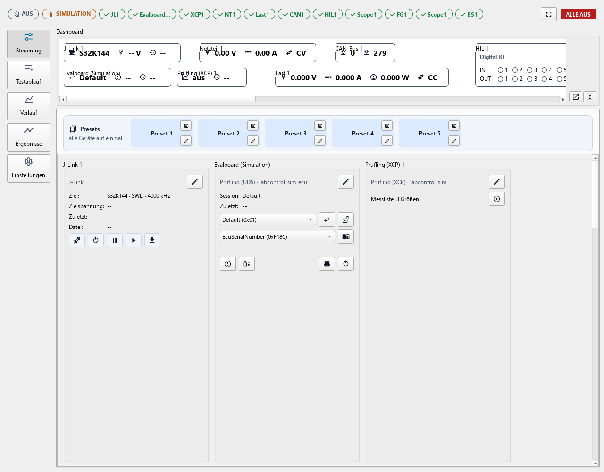

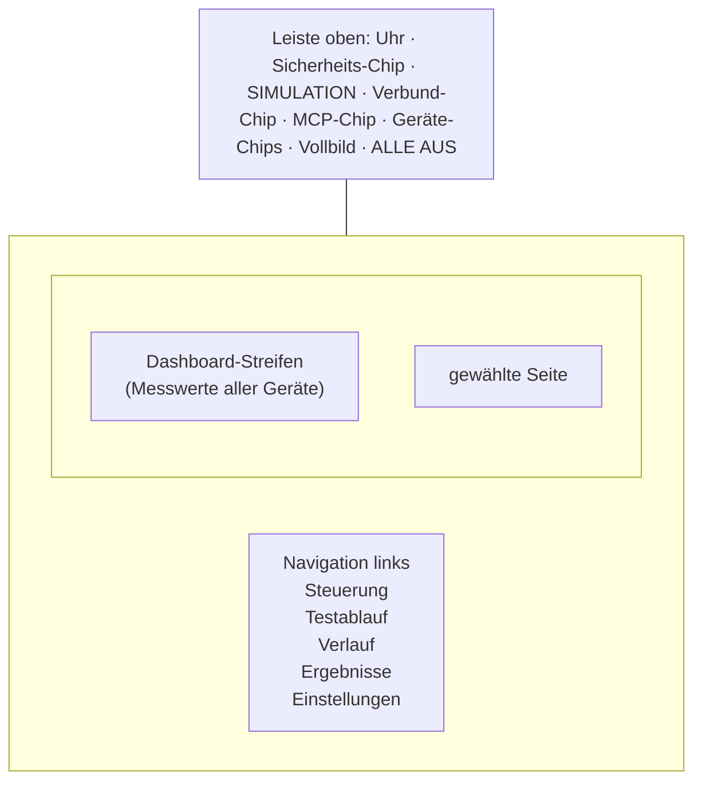

| Seite | Wofür |
|---|---|
| **Übersicht** | nur im Touch-Modus: alle Gerätekacheln auf einer Seite, siehe [Touch-Modus](#touch-modus) |
| **Steuerung** | Geräte von Hand bedienen, Presets, Kacheln anordnen |
| **Testablauf** | Abläufe bauen, starten, debuggen, siehe [Testabläufe](testablaeufe.md) |
| **Verlauf** | Messwerte als Kurven, Aufzeichnung als CSV oder MF4 |
| **Ergebnisse** | frühere Läufe, wackelnde Prüfungen, Trends, Vergleich zweier Läufe |
| **Einstellungen** | Allgemein, Geräte, CAN-Bus, Sicherheit, Netzwerk |

- Der Dashboard-Streifen steht am PC über jeder Seite.
- Meldungen der App erscheinen kurz als Hinweis am unteren Fensterrand.

## Leiste oben

| Element | Bedeutung |
|---|---|
| Uhr | aktuelle Systemzeit (hh:mm:ss), Datum im Tooltip |
| Sicherheits-Chip (Schild-Symbol) | **AUS** = kein Grenzwert aktiv, **AKTIV** = Watchdog überwacht, **AUSGELÖST** = Sicherheitsabschaltung, siehe [Sicherheit](#sicherheit) |
| Chip **SIMULATION** (Reagenzglas, Warnfarbe) | nur bei eingeschaltetem Simulationsmodus, auch in der `.exe` |
| Verbund-Chip, z. B. „⇄ Pi“ | nur bei eingeschaltetem Verbund: grün = verbunden, gelb = verbunden mit Hinweis oder Partner gesperrt, rot „✕ …“ = nicht verbunden; Tooltip nennt den Grund |
| Chip **MCP** | nur bei eingeschalteter Netzwerk-Freigabe: grün = Claude (MCP) darf steuern, grau = nur lesen |
| Geräte-Chips, z. B. „✓ NT1“ | je Gerät Kurzname und Zustand: ✓ verbunden (grün), ✕ getrennt (rot), Ⓗ Handbedienung (orange) |
| Vollbild | Fenster im Vollbild bzw. zurück (nur am PC, nicht in der Touch-Bedienung) |
| **ALLE AUS** | schaltet sofort alle Ausgänge ab |

- Kurznamen: **NT** Netzteil, **Last**, **CAN**, **HIL**, **Scope** Oszilloskop, **FG** Funktionsgenerator,
  **BS** Batterie-Simulator, **JL** J-Link, **ECU** Prüfling (UDS), **XCP** Prüfling (XCP), jeweils mit Nummer.
- Geräte ohne Nummer im Namen zeigen den gekürzten Namen; der volle Name steht im Tooltip.
- Klick auf die Chips öffnet **„Gerätezustand“**: Sicherheit, Verbund, MCP und alle Geräte mit vollem Namen.
- Nicht erreichbare Geräte verbindet LabControl alle 3 Sekunden neu.

## ALLE AUS

Der rote Knopf **ALLE AUS** (Tooltip „Alle Ausgänge sofort abschalten“) wirkt immer, auch während eines
Testablaufs und nach einer Sicherheitsabschaltung.

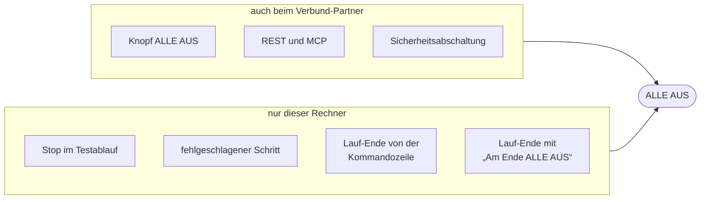

| Gerät | Wirkung von ALLE AUS |
|---|---|
| Elektronische Last | Eingang aus |
| Netzteil HCS-3xxx | Ausgang aus (Sollwerte bleiben); ein Netzteil in Handbedienung bleibt unberührt |
| microHIL | Digitalausgänge, Relais, 12-V-Ausgänge und Analogausgänge aus, PWM-Kanäle auf 0 |
| Funktionsgenerator | beide Ausgänge aus (Form, Frequenz usw. bleiben) |
| Batterie-Simulator | Ausgang gesperrt, die Fernsteuerung bleibt bestehen |
| CAN-Interface | ein laufender Restbus wird gestoppt |
| Testablauf | bricht mit „ALLE AUS – Ablauf abgebrochen“ ab |
| Verbund | bei Knopf, REST/MCP und Sicherheitsabschaltung schaltet der Partner-Rechner ebenfalls alles ab |

**Am Ende eines Laufs:**

- Ablauf-Eigenschaft **„Am Ende ALLE AUS“** (Dialog „Eigenschaften des Ablaufs“): ist sie an, schaltet auch ein
  normal beendeter Lauf aus dem Fenster am Ende alle eigenen Geräte ab.
- Neue Abläufe: vorbelegt (an). Bestehende Abläufe: aus, bis du sie setzt.
- Läufe von der Kommandozeile enden immer mit ALLE AUS, unabhängig von der Eigenschaft.
- Details: [Testabläufe](testablaeufe.md), [Automatisierung](automatisierung.md).

!!! warning "Handbedienung ist von ALLE AUS ausgenommen"
    Ein Netzteil in **Handbedienung** spricht LabControl nicht an, auch ALLE AUS nicht. Schalte es dann am Gerät
    ab, siehe [Handbedienung HCS-Netzteil](#handbedienung-hcs-netzteil).

## Dashboard-Streifen

Am PC sitzt das Dashboard über jeder Seite: je Gerät eine Kachel mit den wichtigsten Messwerten, z. B. Spannung,
Strom und Modus (CV/CC) beim Netzteil oder Session und letzte Bedienung beim Prüfling.

| Funktion | Bedienung |
|---|---|
| Getrennte Geräte | bleiben als graue Kachel mit „getrennt“-Symbol stehen, damit der Aufbau sichtbar bleibt |
| Reihenfolge | Kachel an der Titelzeile greifen und verschieben; bleibt gespeichert |
| Kompakte Ansicht | Knopf unten rechts im Dashboard-Rahmen (Tooltip „Normale Ansicht“ / „Kompakte Ansicht“); ohne gespeicherte Wahl startet LabControl kompakt |
| Abdocken | Knopf links daneben (Tooltip „Dashboard in eigenem Fenster öffnen“), z. B. für einen zweiten Bildschirm; derselbe Knopf oder Schließen des Fensters holt es zurück; Position, Größe und Zustand bleiben gespeichert |
| Partner-Geräte | Netzwerk-Symbol hinter dem Kacheltitel (Tooltip: Rechnername) |

## Steuerung

Jedes Gerät hat eine eigene Kachel, auch zwei baugleiche Geräte. Was jede Kachel kann: [Geräte einrichten](geraete.md),
Prüfling-Kacheln: [Prüfling](pruefling.md).

- **Wert senden:** erst mit dem Haken-Knopf daneben (Tooltip „Setzen“ oder „Übernehmen“).
- **EIN**/**AUS:** schalten den Ausgang; der aktive Zustand ist farbig (grün = ein).
- **Felder folgen dem Gerät:** Bedient jemand anderes das Gerät (Testablauf, Preset, Verbund-Partner, Claude),
  übernimmt die Kachel die neuen Sollwerte. Ein Feld, in dem du gerade tippst, bleibt unangetastet.
- **Belegt:** Nutzt ein Verbund-Partner das Gerät für seinen Testablauf, ist die Kachel gesperrt und zeigt
  „⇄ belegt durch <Rechner> · <Ablauf>“.

### Presets

Oben stehen fünf **Presets** („alle Geräte auf einmal“): Zustand aller sichtbaren Kacheln speichern und mit einem
Klick wiederherstellen.

| Knopf am Preset | Wirkung |
|---|---|
| großer Knopf in der Mitte | **Preset laden**: schreibt sofort alle gespeicherten Werte an die Geräte |
| Diskette (oben rechts) | **Preset speichern**: überschreibt den Platz mit dem aktuellen Zustand |
| Stift (unten rechts) | **Preset umbenennen** |

| Gerät | gespeichert |
|---|---|
| Netzteil | Spannung, Strom, Ausgang ein/aus |
| Elektronische Last | Modus, Sollwert, Eingang ein/aus (nur wenn der Zustand vom Gerät bekannt war) |
| Funktionsgenerator | je Kanal Form, Frequenz, Amplitude, Offset, Tastverhältnis, Ausgang; Phase |
| microHIL | Digitalausgänge, Analogausgänge, PWM, Relais, 12-V-Ausgänge, Stromgrenzen |
| Batterie-Simulator | Sollwerte und Freigaben der Zellen, **nicht** Fernsteuerung und Ausgang |
| CAN, Oszilloskop, J-Link, Prüfling | nichts |

!!! warning "Preset laden schaltet Ausgänge"
    Ein Preset schaltet Ausgänge so, wie sie beim Speichern waren – auch **ein**. Die
    [Verriegelung Netzteil/Last](#verriegelung-netzteillast) gilt für Presets nicht.

### Kacheln anordnen

- **Am PC:** Kachel an der Titelzeile greifen und in eine andere Zelle ziehen, auch in eine Lücke neben einer
  großen Kachel.
- Schon beim Ziehen siehst du, wo sie landet. Eine Kachel am Ziel weicht auf den nächsten freien Platz aus.
- **Escape** bricht ab. Die Anordnung bleibt gespeichert.
- **Touch-Modus:** Knopf **Anordnen**, siehe [Touch-Modus](#touch-modus).

### Umbenennen und Farben

| Knopf in der Kachel | Wirkung |
|---|---|
| Stift (Tooltip „Gerät umbenennen“) | neuer Name für Kachel, Dashboard, Leiste oben, Testablauf und Bericht |
| Farbkreis (Tooltip „Panel-Farbe wählen…“) | Hintergrundfarbe: Blau, Türkis, Grün, Orange, Violett, Pink, Grau oder „Kein (Standard)“ |

- Den Farbkreis gibt es nur mit Häkchen **Kachelfarben** in **Einstellungen → Allgemein**. Beim ersten Einschalten
  bekommt jedes bekannte Gerät eine eigene Farbe.
- Die Farbe gilt in Steuerung und Dashboard.
- Im Verbund gehören Name und Farbe dem Rechner, an dem das Gerät steckt; Änderungen in der Partnerkachel werden
  dort übernommen.

## Verlauf und Aufzeichnung

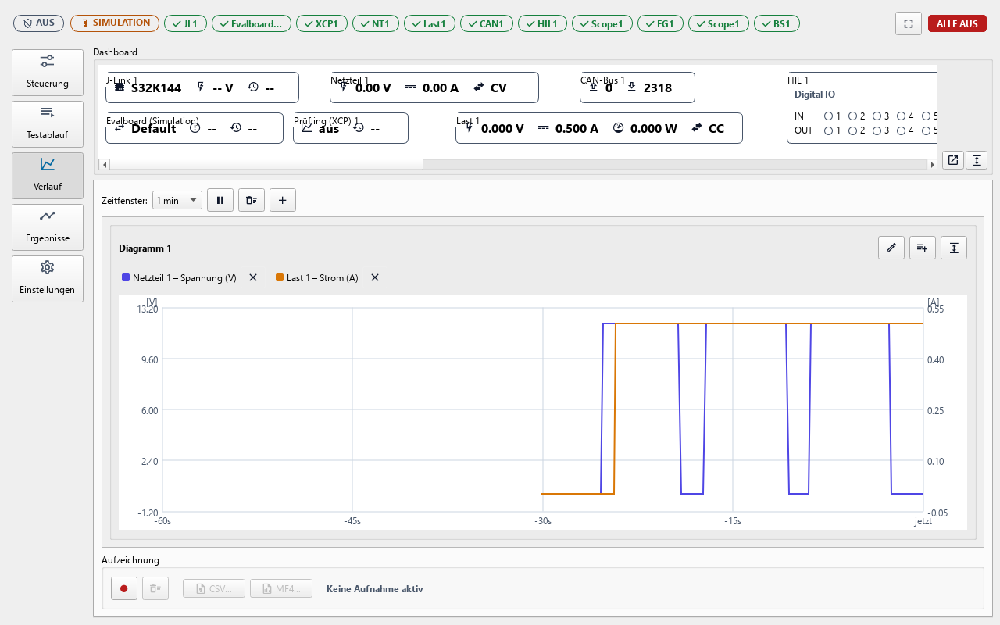

Der **Verlauf** zeigt Messwerte fortlaufend als Kurven, wie ein langsames Oszilloskop – in beliebig vielen
Diagrammen mit eigenen Signalen.

| Bedienelement | Wirkung |
|---|---|
| **Zeitfenster:** | 30 s, 1 min (Vorgabe), 2 min, 5 min, 15 min, 30 min |
| Pause / Fortsetzen | friert die Anzeige ein; die Aufzeichnung läuft weiter |
| Papierkorb (Tooltip „Anzeige zurücksetzen“) | leert nur die sichtbaren Kurven |
| **+** (Tooltip „Diagramm hinzufügen“) | neues, leeres Diagramm |
| je Diagramm oben rechts | **Diagramm umbenennen**, **Signal hinzufügen**, **Y-Achse einstellen…** (automatisch oder fest, links und rechts getrennt), ab zwei Diagrammen **Diagramm entfernen** |
| × hinter einem Signal in der Legende | nimmt das Signal aus dem Diagramm |

- **Achsen:** Signale gleicher Einheit teilen sich eine Achse. Links steht die erste vorhandene Einheit in der
  Reihenfolge V, A, W, rechts die übrigen.

- **Signale:** Netzteil (Spannung, Strom), Last (Spannung, Strom, Leistung), microHIL (Analogeingänge, Strom der
  12-V-Ausgänge, Digitaleingänge und -ausgänge, Relais), Messliste des Prüflings über XCP; im Verbund Netzteile,
  Lasten und microHILs des Partners, etwa im Sekundentakt.

!!! tip "Diagramme behalten"
    Nur umbenannte Diagramme werden mit ihren Signalen gespeichert (`timeline_layout.json`). „Diagramm 1“ usw.
    gelten nur bis zum Beenden.

### Aufzeichnung

Die **Aufzeichnung** unter den Diagrammen sammelt Messwerte unabhängig vom Zeitfenster, bis du sie stoppst.

1. Gewünschte Signale einem Diagramm zuordnen. **Aufgezeichnet wird nur, was mindestens einem Diagramm
   zugeordnet ist.**
2. Roten Punkt klicken (Tooltip „Aufnahme starten“). Die Statuszeile zeigt
   „● Aufnahme läuft seit … · … Werte (… Geräte)“.
3. Erneut klicken (Tooltip „Aufnahme stoppen“).
4. Mit **CSV…** oder **MF4…** exportieren – auch während der Aufnahme.

| Format | Inhalt |
|---|---|
| CSV | eine Zeile je Messwert, Trennzeichen `;`, Spalten Zeitstempel, Sekunden seit Start, Geraet-ID, Geraet, Geraeteart, Kanal, Einheit, Wert |
| MF4 | ASAM MDF4, ein Signal je Gerät und Kanal, z. B. für Auswerteprogramme aus dem Fahrzeugbereich |

- Der Speichern-Dialog startet in `recordings/` (mit Netzlaufwerk in `<Rechner>/recordings/`).
- Papierkorb neben dem Aufnahme-Knopf (Tooltip „Zurücksetzen“): verwirft die Aufzeichnung nach Rückfrage.
- Zeitprüfungen auf einer Aufzeichnung: [Automatisierung](automatisierung.md).

## Ergebnisse

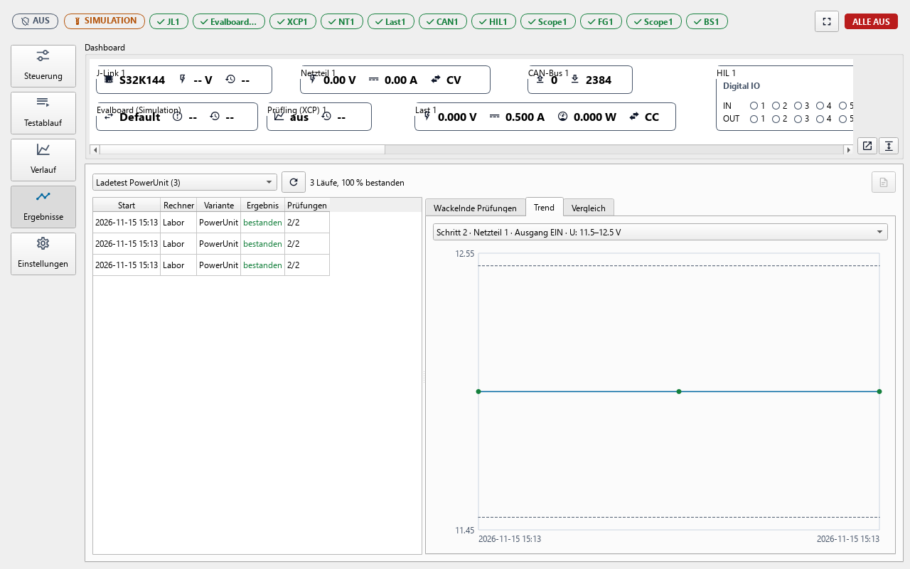

Der Reiter **Ergebnisse** sammelt alle Läufe, egal woher sie kommen.

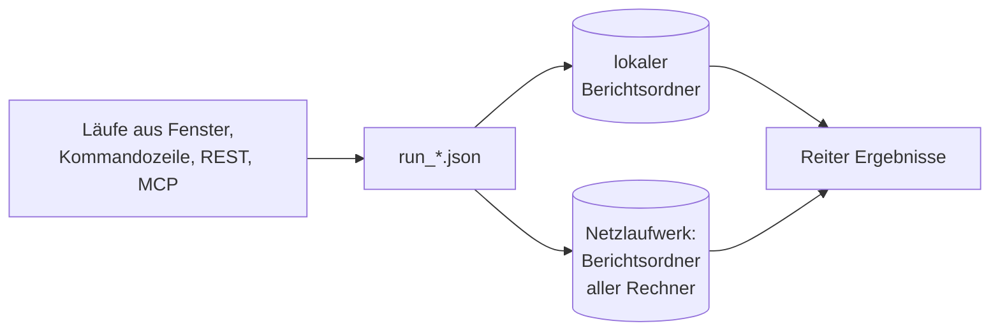

- **Neu eingelesen:** beim Öffnen, jede Minute und mit **Neu einlesen**.

1. Oben links den Ablauf wählen. Daneben stehen Zahl der Läufe und Bestanden-Quote, z. B. „3 Läufe, 100 % bestanden“.
2. Links die Läufe, neueste zuerst: **Start**, **Rechner**, **Variante**, **Ergebnis**, **Prüfungen**
   (bestanden/gesamt).
3. Rechts die Auswertung wählen:

| Reiter | Inhalt |
|---|---|
| **Wackelnde Prüfungen** | Prüfungen, die mal bestanden und mal nicht – mit Zahl der Wechsel |
| **Trend** | eine Prüfung über alle Läufe: letzter Messwert je Lauf, Grenzen gestrichelt, Punkte grün/rot |
| **Vergleich** | zwei Läufe Prüfung für Prüfung nebeneinander; dazu links zwei Läufe mit Strg+Klick markieren |

- Knopf oben rechts: HTML-Bericht des gewählten Laufs.
- Eine Prüfung wird über Schrittnummer, Aktion und Messgröße wiedererkannt; nach einer Änderung am Ablauf erscheint
  sie als neue Prüfung.
- Kommandozeile: `python lab_gui/main.py history`, siehe [Automatisierung](automatisierung.md).

## Einstellungen im Überblick

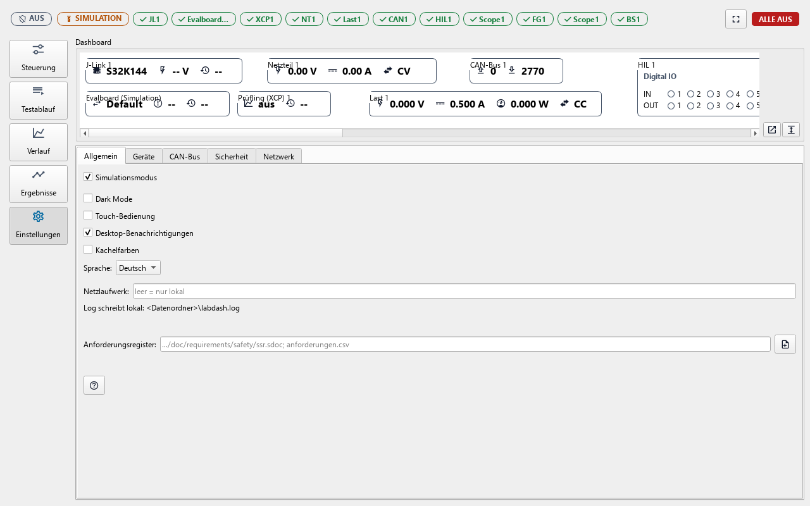

Fünf Reiter; alles wird sofort übernommen und in `settings.json` gespeichert.

| Reiter | Inhalt | Details |
|---|---|---|
| **Allgemein** | Simulationsmodus, Dark Mode, Touch-Bedienung, Desktop-Benachrichtigungen, Kachelfarben, Sprache, Netzlaufwerk, Anforderungsregister, Hilfe (Fragezeichen) | unten, [Schnellstart](schnellstart.md#gemeinsamer-ordner-netzlaufwerk), [Testabläufe](testablaeufe.md) |
| **Geräte** | Nicht verbundene Geräte löschen, Alle Geräte löschen, Oszilloskope im Netzwerk (SCPI), J-Link, Firmware des microHIL, Messmittel, Prüfling (UDS/XCP, Flashen) | [Geräte einrichten](geraete.md), [Prüfling](pruefling.md) |
| **CAN-Bus** | CAN-Interfaces mit Kanal, Bitrate, Bezeichnung, DBC-Datei und „Gerät am Bus“ | [Geräte einrichten](geraete.md) |
| **Sicherheit** | Grenzwerte je Netzteil und Last, Verriegelung Netzteil/Last | [Sicherheit](#sicherheit) |
| **Netzwerk** | Freigabe im lokalen Netzwerk, Claude (MCP) darf steuern, Port, Token, gekoppelte Programme, Freigaben je Gerät, Verbund | [Automatisierung](automatisierung.md), [Raspberry Pi und Verbund](pi-verbund.md) |

??? example "Bildschirmfotos der Reiter Geräte, CAN-Bus und Netzwerk"
    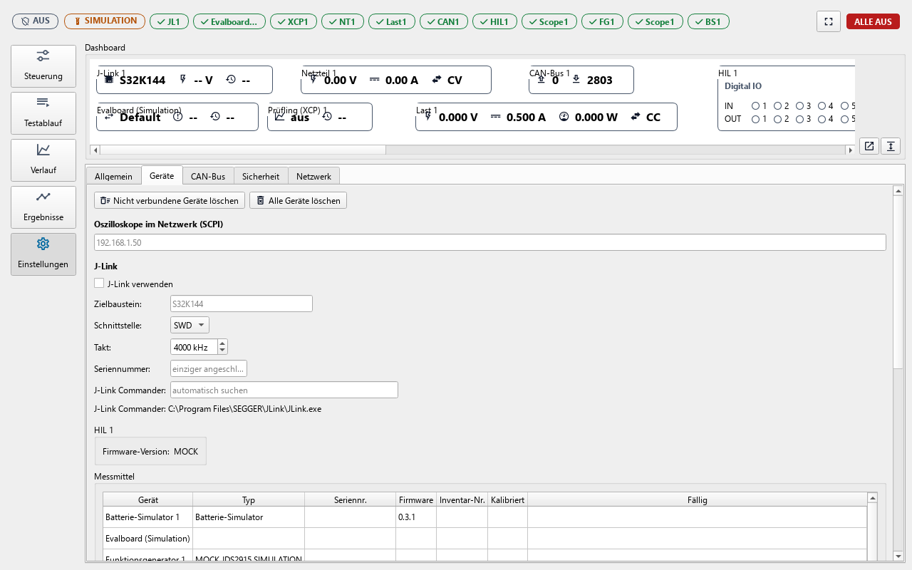

    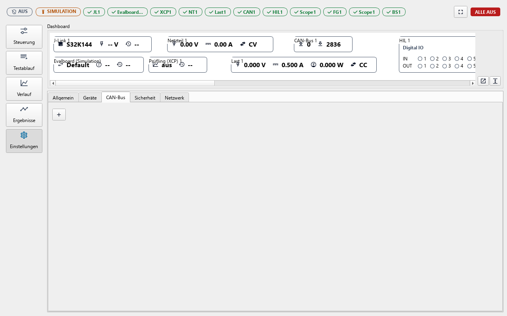

    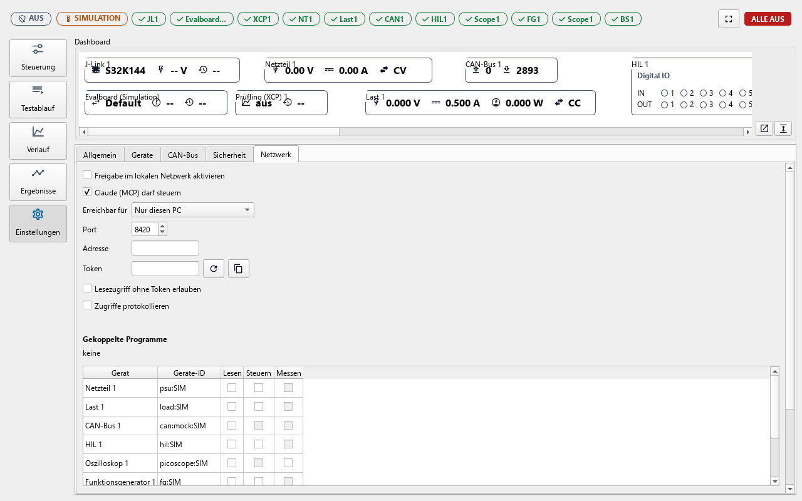

!!! note "Geräte löschen"
    **Nicht verbundene Geräte löschen** vergisst die gerade nicht verbundenen Geräte samt Namen, Grenzwerten,
    Kachelfarben und Freigaben, **Alle Geräte löschen** das für alle. Beide fragen nach und sind nicht umkehrbar.

### Reiter Allgemein

| Häkchen oder Feld | Wirkung |
|---|---|
| **Simulationsmodus** | nachgebildete Geräte zusätzlich zu echten, in `.exe` und Quellcode; oben steht dann **SIMULATION**, siehe [Schnellstart](schnellstart.md#simulationsmodus-einschalten) |
| **Dark Mode** | dunkles Farbschema, sofort, ohne Neustart |
| **Touch-Bedienung** | Touch-Modus ein/aus, siehe [Touch-Modus](#touch-modus); „(automatisch)“ = LabControl hat ihn selbst eingeschaltet |
| **Desktop-Benachrichtigungen** | Meldung des Systems bei Lauf-Ende oder Fehler, auch bei Fenster im Hintergrund |
| **Kachelfarben** | Farbwahl in den Kacheln ein/aus, siehe [Umbenennen und Farben](#umbenennen-und-farben) |
| **Sprache:** | Deutsch oder English, sofort, ohne Neustart; das eingebaute Handbuch gibt es in beiden Sprachen |

## Sicherheit

Drei Schutzebenen in Software: Grenzwerte mit Watchdog, Überwachung laufender Abläufe, Verriegelung
Netzteil/Last. Sie ersetzen keine Schutzfunktion am Gerät wie OVP/OCP des Netzteils.

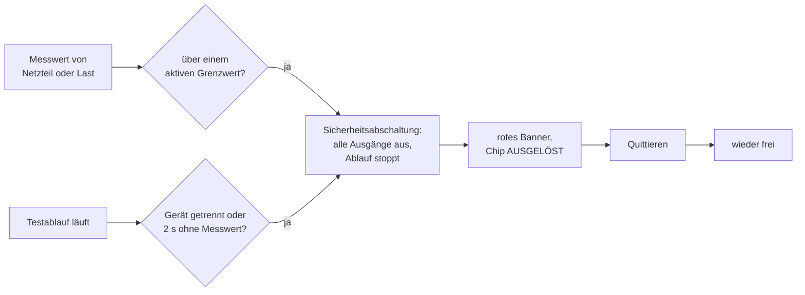

### Grenzwerte und Watchdog

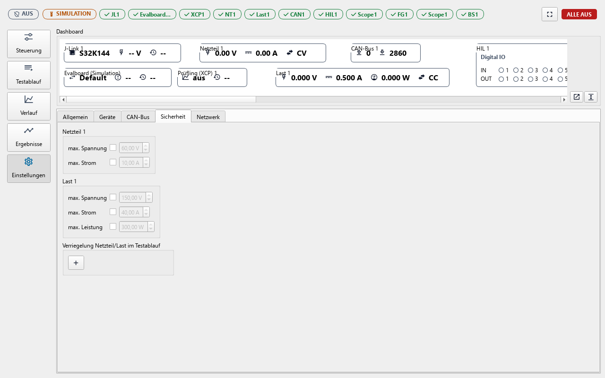

In **Einstellungen → Sicherheit** hat jedes Netzteil und jede Last einen Abschnitt. Ein Grenzwert gilt erst mit
gesetztem Häkchen.

| Gerät | Grenzwerte (Vorgabe) |
|---|---|
| Netzteil | **max. Spannung** (60 V), **max. Strom** (10 A) |
| Last | **max. Spannung** (150 V), **max. Strom** (40 A), **max. Leistung** (300 W) |

| Auslöser | Wann | Meldung im Banner |
|---|---|---|
| Grenzwert | jede Messung des Geräts liegt über einem aktiven Grenzwert, mit oder ohne Testablauf | „Grenzwert überschritten: …“ |
| veraltete Messwerte | nur im Testablauf: beteiligtes Gerät getrennt oder 2 s ohne Messwert, Funktionsgenerator 5 s (schützt unbeaufsichtigte Läufe) | „Messwerte veraltet für Gerät …“ |

Folgen der **Sicherheitsabschaltung**:

- alle Ausgänge aus wie bei ALLE AUS, im Verbund auch beim Partner,
- ein laufender Testablauf stoppt,
- rotes Banner mit dem Grund, Chip **AUSGELÖST**.

!!! warning "Der Watchdog prüft Messwerte, nicht Sollwerte"
    Ein Sollwert über dem Grenzwert löst erst aus, wenn eine Messung darüber liegt; REST und MCP lehnen ihn gleich
    ab. Setze die Grenzwerte passend zum Aufbau und nutze zusätzlich OVP/OCP am Netzteil.

### Sicherheitsabschaltung quittieren

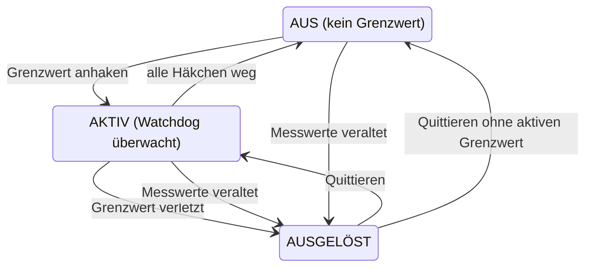

Solange **AUSGELÖST** gilt:

- Ein Testablauf startet nicht („Testlauf gesperrt: Sicherheitsabschaltung zuerst quittieren“).
- Steuerbefehle über Netzwerk und MCP werden abgewiesen. ALLE AUS geht weiter.

1. Grund im roten Banner lesen.
2. Aufbau prüfen, Ursache beheben.
3. Im Banner **Quittieren** klicken. Der Chip springt auf **AKTIV** bzw. **AUS**.
4. Ausgänge bei Bedarf wieder einschalten – Quittieren schaltet nichts ein.

### Verriegelung Netzteil/Last

Hängen Netzteil und Last an derselben Stelle, dürfen sie im Testablauf nicht gleichzeitig ein sein.

1. **Einstellungen → Sicherheit → „Verriegelung Netzteil/Last im Testablauf“** öffnen.
2. **+** klicken (Tooltip „Paar hinzufügen“).
3. Netzteil und Last des Paares wählen.

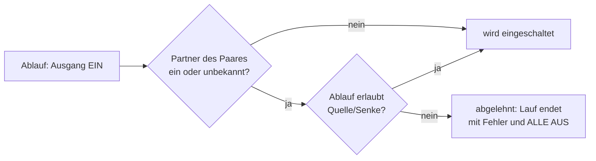

- Meldung bei Ablehnung: „Verriegelung: … ist eingeschaltet“.
- Bewusst aufheben, z. B. um eine Batterie nachzubilden: im Testablauf „Eigenschaften des Ablaufs…“ →
  **„Netzteil und Last gleichzeitig (Quelle/Senke)“**. Der Bericht vermerkt das.
- Es zählen nur Geräte dieses Rechners, nicht die des Verbund-Partners.

!!! warning "Nur im Testablauf"
    Kachel, Presets und Befehle über das Netzwerk sind **nicht** verriegelt. Achte bei parallel verdrahteten Geräten
    selbst darauf, nie beide einzuschalten.

## Handbedienung HCS-Netzteil

Das HCS-3xxx hat keine Ausgangstaste, und jeder Befehl von LabControl sperrt seine Drehregler für einige Sekunden
(LED „Rear control“). Für die Bedienung am Gerät gibt es in der Netzteil-Kachel den Schalter **Handbedienung**
(Tooltip „Gibt das Netzteil zur Bedienung am Gerät frei: LabControl spricht es dann nicht mehr an.“).

| | Handbedienung ein | Handbedienung aus |
|---|---|---|
| beim Umschalten | setzt Strom 0 A, Spannung 1 V (Minimum), **Ausgang EIN**, entsperrt die Regler | übernimmt Ausgang, Sollspannung und Sollstrom vom Gerät in die Kachel, sendet nichts |
| Abfrage | keine, die LED bleibt aus | wie gewohnt |
| Kachel | Felder gesperrt | bedienbar |
| Testablauf, Netzwerk, MCP | abgelehnt („Netzteil in Handbedienung“) | erlaubt |
| ALLE AUS, Sicherheitsabschaltung | lassen das Gerät **unberührt** | schalten den Ausgang aus |
| Leiste oben, Dashboard | Chip „Ⓗ“ orange, Kachel wie nicht verfügbar | normal |

- **Beim Beenden** gibt LabControl jedes Netzteil genauso frei (1 V, 0 A, Ausgang EIN).
- **Im Verbund** lässt sich die Handbedienung nur an dem Rechner umschalten, an dem das Netzteil steckt.

!!! warning "Ausgang ist nach der Freigabe eingeschaltet"
    Nach der Freigabe ist der Ausgang **ein**, nur durch 0 A begrenzt. Drehst du am Gerät den Strom auf, liegt
    sofort Spannung am Prüfling.

## Touch-Modus

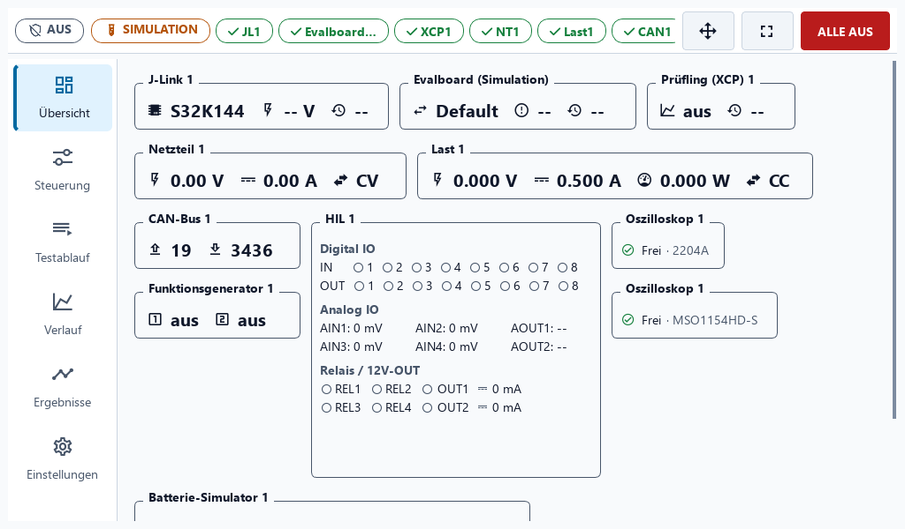

Für kleine Touch-Displays, z. B. den Raspberry Pi mit 1024 × 600 Pixeln.

- **Einschalten:** **Einstellungen → Allgemein → Touch-Bedienung**.
- **Automatisch:** Solange das Häkchen nie gesetzt wurde, schaltet LabControl ihn auf Bildschirmen bis
  1024 × 600 selbst ein.

| Bereich | im Touch-Modus |
|---|---|
| Größen | größere Schrift, Knöpfe und Felder; Navigation links mit großen Schaltflächen |
| Übersicht | eigene Seite **Übersicht** statt Dashboard-Streifen; bricht an der Bildschirmbreite um, immer kompakt, kein Abdocken |
| Leiste oben | Geräte-Chips zum Wischen; Sicherheits-Chip bleibt fest links; zusätzlich Knopf **Anordnen** (Verschiebe-Kreuz) |
| Kacheln anordnen | **Anordnen** antippen: verkleinertes Abbild aller Kacheln, Kachel greifen und ablegen; der Knopf zeigt dann einen Haken, Antippen beendet den Modus |
| Zahlenfelder | große −/+-Tasten; Antippen des Werts öffnet ein Zahlenfeld mit Bereich und Einheit, **Setzen** übernimmt und sendet |
| Textfelder | eigene Bildschirmtastatur (QWERTZ mit Umlauten) |
| Testablauf | Ausführen-Ansicht statt Editor, siehe unten |
| Verlauf | Zeitfenster über Tasten, Signale aus einer Liste zum Wischen |
| Wischen | Listen, Tabellen und Seiten mit dem Finger verschieben |

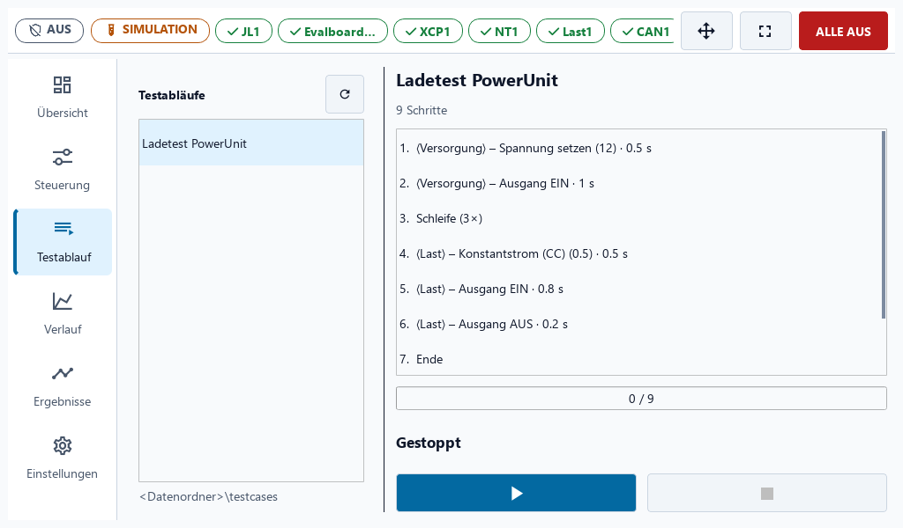

- **Testablauf:** links die gespeicherten Abläufe (aus `testcases/`, mit Netzlaufwerk von dort), rechts Schritte,
  Fortschritt und große Knöpfe **Start** und **Stop**. Bearbeitet wird am PC, ausgeführt genauso wie im Editor.
- **Ein/Aus (nur Linux):** Knopf oben, fragt „Rechner herunterfahren oder neu starten?“ mit **Herunterfahren**,
  **Neu starten** und **Abbrechen**; LabControl gibt vorher die Netzteile frei.
- Einrichtung des Pi mit Kiosk und Vollbild: [Raspberry Pi und Verbund](pi-verbund.md).
