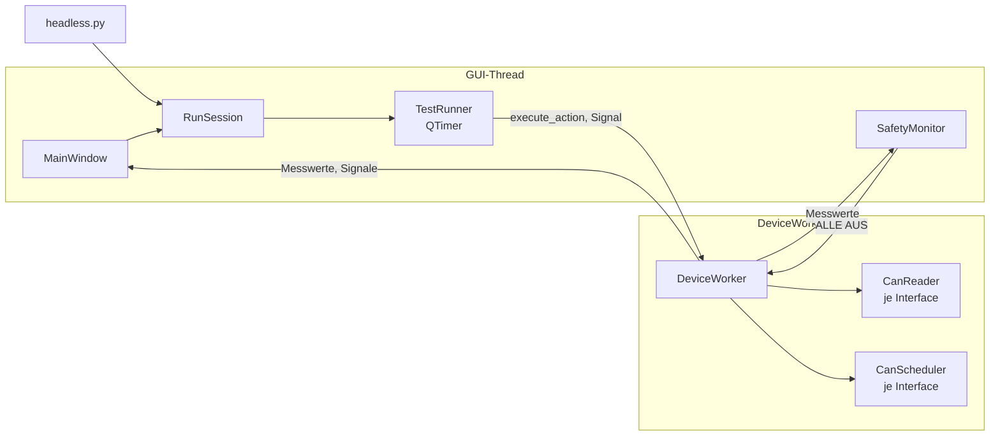
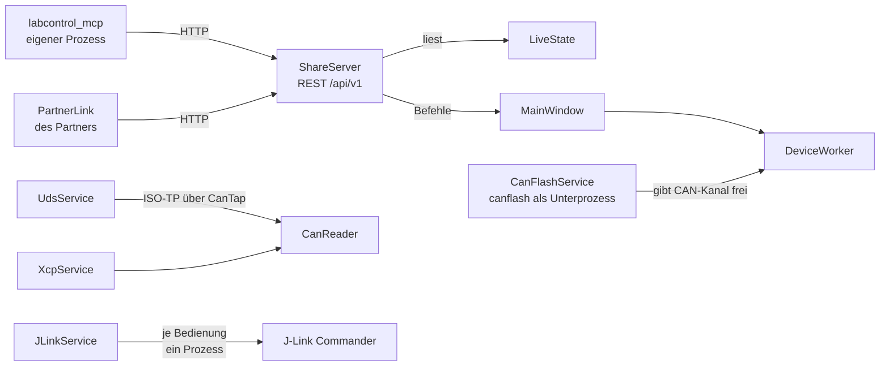
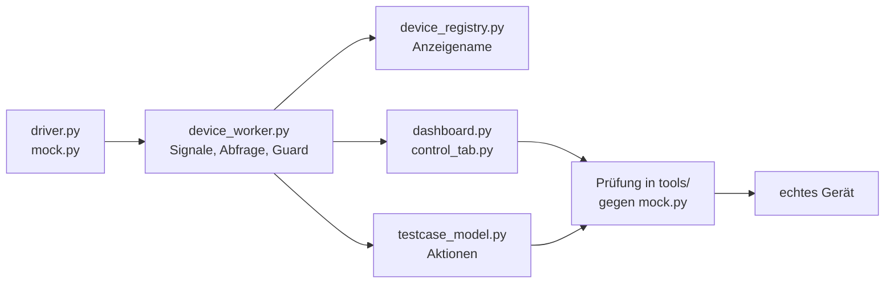

# Für Entwickler

Für alle, die LabControl erweitern, einen Treiber für ein neues Gerät schreiben oder einen Fehler beheben wollen.
LabControl ist in Python mit PySide6 (Qt) geschrieben und läuft unter Windows und Linux (auch auf dem Raspberry Pi).

## Architektur

**Kern: Oberfläche, Testablauf, Geräte**



**Dienste und Netzwerk**



**Regeln:**

| Regel | Umsetzung |
|---|---|
| Gerätezugriffe nur im DeviceWorker | Alle blockierenden Zugriffe auf serielle Geräte, CAN und Oszilloskope laufen im eigenen `QThread` (`lab_gui/device_worker.py`). Die Oberfläche spricht nur über Qt-Signale und -Slots mit ihm; ein Timeout friert nie das Fenster ein. |
| Treiber bleiben dumm | Treiber in `device-driver/` haben synchrone, blockierende `get_*`/`set_*`-Methoden. Threads, Wiederverbinden und Fehlerbehandlung macht der Worker. |
| Testablauf im GUI-Thread | `TestRunner` (`testcase_runner.py`) steuert die Schritte per `QTimer` und schickt jeden Befehl per Signal an `DeviceWorker.execute_action()`. `RunSession` (`run_session.py`) verdrahtet Lauf, Sicherheit, Verriegelung und Aufzeichnung. Fenster und Kommandozeile (`headless.py`) nutzen denselben Weg. |
| Netzwerk liest nur einen Schnappschuss | `share_server.py`/`share_api.py` fassen weder Geräte noch Qt-Objekte an, sondern lesen `live_state.LiveState`; Befehle gehen über die GUI an den Worker. |
| Sicherheit entscheidet LabControl | Der MCP-Server (`labcontrol_mcp/server.py`) übersetzt Werkzeugaufrufe in REST-Anfragen und kann nichts, was die Schnittstelle nicht ohnehin erlaubt. |

### Threads im Überblick

| Thread | Aufgabe |
|---|---|
| GUI | Fenster, TestRunner, SafetyMonitor |
| DeviceWorker | Erkennung, Abfrage (Netzteil, Last, microHIL, Funktionsgenerator), Befehle, ALLE AUS |
| CanReader (je Interface) | liest CAN-Frames fortlaufend, gibt sie an Anzeige, DBC-Dekodierung und ISO-TP |
| CanScheduler (je Interface) | sendet zyklische Botschaften im 10-ms-Takt (Batterie-Simulator, Restbus) |
| UdsService, XcpService | Diagnose und Messen/Verstellen am Prüfling |
| JLinkService | je Bedienung ein J-Link-Commander-Prozess |
| ScopeService | Oszilloskop-Erfassungen für Netzwerk/MCP |
| ShareServer | HTTP-Server, ein Thread je Verbindung |
| PartnerLink | Abfrage, Befehle und ALLE AUS zum Verbund-Partner |
| DataStore, Log | schieben Dateien aufs Netzlaufwerk und schreiben das Log, ohne andere aufzuhalten |

## Verzeichnisstruktur

| Ordner / Datei | Inhalt |
|---|---|
| `lab_gui/` | die Anwendung: `main.py` (Einstieg, Weiche zur Kommandozeile), `main_window.py`, Reiter, Dienste, `settings.py`, `version.py` |
| `lab_gui/translations/` | Sprachdateien `de.json`, `en.json` |
| `lab_gui/help/` | eingebautes Handbuch (`manual_de.md`, `manual_en.md`) |
| `device-driver/` | ein Ordner je Gerätetreiber mit `driver.py`, `mock.py`, `README.md` |
| `scope_api/` | herstellerneutrale Oszilloskop-Schicht (Adapter für PicoScope und UNI-T, Auswertung, Speicher) |
| `labcontrol_mcp/` | MCP-Server für Claude, eigener Prozess |
| `tools/` | Prüfungen `check_*.py`, `no_hardware.py`, `docs_screenshots.py`, `labcontrol_pair.py`, Icon- und Splash-Erzeugung |
| `tools/pi/` | Einrichtung und Betrieb am Raspberry Pi (siehe [Raspberry Pi und Verbund](pi-verbund.md)) |
| `docs/` | diese Dokumentation (MkDocs) |
| `.github/workflows/` | `build-exe.yml` (Windows-.exe), `linux-checks.yml` (Prüfungen unter Linux), `docs.yml` (Website) |
| `LabControl.spec` | PyInstaller-Bauanleitung der .exe |
| `CHANGELOG.md` | alle Änderungen, auf Deutsch, mit Prüfstatus |

`device-driver/` ist wegen des Bindestrichs kein Python-Paket, sondern steht im Suchpfad. Importiert wird über den
Paketnamen, z. B. `from hcs34xx.driver import HCS34xx`.

## Aus dem Quellcode starten

1. Python 3.12 installieren.
2. `pip install -r requirements.txt`
3. `python lab_gui/main.py`
4. Ohne Geräte: **Einstellungen → Allgemein → Simulationsmodus** (gibt es auch in der .exe).

**.exe bauen:** im Repo-Stamm `pyinstaller LabControl.spec`, Ergebnis `dist/LabControl_v<version>.exe`. Nach
jedem Push auf `master` baut GitHub Actions sie automatisch.

!!! note "Hintergrund-Importe in der .exe"
    `python-can` und `pyvisa` laden ihre Backends zur Laufzeit über den Modulnamen, was PyInstaller nicht sieht.
    `LabControl.spec` bindet sie ausdrücklich ein; diese Einträge beim Umbau behalten.

## Neuen Treiber anlegen

Die vollständige Checkliste steht in
[NEUEN_TREIBER_ANLEGEN.md](https://github.com/danielsimonreinhardt/LabControl/blob/master/NEUEN_TREIBER_ANLEGEN.md).



1. **Ordner** `device-driver/<geraetename>/` mit `__init__.py`, `driver.py`, `mock.py`, `README.md`. Vorlage für
   ein USB-Seriell-Gerät mit Messwerten: `hcs34xx` (Netzteil) oder `korad_kel102` (Last).
2. **`driver.py`:**
    - eigene Fehlerklasse `<X>Error`, dazu eine Unterklasse für „Wert abgelehnt“, damit der Worker das von
      „Verbindung tot“ unterscheidet; jeden rohen Bibliotheksfehler in die eigene Klasse übersetzen
    - Erkennung als `discover()`/`discover_ports()` (mit Seriennummer), dazu `open_first()`, `close()`,
      Context-Manager
    - jede Eigenheit des Protokolls direkt am Code begründen
3. **`mock.py`:** dieselbe öffentliche Schnittstelle, Zustand nur im Speicher. Für Simulationsmodus und Prüfungen.
4. **`README.md`:** Kurzbeschreibung, Beispiel, Abschnitt „Bekannte Eigenheiten / Einschränkungen“.
5. **`lab_gui/device_worker.py`:**
    - Signale mit `device_id` als erstem Argument
    - Simulationsgerät (`SIM_<KIND>_ID`), Wiederverbinden mit echtem Handshake, Abfrage in `_poll()`
    - ein `_guard_<kind>()` für alle Befehle
    - sicherheitsrelevanter Ausgang: `_kill_<kind>()` in `all_outputs_off()` ergänzen
6. **Anzeigename** in `lab_gui/device_registry.py` (`KIND_DISPLAY`).
7. **Testablauf:** Aktionen in `lab_gui/testcase_model.py`, Zweig in `DeviceWorker._dispatch_action()`.
8. **Oberfläche:** Kachel in `lab_gui/dashboard.py`, `<X>ControlGroup` in `lab_gui/control_tab.py`.
9. **Ohne sichere USB-Erkennung:** Konfiguration in den Einstellungen. Vorlagen:
    - `can_bus`: eingetragene Interfaces
    - `unit_mso1000hd`: Netzwerkgerät mit Erkennung in eigenem Thread und SCPI-Simulator
    - `battsim`: Gerät als `CanNode` an einem CAN-Interface
10. **Testen:** erst gegen `mock.py` mit einer Prüfung in `tools/`, dann **am echten Gerät**. Viele Eigenheiten
    (abgelehnte Werte, Baudrate, Zahlenformate) zeigen sich erst dort.

## Prüfungen

Unter `tools/` liegt je Thema ein eigenständiges Skript `check_<thema>.py`, Exit-Code 0 bei Erfolg:

```
python tools/check_instruments.py
```

| Eigenschaft | Umsetzung |
|---|---|
| Offscreen | setzen `QT_QPA_PLATFORM=offscreen`, kein sichtbares Fenster |
| Simulation | Mocks und nachgebildete Geräte (z. B. Steuergerät, XCP-Slave, Batterie-Simulator am simulierten CAN-Bus), eigener temporärer Datenordner |
| Keine echte Hardware | Der Simulationsmodus sucht echte Geräte trotzdem. Jede Prüfung, die `MainWindow` oder `DeviceWorker` baut, ruft vorher `no_hardware.block()` aus `tools/no_hardware.py` auf; `tools/check_hardware_isolation.py` stellt das für alle Prüfungen sicher. |
| Linux-CI | `.github/workflows/linux-checks.yml` lässt bei jedem Push auf `master` alle `tools/check_*.py` unter Ubuntu laufen (Python 3.12, offscreen, je Prüfung höchstens 300 s) |

!!! warning "Prüfungen am Rechner mit angesteckten Geräten"
    Ohne `no_hardware.block()` verbindet eine Prüfung echte Geräte und sendet beim Schließen ALLE AUS bzw. die
    Freigabe der Netzteile an sie. Neue Prüfungen mit `MainWindow` oder `DeviceWorker` brauchen die Sperre immer.

## Versionierung und CHANGELOG

- Versionsnummer nur in `lab_gui/version.py` (`__version__`, `MAJOR.MINOR.PATCH`). Fenstertitel,
  `LabControl.spec` und der .exe-Bau lesen sie von dort.
- Neue Funktionen erhöhen MINOR, Fehlerbehebungen PATCH (z. B. 0.64.0 → 0.64.1).
- `CHANGELOG.md` folgt „Keep a Changelog“: Hinzugefügt, Geändert, Behoben, Entfernt. Jeder Eintrag nennt die
  Version und **wie** geprüft wurde:
    - **Mock-verifiziert:** mit welcher Prüfung in `tools/` (Simulation, keine Hardware).
    - **Hardware-verifiziert:** an welchem Gerät, wann, mit welchem Ergebnis.
    - Was noch nicht am Gerät geprüft ist, steht ausdrücklich dabei.
- CHANGELOG vor jedem Push aktualisieren.

## Übersetzungen

Oberfläche auf Deutsch und Englisch (**Einstellungen → Allgemein → Sprache**). Umsetzung in `lab_gui/i18n.py`,
Regeln in `lab_gui/translations/README.md`.

- **Schlüssel = deutscher Text:** im Code `tr("Übernehmen")`. `tr()` schlägt ihn in der Sprachdatei nach;
  fehlt er, erscheint der deutsche Text.
- **Platzhalter** wie bei `str.format()`: `tr("Kanal {n}", n=channel)`; der Schlüssel mit Platzhalter lautet in
  beiden Dateien gleich.
- **Neue Stelle:**
    1. Text mit `tr()` umschließen.
    2. Schlüssel in `de.json` (Wert = Schlüssel) und `en.json` (Übersetzung) eintragen.
    3. Widgets mit Text verbinden `Translator.instance().language_changed` mit einer `_retranslate()`-Methode;
       die Sprache wechselt dann ohne Neustart.
- **Auswahllisten:** interner Code immer in `itemData`, nur der Anzeigetext aus `tr()`. Code liest
  `currentData()`, nie `currentText()`.
- **Neue Sprache:** `en.json` kopieren, übersetzen, in `AVAILABLE_LANGUAGES` in `i18n.py` eintragen.

## Dokumentation

Markdown für MkDocs Material in `docs/de/`, Navigation in `mkdocs.yml`.

**Lokal ansehen:**

```
pip install mkdocs-material
mkdocs serve
```

- Die Seite lädt unter der ausgegebenen Adresse bei jeder Änderung neu.
- Push auf `master` mit Änderung an `docs/` oder `mkdocs.yml`: `.github/workflows/docs.yml` baut
  (`mkdocs build --strict`) und veröffentlicht auf GitHub Pages.

**Screenshots neu erzeugen:**

```
python tools/docs_screenshots.py              # alle Bilder
python tools/docs_screenshots.py testablauf   # nur Bilder, deren Name das Wort enthält
```

Das Skript startet LabControl offscreen im Simulationsmodus mit Beispieldaten, ohne echte Hardware und mit
eigenem Datenordner an neutralem Ort (kein Benutzername im Bild). Ergebnis in `docs/de/bilder/`.

## Mitmachen

Beiträge, Ideen und Fehlermeldungen sind willkommen.

| Was | Wie |
|---|---|
| Fehler oder Wünsche | Issue auf GitHub; hilfreich sind Version (Fenstertitel), Betriebssystem, betroffenes Gerät, passender Ausschnitt aus `labdash.log` |
| Neues Gerät | Issue öffnen; besonders hilfreich, wenn du einen Treiber am echten Gerät testen kannst (siehe [Neuen Treiber anlegen](#neuen-treiber-anlegen)) |
| Treiber testen | UNI-T MSO1000HD und J-Link sind nur gegen Simulatoren geprüft (siehe [Geräte einrichten](geraete.md)); Rückmeldungen vom echten Gerät helfen sehr |
| Code-Beiträge | Prüfungen in `tools/` grün halten, für neue Funktionen eine Prüfung ergänzen, CHANGELOG mit Prüfstatus pflegen |
