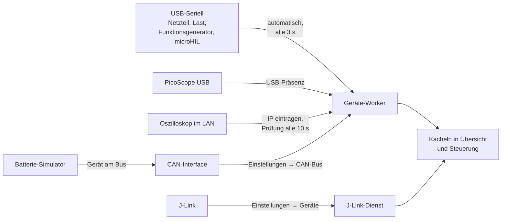
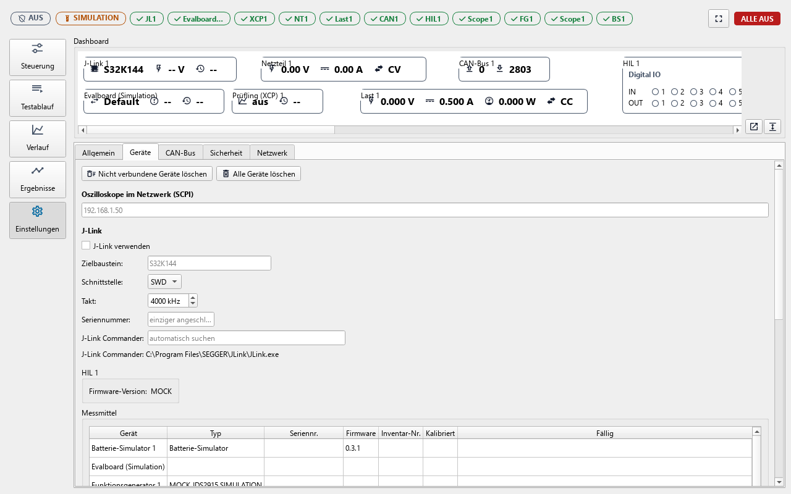
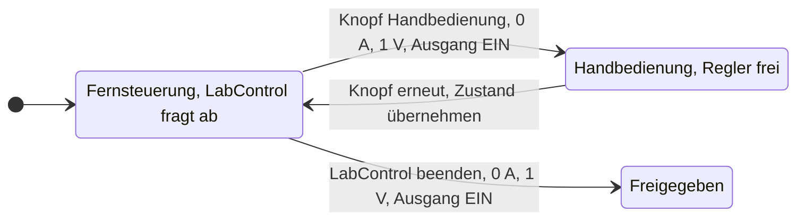
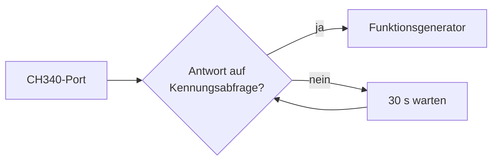
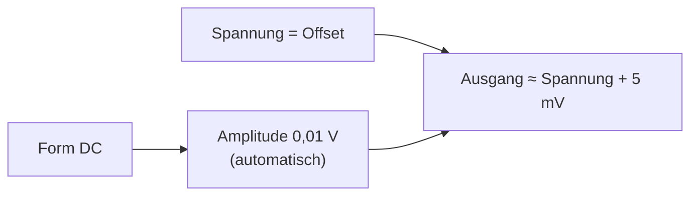
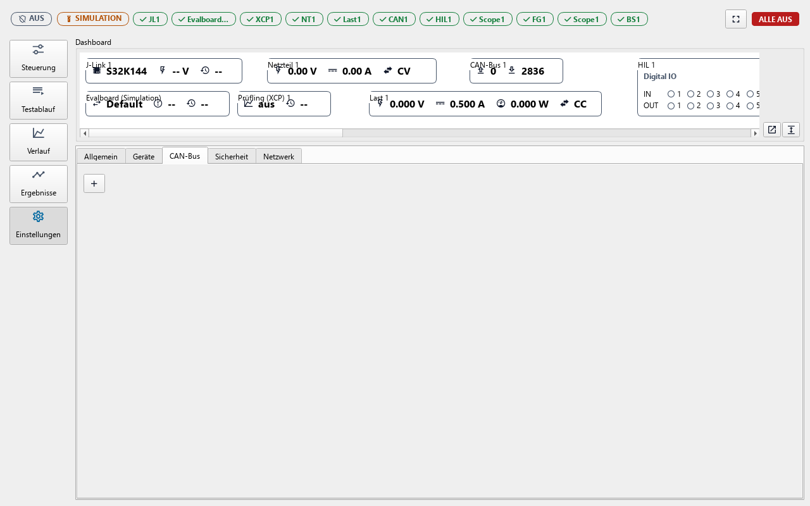
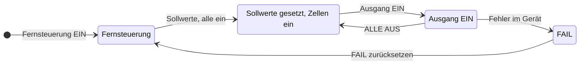
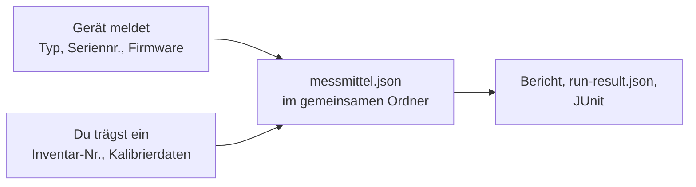
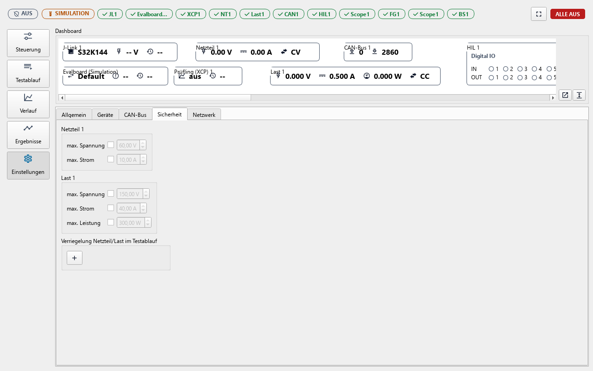
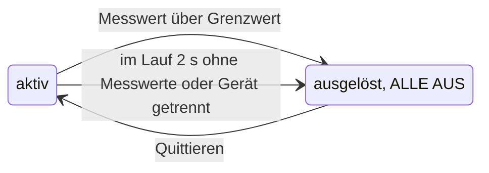

# Geräte einrichten

LabControl findet die meisten Geräte von selbst, sobald sie per USB stecken. Geräte ohne sichere Erkennung –
LAN-Oszilloskope, CAN-Interfaces, J-Link, Prüfling – trägst du in den **Einstellungen** ein.

## Überblick

| Gerät | Anschluss | Erkennung | Kennung (Beispiel) | Am echten Gerät geprüft |
|---|---|---|---|---|
| MANSON HCS-3xxx (Netzteil) | USB (CP210x, virtueller COM-Port) | automatisch | `psu:<USB-Seriennummer>` | ja |
| KORAD KEL102 (elektronische Last) | USB (CDC) | automatisch, VID/PID `0416:5011` | `load:<USB-Seriennummer>` | ja |
| JDS66xx / JDS2915 (Funktionsgenerator) | USB (CH340) | automatisch mit Handshake | `fg:COM6` | ja (ohne Messung am Ausgang) |
| PicoScope 2204A/2205A | USB | automatisch | `picoscope:…` | ja |
| UNI-T MSO1000HD | LAN (SCPI) | IP-Adresse eintragen | `scpiscope:<IP>` | nein, nur Simulator |
| microHIL | USB (CDC, zwei Ports) | automatisch | `hil:…` | ja |
| SEGGER J-Link | USB, J-Link Commander | in den Einstellungen einschalten | `jlink:…` | nein, nur nachgebildet |
| CAN-Interfaces | Vector, PCAN, SLCAN, SocketCAN | in den Einstellungen eintragen | `can:<Interface>:<Kanal>` | ja |
| Batterie-Simulator (14 Zellen) | über CAN | „Gerät am Bus“ | `battsim:<Interface>:<Kanal>` | ja |

**Kennung:**

- Steht in Testabläufen, im Log und in der [Automatisierung](automatisierung.md); direkt brauchst du sie selten.
- Ohne eindeutige USB-Seriennummer: unter Windows der COM-Port (`psu:COM6`), unter Linux der USB-Pfad
  (`psu:usb-1-1.2:1.0`). Sie bleibt gleich, solange das Gerät an derselben Buchse steckt.

!!! tip "Ohne Hardware ausprobieren"
    **Einstellungen → Allgemein → Simulationsmodus** (auch in der .exe) fügt je Geräteart ein simuliertes Gerät
    hinzu (Kennung endet auf `SIM`); oben in der Leiste steht dann „SIMULATION“. Echte Geräte sucht LabControl
    weiter, beides lässt sich mischen.

### Namen, Farben, Aufräumen

- Neue Geräte heißen nach Art und Nummer, z. B. „Netzteil 1“. Umbenennen (Stift) und Panel-Farbe in der Kachel
  auf der Seite **Steuerung**.
- Geräte, die du an PC und Raspberry Pi nutzt, auf beiden Rechnern **gleich benennen**. Dann findet ein
  Testablauf das Gerät auch am anderen Rechner (siehe [Raspberry Pi und Verbund](pi-verbund.md)).
- Aufräumen in **Einstellungen → Geräte** (siehe unten): **Nicht verbundene Geräte löschen** vergisst fehlende
  Geräte, **Alle Geräte löschen** alle.

## Einstellungen → Geräte

| Bereich (von oben nach unten) | Inhalt |
|---|---|
| Geräteverwaltung | Nicht verbundene Geräte löschen, Alle Geräte löschen |
| Oszilloskope im Netzwerk (SCPI) | IP-Adressen der LAN-Oszilloskope, mehrere durch Komma getrennt |
| J-Link | J-Link verwenden, Zielbaustein, Schnittstelle, Takt, Seriennummer, J-Link Commander |
| Geräte-Info | je microHIL die Firmware-Version |
| Messmittel | Kennung und Kalibrierung je Gerät (siehe [Messmittel](#messmittel)) |
| Prüfling (UDS/XCP) | Steuergerät am CAN-Bus (siehe [Prüfling](#prufling)) |

## Netzteil MANSON HCS-3xxx

- **Anschluss:** USB, virtueller COM-Port (CP210x, 9600 Baud). Mehrere baugleiche Netzteile gleichzeitig gehen.
- **Geprüft** mit HCS-3404 (60 V / 9 A) und einem 16-V/30-A-Modell. Die Wertebereiche richten sich nach den
  Nennwerten, die das Netzteil meldet.

**Kachel** „Labornetzteil (HCS-34xx)“:

| Element | Funktion |
|---|---|
| Spannung, Strom | Sollwert eingeben, mit ✓ setzen |
| OVP, OCP | Abschaltschwellen des Geräts setzen |
| Handbedienung | gibt das Netzteil zur Bedienung am Gerät frei (siehe unten) |
| Ausgang EIN / AUS | schaltet den Ausgang; „EIN“ schickt vorher Spannung und Strom aus den Feldern |

**Besonderheiten:**

- **Mindestens 1 V:** Das Gerät nimmt nichts unter 1,0 V an, LabControl lässt es gar nicht zu. 0 A geht.
- **OVP/OCP:** Ein Sollwert über der Schwelle wird vom Gerät still ignoriert; die Kachel warnt schon beim Tippen.
- **Ohne Last** sinkt die Spannung nach „Ausgang AUS“ langsam (etwa 10 s bis unter 0,6 V). Der Ausgang ist
  trotzdem aus.
- **Beim Verbinden** übernimmt LabControl Ausgang und Sollwerte vom Gerät und schaltet nichts.
- **Regler gesperrt:** Jeder Befehl sperrt die Drehregler für etwa 5 s (LED „Rear control“). Wegen der laufenden
  Abfrage geht Bedienung von Hand nur über die Handbedienung.

### Handbedienung

- Felder der Kachel gesperrt, oben in der Leiste steht „Handbedienung“. Fernsteuerung, Claude (MCP) und
  Testabläufe werden mit „Netzteil in Handbedienung“ abgelehnt.
- Beim Zurückschalten sendet LabControl nichts. Nach dem Beenden ist jedes Netzteil sofort von Hand benutzbar.

!!! warning "Handbedienung: kein ALLE AUS, keine Grenzwerte"
    ALLE AUS schaltet ein Netzteil in Handbedienung **nicht** ab, und die Sicherheitsgrenzen greifen nicht. Nach
    dem Beenden von LabControl ist der Ausgang eingeschaltet (1 V, 0 A).

## Elektronische Last KORAD KEL102

- **Anschluss:** USB-CDC (Windows `COMx`, Linux `/dev/ttyACM0`), gefunden über VID/PID `0416:5011`.
  Abziehen und Wiederanstecken erkennt LabControl, auch am Pi.
- Geprüft mit Firmware V2.20. Übersicht und Verlauf zeigen Spannung, Strom und Leistung.

**Kachel** „Elektronische Last (KEL102)“:

| Element | Funktion |
|---|---|
| Modus | Konstantstrom (CC), Konstantspannung (CV), Konstantwiderstand (CR), Konstantleistung (CW) |
| Sollwert | Wert für den gewählten Modus, mit ✓ übernehmen |
| Ausgang EIN / AUS | schaltet den Lasteingang |

## Funktionsgenerator JDS66xx / JDS2915

- **Anschluss:** USB (CH340, 115200 Baud). Zweikanalige DDS-Generatoren von Joy-IT/JUNTEK, geprüft mit dem
  JDS2915 (15 MHz).
- **Erkennung:** Den CH340 nutzen viele Boards, deshalb erst eine Kennungsabfrage:

Ein ausgeschalteter Generator hat seinen COM-Port trotzdem. Nach dem Einschalten dauert die Erkennung daher bis
zu 30 s.

**Kachel** „Funktionsgenerator (JDS66xx)“, je Kanal:

| Feld | Bedeutung |
|---|---|
| Form | Sinus, Rechteck, Puls, Dreieck, DC u. a. |
| Frequenz | bis 15 MHz, Auflösung 0,01 Hz; in DC gesperrt |
| Amplitude | Spitze-Spitze im Leerlauf, 0 … 20 V; in DC ausgeblendet |
| Offset | ±9,99 V; in DC heißt das Feld **Spannung** |
| Tastverhältnis | in %, nur bei **Puls** bedienbar |
| Ausgang EIN / AUS | schaltet den Ausgang, alle Signalwerte bleiben gespeichert |
| Phase (Kanal 2 zu 1) | nur einmal vorhanden |

**DC (seit 1.0.1):** In DC liegt am Ausgang die eingestellte **Spannung** an. Gemessen (JDS2915, ohne Last) gibt
das Gerät in DC etwa **Offset + Amplitude/2** aus; bei Amplitude genau 0 kommt der Offset aber nur zu etwa 1/10 an
(2,5 V → 0,22 V). LabControl setzt deshalb beim Umschalten auf DC die Amplitude auf **0,01 V** und gibt die
Spannung als Offset vor. Am Ausgang liegt die Spannung plus **5 mV** (halbe Amplitude), dazu der Offset-Fehler des
Geräts (gemessen etwa +0,1 V bei 2,5 V).

| Aktion in DC | Wirkung |
|---|---|
| Wellenform DC (`FG_WAVE_DC`) | Form DC, Amplitude 0,01 V |
| Offset setzen (`FG_OFFS`) | Spannung am Ausgang; eine am Gerät verstellte Amplitude wird vorher wieder 0,01 V |
| Amplitude setzen (`FG_AMPL`) | **abgelehnt** mit Meldung (Schritt scheitert) |

**Tastverhältnis nur bei Puls (seit 1.0.1):** Gemessen wirkt es nur bei der Form **Puls** (99 % → 98,9 %), bei
Rechteck bleibt das Signal bei 50 %, egal was eingestellt ist. `FG_DUTY` (Testablauf, MCP, REST, Verbund) ist bei
jeder anderen Form **abgelehnt**; die Form wird nie still umgeschaltet. Ein Ablauf, der an einer Stelle mit
bekannter Form (Wellenform-Schritt davor, ohne Blockgrenze dazwischen) das Tastverhältnis bei Rechteck setzt oder
in DC die Amplitude, startet gar nicht erst; sonst scheitert der Schritt im Lauf.

**Grenzen:**

- Amplitude frequenzabhängig begrenzt: bei 15 MHz **still auf 10 V**. LabControl liest zurück und zeigt den
  tatsächlich eingestellten Wert.
- Am Ausgang gemessen (Oszilloskop) sind nur DC und Tastverhältnis (17.11.2026); die Umsetzung in LabControl ist
  nur gegen die Nachbildung geprüft.

## Oszilloskop PicoScope 2204A/2205A

- **Anschluss:** USB. Braucht die Bibliothek `ps2000`, die mit **PicoScope 7** kommt. Fehlt sie, startet
  LabControl trotzdem, nur ohne Oszilloskop.
- **Erkennung:** nur USB-Präsenz, ohne das Gerät zu öffnen. Das PicoScope lässt sich nur von einem Programm
  öffnen, deshalb hält LabControl es nie dauerhaft fest.
- **Linux:** Bibliothek `libps2000.so`; ob es sie für den Raspberry Pi (arm64) gibt, ist nicht geprüft.

**Kachel** „Oszilloskop“:

| Element | Funktion |
|---|---|
| Status | frei oder belegt (z. B. von PicoScope 7) |
| Gerät | Modell und Seriennummer |
| Letzte Erfassung | Zeit der letzten Messung über Netzwerk/MCP |
| PicoScope 7 öffnen | startet die Hersteller-Software (nur am PC, nicht im Touch-Profil) |
| Trennen (Symbol) | gibt die Verbindung für Erfassungen über Netzwerk/MCP sofort frei |
| Kurve (Symbol) | zeigt die letzte Erfassung als Bild |

- Kanäle, Trigger und Kurvenanzeige stellst du in PicoScope 7 ein; LabControl baut das nicht nach.
- Im Testablauf liefert das PicoScope Kennwerte an Kanal A oder B: **Maximum (Spitzenwert)**,
  **Minimum (Spitzenwert)**, **Spitze-Spitze (Vpp)**, **Effektivwert (RMS)** (siehe [Testabläufe](testablaeufe.md)).

!!! note "PicoScope 7 und LabControl gleichzeitig"
    Nach einer Messung über Netzwerk/MCP hält LabControl das Gerät noch 60 s offen. Mit dem Trennen-Knopf in der
    Kachel ist es sofort frei für PicoScope 7.

## Oszilloskop UNI-T MSO1000HD (SCPI im Netzwerk)

- **Anschluss:** LAN, SCPI über VXI-11 mit dem reinen Python-Paket `pyvisa-py`. Kein NI-VISA nötig, auch nicht in
  der `.exe`; USB ginge nur mit installiertem NI-VISA.

**Einrichten:**

1. Am Oszilloskop eine **feste IP-Adresse** vergeben (oder feste DHCP-Zuweisung im Router). Die Adresse ist die
   Kennung (`scpiscope:<IP>`); Name, Farbe und Freigaben hängen daran.
2. **Einstellungen → Geräte → Oszilloskope im Netzwerk (SCPI)**: IP eintragen, mehrere durch Komma.
3. LabControl fragt alle 10 s per `*IDN?`. Meldet sich ein UNI-T, erscheint die Kachel.
4. Für Messungen über Claude (MCP): **Einstellungen → Netzwerk**, Häkchen **Messen** beim Oszilloskop
   (siehe [Automatisierung](automatisierung.md)).

**Kachel:** Status, Gerät, Letzte Erfassung, Trennen, Kurve – kein Startknopf, bedient wird am Gerät selbst.
Testablauf-Aktionen wie beim PicoScope gibt es noch nicht.

!!! note "Nur gegen den Simulator geprüft"
    Der Treiber folgt dem Programmierhandbuch und ist nur gegen ein nachgebildetes SCPI-Gerät geprüft. Offene
    Annahmen (z. B. Vorzeichen des Offsets) stehen in `device-driver/unit_mso1000hd/README.md`.

## microHIL

- **Projekt:** eigene Entwicklung, Projektseite auf GitHub: [microHIL](https://github.com/danielsimonreinhardt/microHIL).
- **Anschluss:** USB mit **zwei** COM-Ports (VID:PID `0483:5740`): Steuerung und CAN-Adapter (SLCAN, siehe
  [CAN-Interfaces](#can-interfaces)). LabControl unterscheidet beide selbst.

**Kachel** „microHIL“:

| Bereich | Umfang |
|---|---|
| Digitalausgänge | OUT1 … OUT8 |
| PWM 1 … 4 (→ OUT1 … OUT4) | Tastverhältnis; PWM n und OUT n teilen sich eine Endstufe |
| Analogausgang 1, 2 | Spannung in mV (kalibriert) |
| Relais | REL1 … REL4 |
| 12V-Ausgang 1, 2 | schaltbare 12-V-Ausgänge mit Strommessung |

- **Übersicht** zeigt zusätzlich IN1 … IN8, AIN1 … AIN4 und den Strom der 12-V-Ausgänge; die Firmware-Version
  steht in **Einstellungen → Geräte**.
- **PWM und OUT1–4** teilen eine Endstufe: OUT n einschalten schaltet PWM n aus und umgekehrt, ohne Meldung.
- **Analogausgang und PWM** werden auf den gültigen Bereich begrenzt, nicht abgelehnt.
- **12-V-Ausgänge:** Anhaltende Überschreitung der Strombegrenzung (nach Reset 1200 mA) schaltet in der Firmware
  ab. Einfaches Wiedereinschalten hebt das nicht auf.
- Liest ein Überwachen-Block im Testablauf einen Eingang, fragt LabControl diesen Kanal alle 100 ms ab statt
  einmal je Sekunde.
- **ALLE AUS** schaltet Digitalausgänge, Relais und 12-V-Ausgänge ab und setzt Analogausgänge (0 mV) und
  PWM-Kanäle auf 0. Das Zurücksetzen der PWM ist bisher nur in der Simulation geprüft.

## J-Link

LabControl bedient einen SEGGER J-Link über den **J-Link Commander** (`JLink.exe` unter Windows, `JLinkExe` unter
Linux), mit einem eigenen Prozess je Bedienung. Der Debugger deiner Entwicklungsumgebung bleibt so nutzbar.

**Einstellungen → Geräte → J-Link:**

| Feld | Bedeutung |
|---|---|
| J-Link verwenden | schaltet die J-Link-Kachel ein |
| Zielbaustein | Name des Bausteins, wie ihn SEGGER kennt (z. B. `S32K144`) |
| Schnittstelle | SWD oder JTAG |
| Takt | in kHz |
| Seriennummer | leer = einziger angeschlossener J-Link |
| J-Link Commander | Pfad zum Programm; leer = automatisch suchen (gefundener Commander steht darunter) |

**Kachel:** zeigt Ziel, Zielspannung, Kern, letzte Bedienung und Datei. Knöpfe (Symbole mit Tooltip):

| Knopf | Wirkung |
|---|---|
| Prüfen | verbinden, Zielspannung und Kern lesen; der Kern läuft weiter |
| Reset, Anhalten, Starten | wie benannt |
| Flashen | Firmware wählen (HEX, SREC, ELF), danach Reset und Start; `.bin` wird abgelehnt (keine Startadresse) |

**Grenzen:**

- Keine Abfrage im Hintergrund, denn jede Abfrage öffnet die Sonde.
- Zeitlimit je Aufruf 30 s, Flashen 180 s. Die **EDU-Lizenz** zeigt einmal am Tag einen Bestätigungsdialog, der
  den Commander anhält; die Zeitlimit-Meldung nennt ihn als wahrscheinlichen Grund.
- Nicht über den [Verbund](pi-verbund.md): Abläufe mit J-Link-Schritten startest du an dem Rechner, an dem er steckt.
- Nur mit einem nachgebildeten Commander geprüft, nicht am echten J-Link.

## CAN-Interfaces

CAN-Interfaces verbindet LabControl nie automatisch: Eine falsche Bitrate kann einen laufenden Bus stören.

1. **Einstellungen → CAN-Bus**, unten **+** (Interface hinzufügen).
2. **Interface** wählen, bei **Kanal** die Lupe (Verfügbare Kanäle suchen…) drücken und den Kanal wählen.
3. **Bitrate** einstellen; optional **Bezeichnung**, **DBC-Datei** und **Gerät am Bus**.

| Feld | Bedeutung |
|---|---|
| Interface | Typ des Adapters (siehe unten) |
| Kanal | Kanal des Adapters; ein Warnsymbol zeigt einen Verbindungsfehler, der Text steht im Tooltip |
| Gerät am Bus | „—“ oder „Batterie-Simulator“: Gerät, das über dieses Interface gesteuert wird |
| Bitrate | Bus-Bitrate in bit/s (bei SocketCAN ohne Wirkung) |
| Serial-Baudrate | nur bei SLCAN: Baudrate der Verbindung zum Adapter |
| Bezeichnung | freier Name |
| DBC-Datei | dekodiert empfangene Botschaften zu Signalen |

| Interface | System | Voraussetzung | Kanal |
|---|---|---|---|
| `vector` | Windows | Vector XL Driver Library vom Hersteller | `<Seriennummer>:<Hardware-Kanal>`, z. B. `12345:0` |
| `pcan` | Windows, Linux | PCAN-Basic von PEAK | z. B. `PCAN_USBBUS1` |
| `slcan` | Windows, Linux | keine | Name des seriellen Ports, z. B. `COM5` |
| `socketcan` | nur Linux | Kernel-Treiber, z. B. für PEAK PCAN-USB | z. B. `can0` |

**Hinweise:**

- **Vector:** Die Seriennummer im Kanal sorgt dafür, dass immer die richtige Hardware verbunden wird,
  unabhängig von der Vector Hardware Config. Alte Einträge mit nur einer Zahl laufen weiter; einmal neu über die
  Lupe wählen.
- **Fehlender Hersteller-Treiber:** Die Lupe meldet „Keine Kanäle gefunden“ mit Grund; beim Start keine Meldung.
- **SLCAN:** typisch der zweite Port des microHIL. Dessen Steuer-Port blendet die Kanalliste aus, der CAN-Port
  bekommt einen lesbaren Namen.
- **SocketCAN** (Raspberry Pi): Die Bitrate setzt das System beim Hochfahren der Schnittstelle (siehe
  [CAN am Pi](pi-verbund.md#can-am-pi)).
- Nur klassisches CAN, kein CAN-FD.
- Jedes Interface liest in einem eigenen Thread; die Anzeige bleibt gleichmäßig, auch wenn andere Geräte
  langsam antworten.

**DBC-Datei:** Ungültige Dateien werden schon beim Auswählen abgelehnt. Mit DBC zeigt die CAN-Kachel die Spalte
„Signale (DBC)“, und Signale stehen für Bedingungen und den [Restbus](pruefling.md) bereit.

**CAN-Kachel** in der Steuerung:

- **ID / Extended**, **Daten (Hex)**, **Senden** für einzelne Botschaften.
- Tabelle aller empfangenen Botschaften; **Delta-Ansicht** zeigt je ID eine Zeile mit Δt zur vorigen Botschaft.
- **Anzeige leeren**, **Restbus starten/stoppen**, **Restbus…** (siehe [Prüfling](pruefling.md)).

## Batterie-Simulator

Selbst gebautes Gerät: 14 galvanisch getrennte Zellkanäle (0–5 V, höchstens 0,5 A), zu einem Stapel kaskadiert,
fernsteuerbar über CAN mit 500 kbit/s. Projekt: [BatterySimulator](https://github.com/danielsimonreinhardt/BatterySimulator)
(noch nicht öffentlich).

**Einrichten:** CAN-Interface wie oben eintragen, bei **Gerät am Bus** „Batterie-Simulator“ wählen. Jedes
Interface geht, den Bus kann er mit dem Prüfling teilen. Verbunden gilt er erst, wenn er antwortet.

**Kachel** „Batterie-Simulator (CAN, 14 Zellen)“:

| Element | Funktion |
|---|---|
| Fernsteuerung EIN / AUS | übernimmt das Gerät bzw. gibt es ab |
| Ausgang EIN / AUS | schaltet die Zellausgänge frei bzw. sperrt sie |
| Alle Zellen | Sollwert für alle Zellen, dazu „alle ein“ und „alle aus“ |
| Grenzwert je Zelle | höhere Sollwerte werden abgelehnt; Vorgabe 4,30 V, einstellbar bis 5,0 V |
| FAIL zurücksetzen | aus dem Fehlerzustand zurück in die Fernsteuerung, der Ausgang bleibt aus |
| Tabelle | je Zelle Sollwert, ein, Istwert |
| Zustand | Gerätezustand, Stapelspannung, bei neuer Firmware FAIL-Grund, Regler, 48-V-Strom, Firmware-Version |

**Einschalten** in dieser Reihenfolge:

**Besonderheiten:**

- Ohne „Fernsteuerung EIN“ sendet LabControl nichts an den Simulator.
- **ALLE AUS** sperrt nur den Ausgang und sendet weiter. Hörte LabControl auf zu senden, ginge der Simulator nach
  4,5–6 s in FAIL.
- Beim Beenden oder Entfernen des Interfaces: geordnetes Ende (Ausgang gesperrt, Fernsteuerung abgegeben).
- Istwerte nur auf etwa ±0,1 V genau; für genaue Werte am Prüfling ein Multimeter nehmen.
- Ohne Last kommt ein Kanal nicht unter etwa 0,7 V. Ein Sollwert darunter erscheint als „(OL)“, kein Fehler.
- Überlast der 48-V-Versorgung: nur mit der Taste am Gerät zurücksetzbar, nicht per CAN.
- Sendet ein anderer Teilnehmer die Steuerbotschaft (z. B. LabControl am zweiten Rechner), wird
  „Fernsteuerung EIN“ mit „anderer Rechner sendet 0x130“ abgelehnt.

!!! warning "Reset und Einschalten mit angeschlossenem Prüfling"
    RESET an der Versorgungsplatine bringt jede Zelle für etwa 40 ms auf etwa 5,4 V, Netz-Einschalten auf bis zu
    2,3 V. Mit Prüfling am Zellabgriff weder RESET drücken noch einschalten.

## Prüfling

Der Prüfling ist das getestete Steuergerät (z. B. ein Steuergerät mit neXtBSW) an einem CAN-Interface.
Einstellung unten in **Einstellungen → Geräte → Prüfling (UDS/XCP)**:

| Feld | Bedeutung |
|---|---|
| Name: | Name von Kachel, Bericht und Netzwerk |
| CAN-Interface: | „automatisch“ oder ein eingetragenes Interface |
| ODX/PDX: | Diagnosebeschreibung (Export von neXtBSW diaggen) |
| Schlüssel: | Name der Schlüsseldatei `<gemeinsamer Ordner>/keys/<Name>.key` zum Entsperren |
| A2L (XCP): | A2L-Datei für Messen und Verstellen per XCP |
| Messliste (XCP): | A2L-Namen, die zyklisch gelesen werden |
| Abfragerate: | 0,5 … 50 Hz, Vorgabe 10 Hz |
| Flashen (canflash): | neXtBSW-Ordner mit `tools/canflash` und `.venv` |
| Projekt (canflash): | Projektname für canflash (Speicher-Layout, Diagnose-Adressen) |

- Ist ein Prüfling eingestellt, erscheinen die Kacheln für UDS und XCP; im Simulationsmodus gibt es auch ohne
  Einstellung ein nachgebildetes Steuergerät.
- **Flashen über SocketCAN** (`can0` am Pi) geht noch nicht: canflash erwartet eine Kanalnummer. Die Erweiterung
  in canflash ist geplant.
- Alles Weitere: [Prüfling (UDS, XCP, Flashen, Restbus)](pruefling.md).

!!! warning "Schlüssel schützen"
    Die Schlüsseldatei enthält den Master-Schlüssel des Steuergeräts; LabControl schreibt ihn nie ins Log oder in
    die Einstellungen. Lege sie nur im gemeinsamen Ordner ab und gib sie nicht weiter.

## Messmittel

**Einstellungen → Geräte → Messmittel**, eine Zeile je Gerät:

| Spalte | Herkunft |
|---|---|
| Gerät, Typ, Seriennr., Firmware | beim Verbinden vom Gerät gemeldet: Last, Funktionsgenerator, microHIL aus der Kennungsabfrage; Netzteil Typ aus den Nennwerten, USB-Seriennummer, keine Firmware; Oszilloskope und Batterie-Simulator aus ihren Meldungen |
| Inventar-Nr. | trägst du ein |
| Kalibriert, Fällig | trägst du ein, Datum als JJJJ-MM-TT (ungültiges Datum wird verworfen) |

- Der Knopf daneben liest Kennungen und Kalibrierdaten neu.
- `messmittel.json` liegt im gemeinsamen Ordner: PC und Pi sehen denselben Stand.
- Im Bericht steht der Abschnitt „Messmittel“. Fälligkeit überschritten: „Kalibrierung abgelaufen: …“ – **nur
  eine Warnung**, der Lauf bleibt bestanden.

## Sicherheitsgrenzen je Gerät

In **Einstellungen → Sicherheit** hat jedes Netzteil und jede Last einen eigenen Abschnitt. Ein Grenzwert gilt nur
mit gesetztem Häkchen.

| Gerät | Grenzwerte |
|---|---|
| Netzteil | max. Spannung, max. Strom (höchstens bis zu den gemeldeten Nennwerten) |
| Last | max. Spannung, max. Strom, max. Leistung |

Zwei baugleiche Geräte können verschiedene Grenzen haben.

**Watchdog:**

- Ein überschrittener Grenzwert schaltet **sofort alle Ausgänge ab**, auch ohne laufenden Testablauf. Die
  2-s-Bedingung gilt nur für Geräte eines laufenden Testablaufs.
- Bis zum **Quittieren** startet kein neuer Lauf. Der Sicherheits-Chip links oben zeigt aus, aktiv oder ausgelöst.

### Verriegelung Netzteil/Last

Unter **Verriegelung Netzteil/Last im Testablauf** legst du mit **+** Paare aus einem Netzteil und einer Last an.

- Im Testablauf wird „Ausgang EIN“ abgelehnt, solange das andere Gerät des Paares an oder sein Zustand unbekannt
  ist. Der Lauf endet mit Fehler und ALLE AUS.
- Aufheben je Ablauf: **Netzteil und Last gleichzeitig (Quelle/Senke)** in den Eigenschaften des Ablaufs, z. B. um
  eine Batterie nachzubilden. Der Bericht vermerkt das.
- Gilt nur im Testablauf und nur für Geräte dieses Rechners. Kachel und Netzwerk sind bewusst nicht verriegelt.

!!! warning "Parallel verdrahtete Netzteile und Lasten"
    Hängen Netzteil und Last an denselben Klemmen, schützt die Verriegelung nur im Testablauf. Schalte an der
    Kachel nie beide gleichzeitig ein.

### Was ALLE AUS je Gerät tut

| Gerät | Wirkung |
|---|---|
| Netzteil | Ausgang aus (mit Rückkontrolle); in Handbedienung: nichts |
| Last | Eingang aus |
| Funktionsgenerator | beide Ausgänge aus, Signalwerte bleiben |
| microHIL | Digitalausgänge, Relais, 12-V-Ausgänge aus; Analogausgänge 0 mV, PWM 0 |
| Batterie-Simulator | Ausgang gesperrt, Senden läuft weiter |
| CAN | ein laufender Restbus stoppt |
| Verbund-Partner | bekommt ebenfalls ALLE AUS (siehe [Verbund](pi-verbund.md#alle-aus-im-verbund)) |

Ein laufender Testablauf bricht ab. Hängt ein Gerät, versucht LabControl es einmal erneut und macht dann mit den
übrigen weiter.
