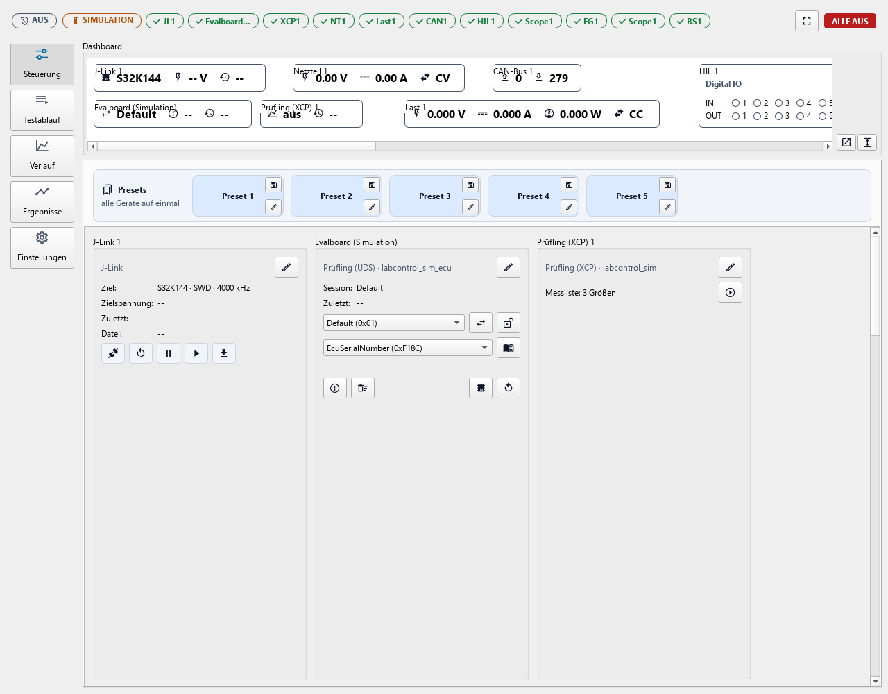
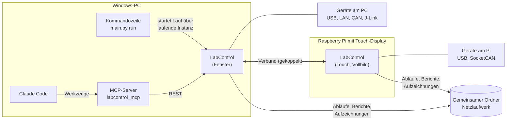

# Überblick

**LabControl** bedient Laborgeräte verschiedener Hersteller aus einer Oberfläche und führt Testabläufe mit
Prüfungen und Bericht aus. Es läuft am Windows-PC und auf einem Raspberry Pi mit Touch-Display; beide Rechner
können im **Verbund** zusammenarbeiten.

## Für wen?

- **Hobbyisten mit Elektronik-Grundwissen:** mehrere Laborgeräte gemeinsam nutzen statt je ein Herstellerprogramm.
- **Steuergeräte-Bastler:** ein Board an Netzteil, Last und CAN-Bus automatisch prüfen, z. B. Steuergeräte mit
  neXtBSW (UDS, XCP, Flashen über CAN).
- **Wiederholte Messungen:** Ein Testablauf läuft jedes Mal gleich, auch nachts ohne Fenster, und legt Bericht und
  Ergebnis ab.

!!! note "Hobby-Projekt in Entwicklung"
    LabControl wird laufend erweitert. Was nur in der Simulation geprüft ist, steht hier und im `CHANGELOG.md` dabei.

## Was kann LabControl?

| Bereich | Kurz | Kapitel |
|---|---|---|
| Geräte | Netzteile, Last, Funktionsgenerator, Oszilloskope, microHIL, CAN, Batterie-Simulator, J-Link | [Geräte einrichten](geraete.md) |
| Bedienung | Kacheln, Presets, Dashboard, Verlauf mit Aufzeichnung (CSV/MF4), Ergebnisse, Sicherheit, Touch-Modus | [Bedienung](bedienung.md) |
| Testabläufe | Schritte, Schleifen, Bedingungen, Prüfungen, Zeitprüfungen, Varianten, Bausteine, Debuggen, Bericht | [Testabläufe](testablaeufe.md) |
| Prüfling | Steuergerät über UDS (ODX) und XCP (A2L), Firmware über CAN flashen, Restbus aus DBC mit E2E | [Prüfling](pruefling.md) |
| Automatisierung | Kommandozeile ohne Fenster, REST-Schnittstelle, MCP-Server für Claude, Nachtläufe | [Automatisierung](automatisierung.md) |
| Pi und Verbund | Raspberry Pi mit Touch-Display, Kopplung PC ↔ Pi, gemeinsamer Ordner | [Raspberry Pi und Verbund](pi-verbund.md) |
| Entwickler | Aufbau des Codes, eigene Gerätetreiber, Prüfungen | [Für Entwickler](entwickler.md) |

Was LabControl von einzelnen Herstellerprogrammen unterscheidet:

- **Mehrere Geräte gemeinsam:** Ein Preset stellt alle Geräte auf einmal ein; ein Testablauf schaltet Netzteil,
  Last und microHIL nacheinander und prüft Messwerte.
- **Sicherheit zuerst:** **ALLE AUS** schaltet alle Ausgänge ab, ein Software-Watchdog überwacht Grenzwerte je
  Gerät, Netzteil und Last lassen sich im Testablauf gegeneinander verriegeln.
- **Nachvollziehbar:** Jede Bedienung steht im Protokoll `labdash.log`; jeder Lauf hinterlässt Bericht (HTML),
  JUnit-XML und `run-result.json`.

## Unterstützte Geräte

| Gerät | Art | Anschluss | Stand |
|---|---|---|---|
| Korad KEL102 | Elektronische Last | USB (virtueller COM-Port) | am Gerät geprüft |
| Manson HCS-3xxx (Treiber für HCS-3400/3402/3404) | Labornetzteil | USB (virtueller COM-Port) | am Gerät geprüft (HCS-3404 mit 60 V und ein 16-V-Modell) |
| Joy-IT JDS2915 (Protokoll JDS66xx) | Funktionsgenerator, 2 Kanäle | USB (CH340-Wandler) | am Gerät geprüft |
| PicoScope 2204A/2205A | USB-Oszilloskop | USB (PicoSDK) | am Gerät geprüft (2204A) |
| UNI-T MSO1000HD, z. B. MSO1154HD-S | Oszilloskop | LAN (SCPI, ohne NI-VISA) | **bisher nur gegen den Simulator geprüft** |
| Rohde & Schwarz RTB2002/RTB2004 | Oszilloskop | LAN (SCPI, ohne NI-VISA) | am Gerät geprüft (RTB2002) |
| microHIL (STM32F446) | I/O-Box: 4 Relais, 8 Digitalaus- und 8 -eingänge, 4 Analogeingänge, 2 Analogausgänge, 2 schaltbare 12-V-Ausgänge, 4 PWM | USB (virtueller COM-Port) | am Gerät geprüft |
| Batterie-Simulator (Eigenbau, 14 Zellen) | Zellspannungen für Batteriemanagement-Tests | über ein CAN-Interface (500 kbit/s) | am Gerät geprüft |
| SEGGER J-Link | Flashen, Reset, Anhalten, Starten | USB über den J-Link Commander | **bisher nur in der Simulation geprüft** |
| Vector (z. B. CANcase XL, VN1610) | CAN-Interface | USB, nur Windows (Vector XL Driver Library nötig) | am Gerät geprüft |
| PEAK PCAN-USB | CAN-Interface | USB; am Pi als SocketCAN `can0` | am Pi über SocketCAN geprüft |
| SLCAN-Adapter (z. B. CAN1 des microHIL) | CAN-Interface | seriell | am Gerät geprüft |
| SocketCAN | CAN-Interface (jeder Adapter mit Linux-Treiber) | nur Linux, z. B. Raspberry Pi | am Pi mit PCAN-USB geprüft |
| Steuergerät (Prüfling) | Diagnose über UDS und XCP, Flashen über CAN | über ein CAN-Interface | am Evalboard S32K144 geprüft |

- Einrichtung je Gerät: [Geräte einrichten](geraete.md).
- Neue Gerätetypen als eigener Treiber: [Für Entwickler](entwickler.md).

## Gesamtaufbau

| Baustein | Kurz |
|---|---|
| Geräte | hängen an genau einem Rechner; der prüft Grenzwerte, Handbedienung und Sicherheitsabschaltung |
| Verbund | nach Kopplung mit Code-Bestätigung sieht jeder Rechner die Geräte des anderen; ALLE AUS wirkt auf beide, siehe [Raspberry Pi und Verbund](pi-verbund.md) |
| Gemeinsamer Ordner | Netzlaufwerk aus den Einstellungen: Abläufe, Bausteine, Varianten gemeinsam; Berichte, Aufzeichnungen, Oszilloskop-Erfassungen je Rechner, siehe [Schnellstart](schnellstart.md#wo-liegen-die-daten) |
| MCP-Server | übersetzt Werkzeugaufrufe eines KI-Assistenten in Anfragen an die Netzwerk-Schnittstelle; darf nur, was LabControl erlaubt, siehe [Automatisierung](automatisierung.md) |
| Kommandozeile | `python lab_gui/main.py run ablauf.json` führt einen Ablauf ohne Fenster aus; läuft LabControl schon, geht der Lauf über die laufende Instanz |

## Ohne Hardware ausprobieren: Simulationsmodus

Im **Simulationsmodus** ersetzen nachgebildete Geräte die Hardware. So probierst du Oberfläche und eigene
Testabläufe gefahrlos aus; alle Bildschirmfotos dieser Doku stammen daraus.

- Nachgebildet: Netzteil, Last, CAN-Bus, microHIL, Funktionsgenerator, zwei Oszilloskope, Batterie-Simulator,
  J-Link und ein Steuergerät für UDS und XCP.
- Einschalten: **Einstellungen → Allgemein → Simulationsmodus**, in der `.exe` und aus dem Quellcode, siehe
  [Schnellstart](schnellstart.md#simulationsmodus-einschalten).
- Solange er an ist, steht oben in der Leiste deutlich **SIMULATION**.

!!! warning "Echte Geräte bleiben aktiv"
    Der Simulationsmodus ergänzt simulierte Geräte, echte bleiben verbunden und werden mitgeschaltet. Zum
    gefahrlosen Ausprobieren steckst du echte Geräte vorher ab.

## Sprache

Oberfläche auf Deutsch und Englisch (Einstellungen → Allgemein → **Sprache:**); diese Dokumentation zunächst nur
auf Deutsch.

## Verwandte Projekte

| Projekt | Worum es geht |
|---|---|
| [microHIL](https://github.com/danielsimonreinhardt/microHIL) | Selbst entwickelte I/O-Box für einfache Hardware-in-the-Loop-Tests; LabControl steuert sie als Gerät und nutzt ihren CAN-Ausgang als SLCAN-Interface |
| [BatterySimulator](https://github.com/danielsimonreinhardt/BatterySimulator) | Selbst gebauter Batterie-Simulator mit 14 Zellkanälen (Hardware, Firmware); LabControl steuert ihn über CAN |
| [neXtBSW](https://github.com/danielsimonreinhardt/neXtBSW) | Basissoftware für S32K-Steuergeräte; LabControl spricht mit ihr per UDS, XCP, Restbus mit E2E und flasht über ihren Bootloader |

!!! note
    BatterySimulator und neXtBSW sind noch nicht öffentlich; die Links funktionieren, sobald die Repos freigegeben sind.

## Wie geht es weiter?

1. [Schnellstart](schnellstart.md): installieren, Simulationsmodus, erstes Gerät, erster Testablauf.
2. [Bedienung](bedienung.md): Hauptfenster, Kacheln, Verlauf, Ergebnisse, Sicherheit.
3. [Geräte einrichten](geraete.md): echte Geräte anschließen.
