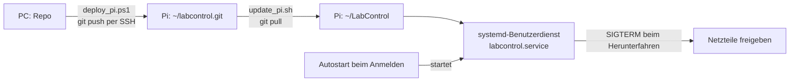
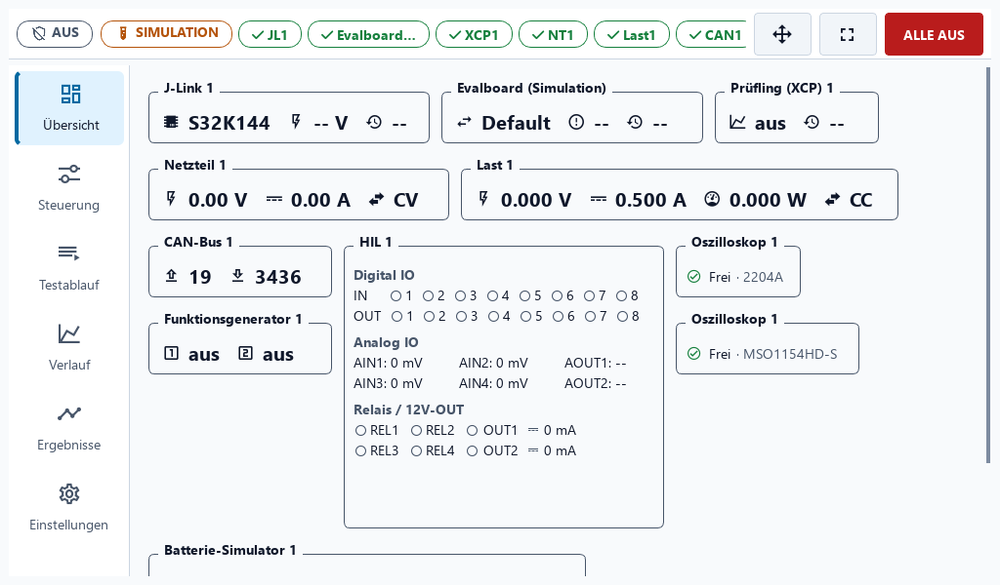
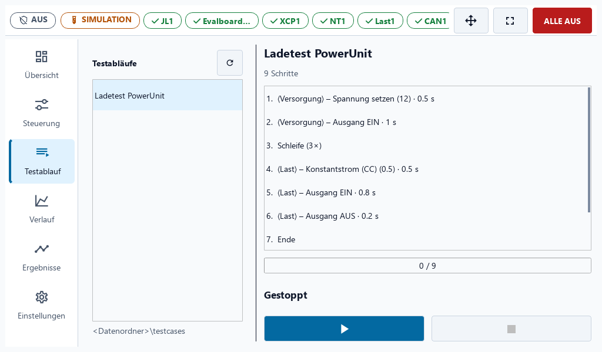
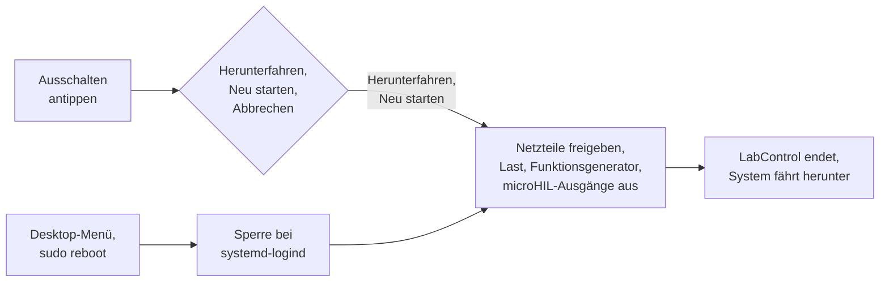
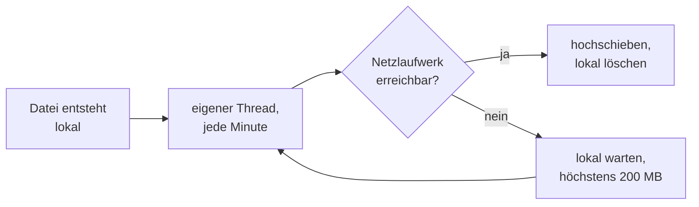
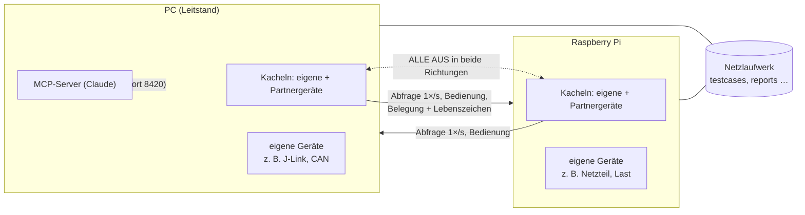
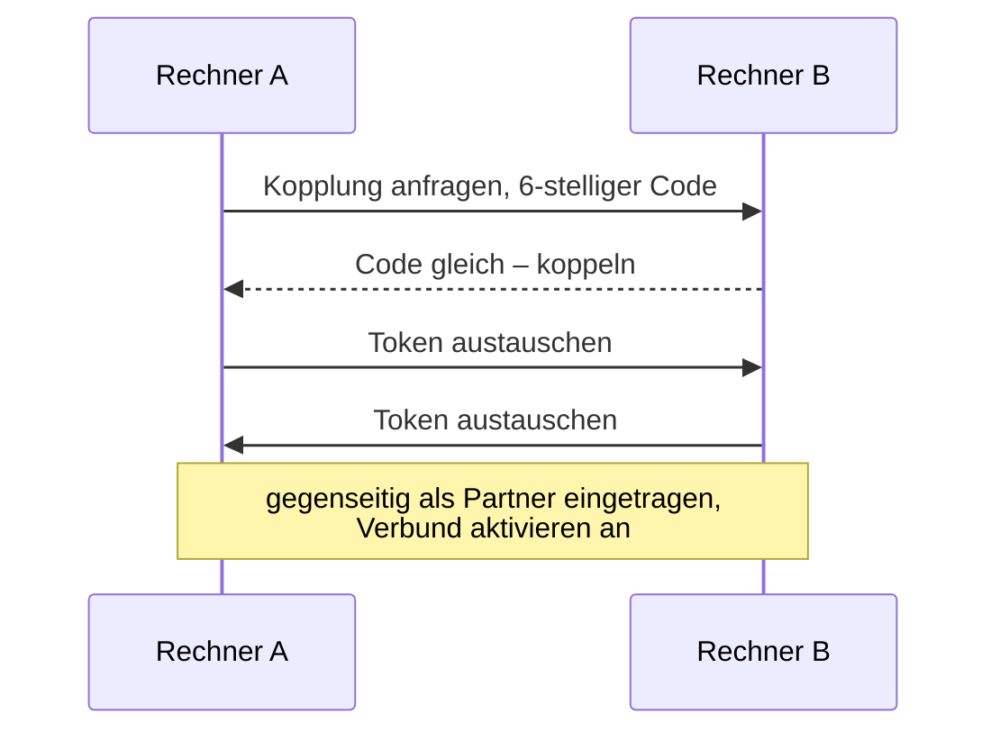
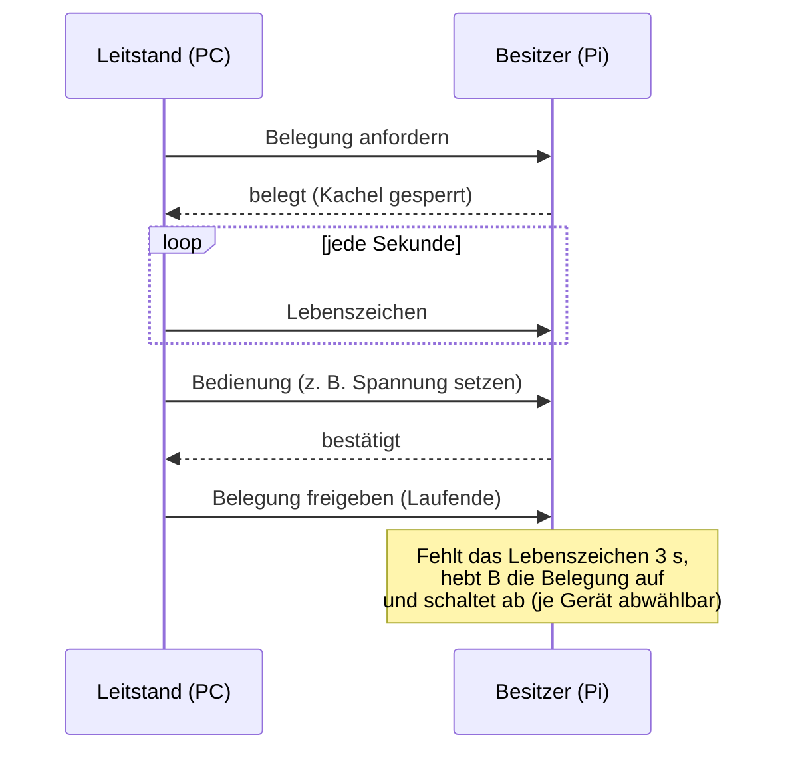
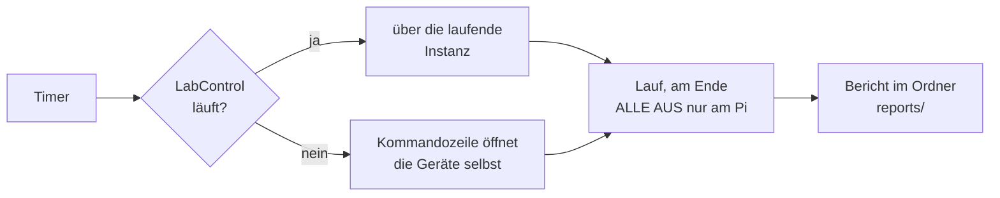

# Raspberry Pi und Verbund

LabControl läuft auch auf einem Raspberry Pi mit Touch-Display und startet dort direkt im Vollbild (Kiosk). Mit
einem PC bildet der Pi einen **Verbund**: Jeder Rechner bedient die Geräte des anderen, beide teilen Testabläufe
und Berichte über ein Netzlaufwerk, und ALLE AUS wirkt auf beide.

## Hardware

| Teil | Erprobt |
|---|---|
| Rechner | Raspberry Pi 5 mit 2 GB |
| System | Raspberry Pi OS 13 (trixie), 64 Bit, mit Desktop |
| Display | 7-Zoll-HDMI-Display 1024 × 600 mit USB-Touch |
| SD-Karte | 8 GB nach dem Verschlanken (siehe unten), sonst 32 GB |
| CAN | PEAK PCAN-USB über SocketCAN |

LabControl braucht am Pi etwa 250 MB Arbeitsspeicher. Die Geräte stecken per USB am Pi wie am PC.

## Einrichtung

Alle Skripte liegen in `tools/pi/`. Der Stand geht nicht über GitHub, sondern vom PC per SSH in ein Git-Repo auf
dem Pi.



| Datei | Zweck |
|---|---|
| `setup_pi.sh` | einmalige Einrichtung am Pi: Python-Umgebung, Dienst, Autostart, SD-Karte schonen, CAN, Gerätegruppen |
| `labcontrol.service` | systemd-Benutzerdienst; Neustart nur nach Absturz, 20 s zum Freigeben beim Beenden |
| `labcontrol-autostart.desktop` | startet den Dienst beim (automatischen) Anmelden |
| `update_pi.sh` | am Pi: neuen Stand holen, bei Bedarf Pakete nachinstallieren, Dienst neu starten |
| `deploy_pi.ps1` | am PC: Stand per SSH zum Pi schieben und `update_pi.sh` aufrufen |
| `kiosk_pi.sh` | Kiosk: beim Booten nur das LabControl-Logo, dann die App im Vollbild; `--undo` nimmt alles zurück |
| `slim_sd.sh` | nur für 8-GB-Karten: Browser, Compiler, fremde Firmware usw. entfernen |
| `netzlaufwerk_pi.sh` | SMB-Netzlaufwerk einhängen und in LabControl eintragen |
| `nightly_pi.sh` | Nachtlauf einrichten (mit `labcontrol-nightly.service` und `.timer`) |

### Erstinstallation

1. Raspberry Pi Imager: „Raspberry Pi OS (64-bit)“, Benutzer anlegen, SSH mit öffentlichem Schlüssel und
   automatische Anmeldung einschalten.
2. Am PC das leere Repo anlegen, den Stand übertragen und einrichten:
   ```
   ssh -i <schlüsseldatei> <benutzer>@<IP des Pi> "git init -q --bare ~/labcontrol.git"
   powershell -File tools\pi\deploy_pi.ps1 -PiHost <IP des Pi> -User <benutzer> -Key <schlüsseldatei>
   ssh -i <schlüsseldatei> <benutzer>@<IP des Pi> "bash ~/LabControl/tools/pi/setup_pi.sh"
   ```
   Der erste Aufruf von `deploy_pi.ps1` legt `~/LabControl` an.
3. Nur bei 8-GB-Karte: `bash ~/LabControl/tools/pi/slim_sd.sh`, dann neu starten.
4. Kiosk: `bash ~/LabControl/tools/pi/kiosk_pi.sh`, dann `sudo reboot`.

**Parameter von `deploy_pi.ps1`:**

| Parameter | Bedeutung |
|---|---|
| `-PiHost` | Adresse oder Name des Pi – **Pflicht** (seit 0.70.0 ohne Vorgabe) |
| `-User` | Benutzer am Pi (Vorgabe `labcontrol`) |
| `-Key` | SSH-Schlüsseldatei (Vorgabe `.ssh\labpi_ed25519` im Benutzerordner) |
| `-Branch` | Zweig, der übertragen wird (Vorgabe `master`) |

**Was `setup_pi.sh` erledigt** (wiederholbar, Erledigtes wird übersprungen oder überschrieben):

- Python-Umgebung `~/labcontrol-venv` nur mit den Qt-Basismodulen (`PySide6-Essentials`, spart gut 300 MB) und
  den übrigen Paketen aus `requirements.txt`.
- Dienst und Autostart.
- SD-Karte schonen: Auslagerung nur komprimiert im Arbeitsspeicher (zram); prüfen, dass das Systemprotokoll nur im
  Arbeitsspeicher liegt und `/` mit `noatime` eingehängt ist.
- systemd-logind gibt LabControl beim Herunterfahren bis zu 15 s, die Netzteile freizugeben.
- udev-Regel: jeder USB-CAN-Adapter geht beim Einstecken mit 500 kbit/s hoch.
- Benutzer in die Gruppen `dialout` und `plugdev` (Zugriff auf die Geräte).

### Kiosk

`kiosk_pi.sh` macht aus dem Pi ein Gerät mit nur einer Aufgabe:

- Beim Booten nur das LabControl-Logo: keine Himbeeren, kein Regenbogen, keine Textmeldungen.
- Kein Desktop, keine Leiste; LabControl im Vollbild.
- Mauszeiger unsichtbar, Dialoge ohne Fensterleiste.
- `KIOSK_BOOTLOADER=1 bash ~/LabControl/tools/pi/kiosk_pi.sh` blendet auch das Bild des Bootloaders aus. Das
  schreibt den Bootloader des Pi 5 mit der neuesten mitgelieferten Firmware neu.
- Wartung am Desktop: `bash ~/LabControl/tools/pi/kiosk_pi.sh --undo`, dann neu starten. Die Originaldateien
  sichert das Skript beim ersten Lauf.
- Bekannt: Beim Übergang vom Boot-Logo zur App ist der Bildschirm etwa 0,1 s schwarz (ohne Eingriff in den
  Compositor nicht vermeidbar).

### Updates vom PC

```
powershell -File tools\pi\deploy_pi.ps1 -PiHost <IP des Pi> -User <benutzer> -Key <schlüsseldatei>
```

- Übertragen wird der letzte Commit. Nicht committete Änderungen meldet das Skript als Warnung und überträgt sie
  nicht.
- `update_pi.sh` installiert Pakete nur, wenn sich `requirements.txt` geändert hat, und startet den Dienst neu.
- Haben sich die Dienstdateien geändert, weist es darauf hin, `setup_pi.sh` erneut auszuführen.

### Betrieb

| Aufgabe | Befehl am Pi |
|---|---|
| Zustand des Dienstes | `systemctl --user status labcontrol` |
| Protokoll des Dienstes | `journalctl --user -u labcontrol` |
| Dienst starten / stoppen | `systemctl --user start labcontrol` / `systemctl --user stop labcontrol` |

- Fenster schließen beendet den Dienst ohne Neustart. Nach einem Absturz startet er nach 5 s neu, höchstens
  5-mal in 10 min; ein Neustart schaltet keine Geräte ein.
- Auch bei `systemctl --user stop` und beim Herunterfahren gibt LabControl die Netzteile frei.
- Datenordner (Einstellungen, Log, Erfassungen): `~/.local/share/labcontrol`, anders über `LABCONTROL_DATA_DIR`.

### CAN am Pi

- Ein PEAK PCAN-USB erscheint als `can0`; die udev-Regel aus `setup_pi.sh` fährt ihn mit 500 kbit/s hoch.
- In LabControl: **Einstellungen → CAN-Bus**, Interface `socketcan`, Kanal `can0`. Das Feld Bitrate wirkt hier
  nicht.
- Andere Bitrate: Regel `/etc/udev/rules.d/80-labcontrol-can.rules` anpassen.
- Mehr in [Geräte einrichten](geraete.md#can-interfaces).

!!! note "Flashen über CAN am Pi"
    Flashen des Prüflings über SocketCAN (`can0`) geht noch nicht, weil canflash eine Kanalnummer erwartet. Die
    Erweiterung in canflash ist geplant; bis dahin flashst du am PC.

## Touch-Oberfläche



Bis 1024 × 600 schaltet LabControl die Touch-Bedienung selbst ein, solange du sie nie selbst gewählt hast.
Umschalten ohne Neustart: **Einstellungen → Allgemein → Touch-Bedienung**.

| Bereich | Verhalten |
|---|---|
| Navigation links | Übersicht, Steuerung, Testablauf, Verlauf, Ergebnisse, Einstellungen |
| Leiste oben | links Sicherheits-Chip, daneben ein Chip je Gerät (✓ verbunden, ✕ getrennt, Ⓗ Handbedienung); wischbar, ein Tipp öffnet „Gerätezustand“ mit vollen Namen; rechts Anordnen, Vollbild, Ausschalten, **ALLE AUS** |
| Größe | Schrift 20 % größer, Knöpfe und Felder mindestens etwa 40 px hoch |
| Eingabe | Zahlenfeld → Tastenfeld (Hex-Felder: Hex-Tastenfeld), Textfeld → Bildschirmtastatur mit Umlauten |
| Anordnen | Symbol mit Verschiebe-Kreuz: verkleinertes Abbild aller Kacheln, Kachel greifen, ablegen, mit Haken beenden |
| Listen | mit dem Finger wischen; statt Tooltips Beschriftungen direkt am Element |

### Testabläufe am Pi



Am Pi werden Testabläufe nur **ausgeführt**; bearbeitet und gespeichert wird am PC.

1. Links unter **Testabläufe** den Ablauf antippen. Die Liste kommt aus dem gemeinsamen Ordner (Netzlaufwerk
   `testcases/`, sonst lokal); der Knopf oben liest sie neu ein.
2. Rechts stehen Name, Zahl der Schritte und die Schritte als Liste.
3. Großer Start-Knopf: Fortschritt, aktueller Schritt und Status groß darunter (Fehler rot, bestanden grün).
4. Stop-Knopf: hält den Lauf an und schaltet ALLE AUS.

- Es gelten dieselben Prüfungen und dieselbe Sicherheitsabschaltung wie am PC.
- Berichte öffnest du am PC, der Pi hat keinen Browser (siehe [Testabläufe](testablaeufe.md)).

## Herunterfahren und Neustart

Unter Linux zeigt die Leiste oben einen Ein/Aus-Knopf (Tooltip „Ausschalten“), wenn das System das Ausschalten
ohne Passwort erlaubt.



- Rückfrage „Rechner herunterfahren oder neu starten?“, **Abbrechen** ist vorgewählt.
- Netzteile freigeben heißt wie beim Beenden: 1 V / 0 A, Ausgang EIN, zur Handbedienung frei.
- Nicht abgedeckt: Abmelden vom Desktop ohne Herunterfahren (im Kiosk kein üblicher Weg).

!!! warning "Netzteile nach dem Ausschalten"
    Nach dem Herunterfahren stehen die Netzteile auf 1 V, 0 A mit **eingeschaltetem** Ausgang. Trenne den
    Prüfling, wenn auch das zu viel ist.

## Netzlaufwerk und gemeinsamer Ordner

PC und Pi legen ihre Daten auf demselben Netzlaufwerk ab: gleiche Testabläufe, alle Berichte an einem Ort.

- **Einstellen:** **Einstellungen → Allgemein → Netzlaufwerk:** (leer = nur lokal). Die Umgebungsvariable
  `LABCONTROL_NETWORK_DIR` hat Vorrang.
- Unter dem Feld steht, wohin die Daten gerade gehen und wie viele Dateien lokal warten.

```
<Netzlaufwerk>/
├── testcases/          Testabläufe, gemeinsam für PC und Pi
├── blocks/             Bausteine
├── varianten/          Varianten mit Rollen und Parametern
├── keys/<Name>.key     Schlüssel des Prüflings
├── messmittel.json     Kalibrierdaten der Messmittel
├── <rechner>/          je Rechner, z. B. raspberrypi/
│   ├── labdash.log, share_access.log
│   ├── reports/        Berichte, run_<id>.json/.xml/.html
│   ├── captures/       Oszilloskop-Erfassungen (CSV)
│   └── recordings/     Aufzeichnungen aus dem Verlauf (CSV/MF4)
└── odx/, a2l/, firmware/   Ablage für Prüfling-Dateien (eigene Ordnung, siehe Hinweis)
```

**So arbeitet die Ablage:**



- Ein hängendes Netzlaufwerk hält weder Oberfläche noch Geräte auf.
- Über 200 MB löscht LabControl die ältesten wartenden Dateien und schreibt das ins Log.
- Speichern-Dialoge und Testablauf-Ordner zeigen aufs Netzlaufwerk, wenn es bei der letzten Prüfung erreichbar
  war, sonst auf den lokalen Datenordner.
- Unter Linux zählt kein Ordner auf der SD-Karte als Netzlaufwerk; ein nicht eingehängter Mountpunkt wird so nicht
  versehentlich beschrieben.

!!! note "Ordner für ODX, A2L und Firmware"
    `odx/`, `a2l/` und `firmware/` legt LabControl nicht an; sie sind nur eine bewährte Ordnung für die Dateien
    unter **Einstellungen → Geräte → Prüfling**. Fest vorgegeben sind `testcases/`, `blocks/`, `varianten/`,
    `keys/` und `messmittel.json`.

### Netzlaufwerk am Pi einhängen

```
bash ~/LabControl/tools/pi/netzlaufwerk_pi.sh //<server>/<freigabe> [<unterordner>] [<benutzer>]
```

| Angabe | Bedeutung |
|---|---|
| `//<server>/<freigabe>` | SMB-Freigabe – **Pflicht** (seit 0.70.0 ohne Vorgabe) |
| `<unterordner>` | Ordner in der Freigabe für LabControl (Vorgabe `LABCONTROL`) |
| `<benutzer>` | SMB-Benutzer (Vorgabe `labcontrol`) |

1. **Passwort:** verdeckt abgefragt (oder aus `NETZ_PASSWORT`). Es liegt danach nur in
   `/etc/labcontrol/smb-credentials` (nur root lesbar), nie im Repo oder in den Einstellungen.
2. **Einhängen** per systemd-Automount unter `/mnt/<freigabe>`: erst beim ersten Zugriff, 15 s Frist. Ist der
   Server weg, startet der Pi trotzdem normal.
3. **Eintragen:** `/mnt/<freigabe>/<unterordner>` wird Netzlaufwerk in LabControl (Dienst dafür kurz angehalten).

**Rückgängig:** Zeile mit dem Mountpunkt aus `/etc/fstab` entfernen (Sicherung: `/etc/fstab.vor-netzlaufwerk`),
`sudo systemctl daemon-reload`, Netzlaufwerk in LabControl leeren.

## Verbund PC + Pi

Jedes Gerät bleibt beim Rechner, an dem es steckt (dem **Besitzer**). Der andere Rechner zeigt es als normale
Kachel und schickt Bedienungen an den Besitzer, der Grenzwerte, Handbedienung und Sperren selbst prüft.



### Koppeln

**Voraussetzung an beiden Rechnern** (**Einstellungen → Netzwerk**):

- **Freigabe im lokalen Netzwerk aktivieren**, **Erreichbar für** = „Alle Geräte im lokalen Netzwerk“.
- Port 8420; am Windows-PC eine Firewall-Freigabe für eingehende Verbindungen auf diesem Port im privaten Netz.



1. **Einstellungen → Netzwerk → Verbund**, **Partner-Adresse:** z. B. `<IP des Pi>:8420` oder Rechnername (ohne
   Port gilt 8420), dann **Koppeln…**.
2. Am anderen Rechner erscheint „Kopplung anfragen“: Codes gleich → **Code gleich – koppeln**, sonst
   **Ablehnen**. Die Anfrage gilt 60 s; am Pi musst du nichts tippen.

Optional legt **Anzeigename:** fest, wie der Partner heißt; sonst gilt sein Rechnername.

**Verbund-Chip** in der Leiste oben:

| Anzeige | Bedeutung |
|---|---|
| „⇄ Name“ | verbunden |
| „✕ Name“ | getrennt |
| gelb | Partnergeräte gerade nicht bedienbar oder Warnung; Grund im Tooltip |
| Hinweis Uhrzeit | Uhren weichen um mehr als 1 s ab (NTP prüfen) |

### Partnergeräte

- Netzteile, Lasten, Funktionsgeneratoren, microHIL und Batterie-Simulator des Partners erscheinen in Übersicht
  und Steuerung mit denselben Kacheln; CAN-Interfaces nur in der Übersicht.
- Merkmal: ein **Netzwerk-Symbol** hinter dem Kacheltitel, der Tooltip nennt den Rechner.
- Name und Kachelfarbe kommen vom Besitzer; Umbenennen in der Partnerkachel ändert den Namen dort. Die Anordnung
  bleibt je Rechner.
- Kennung: `@<rechner>/<id>`, z. B. `@raspberrypi/psu:HCS16`.
- Nicht fernsteuerbar und daher nicht in der Partnerkachel: Handbedienung, OVP/OCP, PWM, 12-V-Ausgänge, Grenzwert
  des Batterie-Simulators.
- Gesperrt, solange beim Besitzer ein Testlauf läuft, eine Sicherheitsabschaltung besteht oder die Werte veraltet
  sind. Eine abgelehnte Bedienung zeigt ihren Grund kurz an der Kachel.
- Oszilloskope und J-Link bleiben am eigenen Rechner. Dasselbe LAN-Oszilloskop an beiden Rechnern: Hinweis in Chip
  und Einstellungen.
- Werte von Partner-Netzteilen, -Lasten und -microHILs laufen im Sekundentakt auch in Verlauf und Aufzeichnung.

### ALLE AUS im Verbund

!!! warning "ALLE AUS wirkt auf beide Rechner"
    Knopf **ALLE AUS**, ALLE AUS über Netzwerk oder MCP und die Sicherheitsabschaltung gehen auch an den Partner.
    Das läuft in einem eigenen Thread, nie hinter wartenden Bedienungen.

| Auslöser | Wirkt auf |
|---|---|
| Knopf ALLE AUS, ALLE AUS über Netzwerk/MCP, Sicherheitsabschaltung | beide Rechner |
| Stop oder Fehler eines Testablaufs | nur eigene Geräte |
| „Am Ende ALLE AUS“ eines Ablaufs | nur eigene Geräte |
| Beenden von LabControl | nur eigene Geräte |
| ALLE AUS am Ende eines Laufs über die Kommandozeile | nur eigene Geräte |
| ALLE AUS, das vom Partner kommt | nur eigene Geräte (nicht zurückgeschickt) |

Bestätigt der Partner ALLE AUS nicht, zeigt LabControl einen Hinweis mit dem Grund.

### Gemeinsame Testabläufe

Ein Testablauf kann Geräte beider Rechner nutzen. Der Rechner, an dem du ihn startest, ist der **Leitstand**.

- Im Editor stehen die Partnergeräte in der Geräteauswahl, z. B. „Pi · Netzteil 1“.
- Speichern mit aktivem Verbund schreibt auch eigene Geräte mit Rechnernamen; die Datei meint an beiden Rechnern
  dasselbe Gerät.
- Ohne Verbund ordnet LabControl unbekannte Geräte über Art und Namen zu – deshalb Geräte gleich benennen.



- **Belegung:** Kachel beim Besitzer gesperrt mit „belegt durch <Rechner> · <Ablauf>“. Die Handbedienung des
  Netzteils bleibt möglich; Bedienungen anderer werden abgelehnt.
- **Lebenszeichen:** Der Leitstand bricht den Lauf nach 3 s ohne bestätigtes Lebenszeichen ab. Der Besitzer hebt
  die Belegung dann auf und schaltet die belegten Geräte ab. Ausnahme: Geräte, bei denen beim Besitzer unter
  Einstellungen → Netzwerk in der Spalte „Aus bei Verbindungsverlust“ kein Haken steht – sie bleiben, wie sie sind
  (z. B. das Netzteil, das ein Board dauerhaft versorgt).
- **Rate-Grenze:** höchstens 5 Fernbefehle je Sekunde, damit ALLE AUS immer durchkommt. Arbiträrsignale und Rampen
  auf Partner-Netzteilen halten daher mindestens 220 ms zwischen zwei Sollwerten.
- **Nicht über den Verbund:** Leseschritte, CAN-Schritte, J-Link. Solche Abläufe starten mit Meldung nicht, ebenso
  Abläufe mit Partnergeräten ohne Verbindung zum Partner.
- Prüfungen auf Messwerte von Partnergeräten nutzen die Abfrage im Sekundentakt: Auflösung etwa 1 s.

### Claude über den PC

- Der MCP-Server spricht nur mit dem PC. Der PC zeigt Claude auch die Partnergeräte (`@<rechner>/<id>`) und
  reicht Befehle an den Besitzer weiter.
- Dabei belegt der PC das Gerät beim Besitzer („Claude (MCP)“), mit Lebenszeichen wie bei Abläufen.
- Die Belegung endet nach 10 min ohne Befehl von Claude, bei ALLE AUS, Sicherheitsabschaltung oder Ablaufstart.
- Einzelheiten in [Automatisierung](automatisierung.md).

!!! note "Batterie-Simulator im Verbund"
    Nur ein Rechner darf die Steuerbotschaft des Batterie-Simulators senden. Führt der Partner einen Simulator oder
    hängt einer am eigenen Bus, ist das Senden dieser Botschaft von Hand oder per CAN-Schritt gesperrt.

## Nachtlauf am Pi

`nightly_pi.sh` richtet einen systemd-Timer ein, der jede Nacht einen Testablauf startet; root ist nicht nötig.

```
bash ~/LabControl/tools/pi/nightly_pi.sh <ablauf.json> [HH:MM]   # einrichten, Standard 02:00
bash ~/LabControl/tools/pi/nightly_pi.sh --now                   # einmal sofort ausführen (Test)
bash ~/LabControl/tools/pi/nightly_pi.sh --off                   # abschalten
```



- Ablauf mit Pfad angeben, z. B. eine Datei in `testcases/` auf dem Netzlaufwerk.
- Über die laufende Instanz nur mit **Freigabe im lokalen Netzwerk aktivieren** und **Claude (MCP) darf steuern**.
- LabControl wartet bis zu 60 s auf die Geräte des Ablaufs.
- Ergebnis: Exit-Code im Journal (`journalctl --user -u labcontrol-nightly`); `run_<id>.*` (Bericht, JUnit,
  `run-result.json`) im Berichtsordner, mit Netzlaufwerk unter `<Netzlaufwerk>/raspberrypi/reports/` (bei anderem Rechnernamen entsprechend), auch im
  Reiter **Ergebnisse** am PC. Exit-Codes: [Automatisierung](automatisierung.md).
