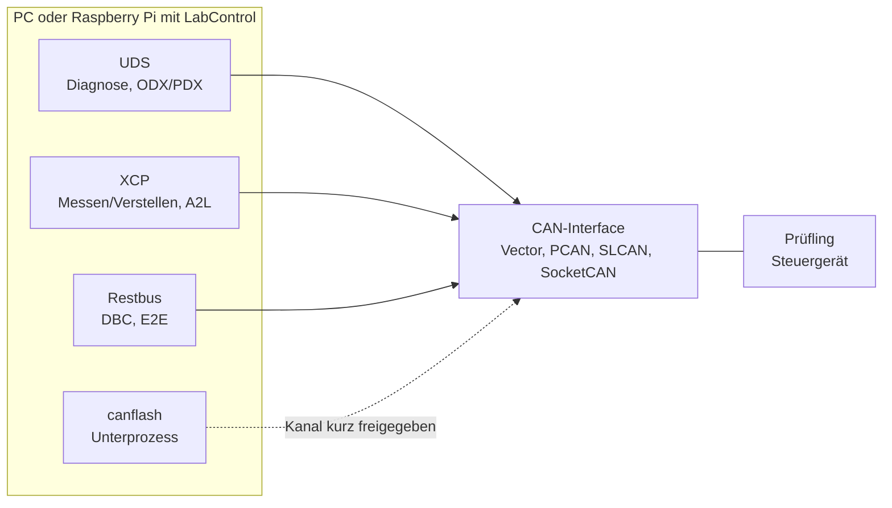
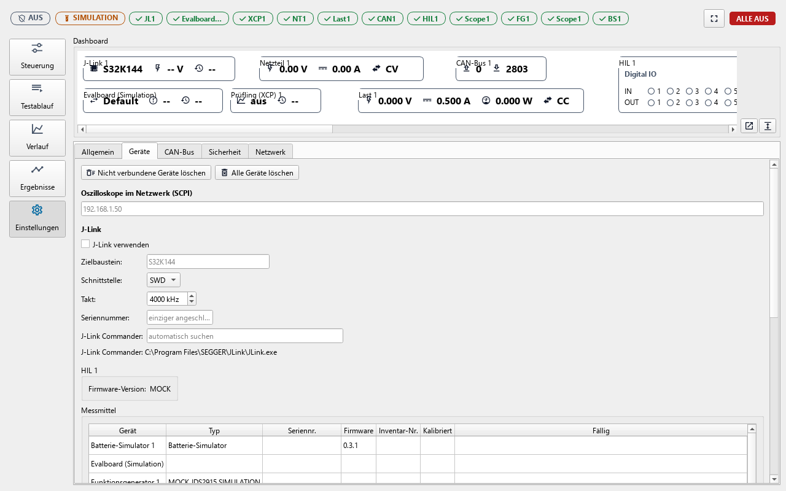
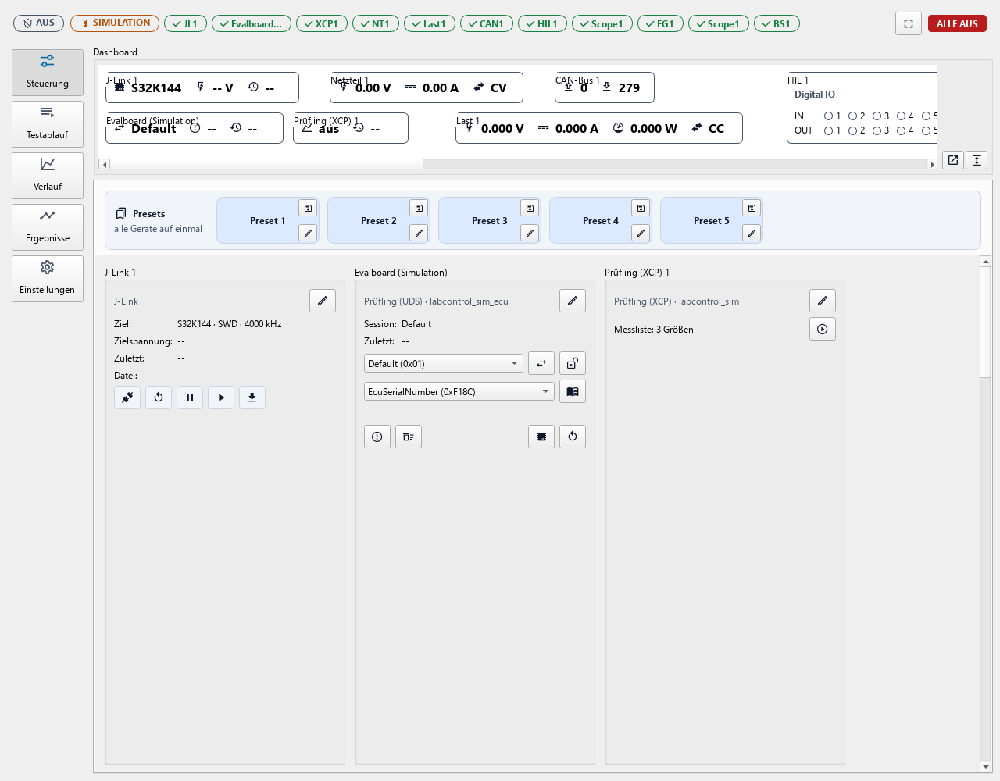
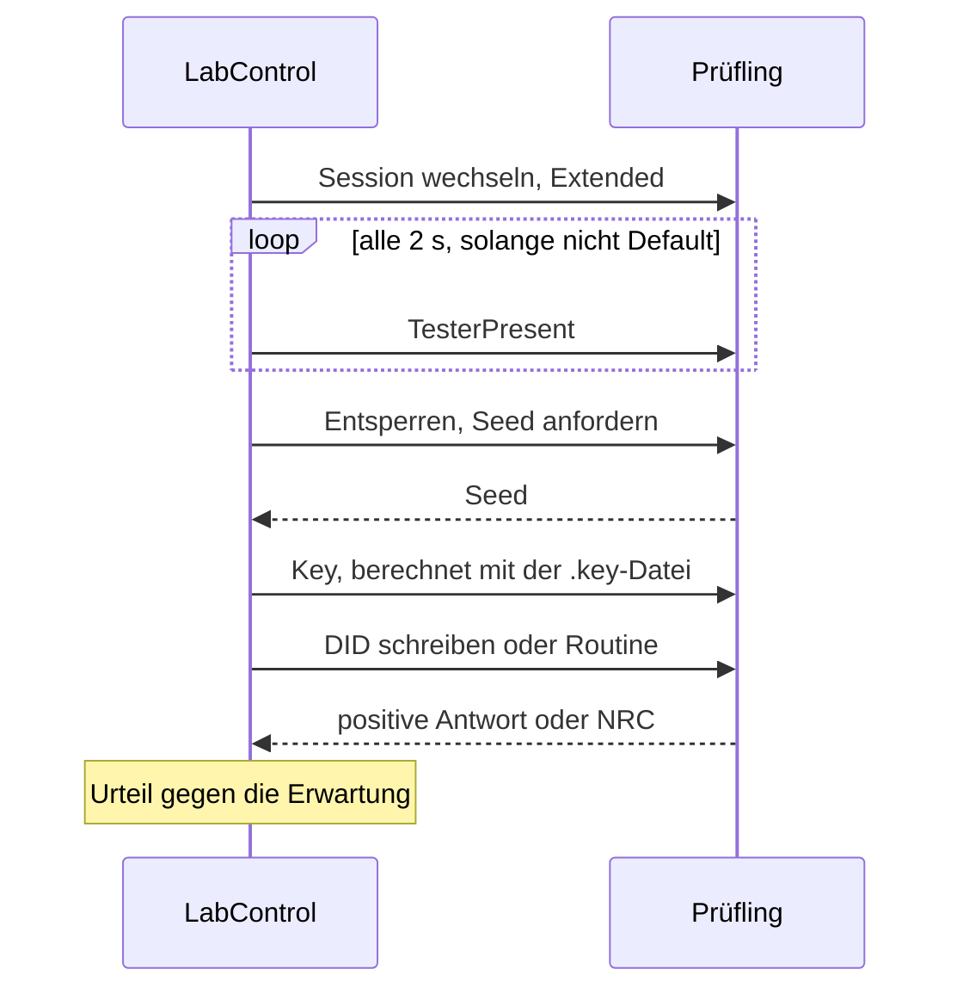
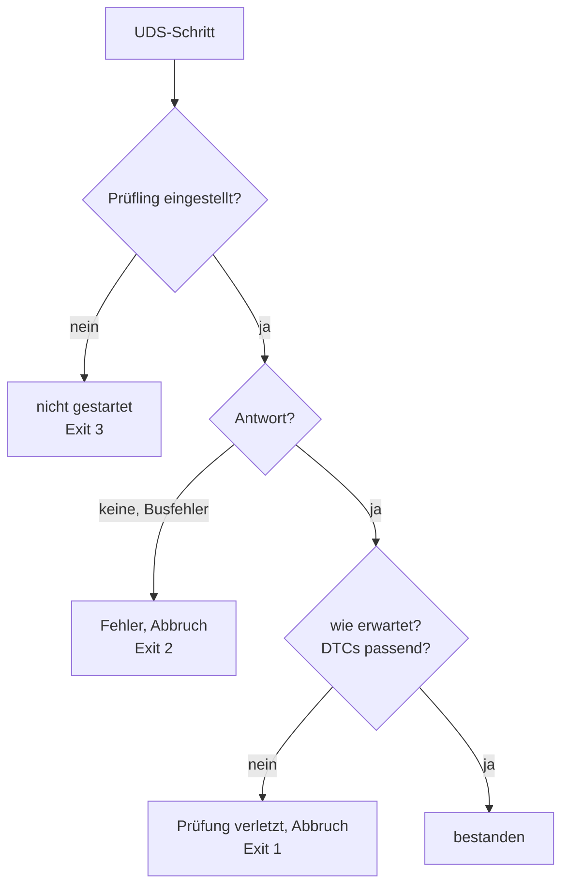
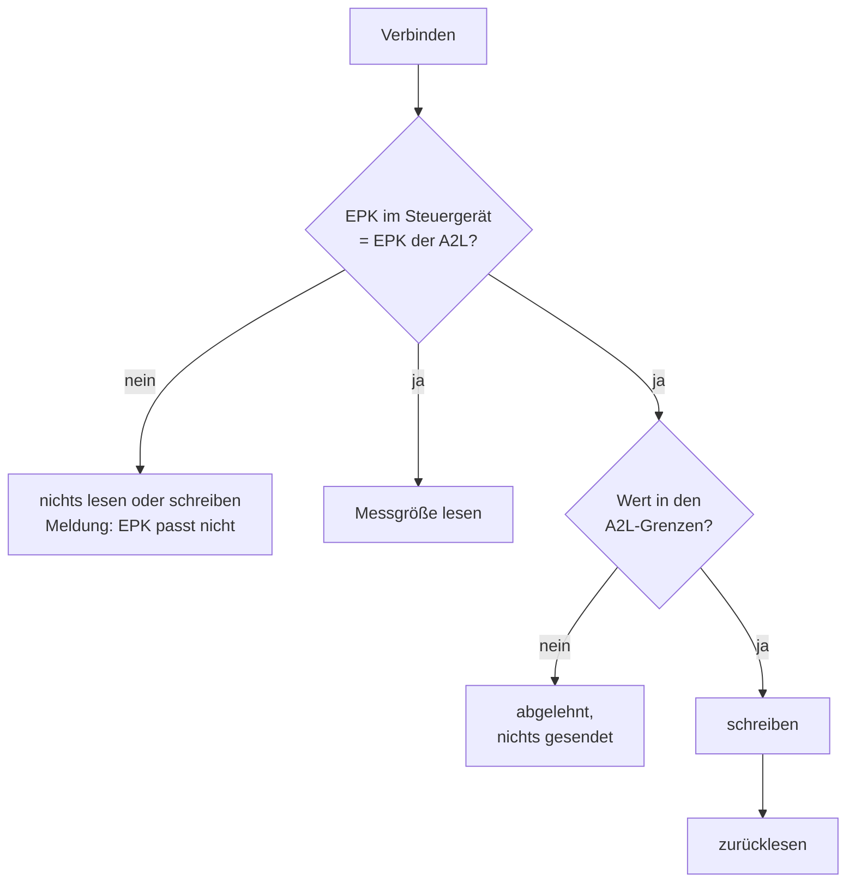
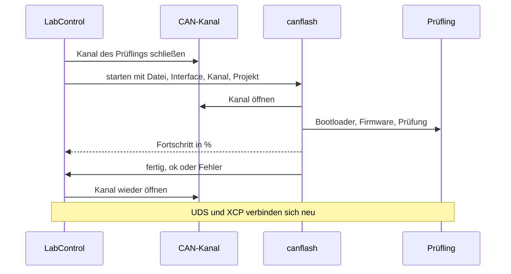
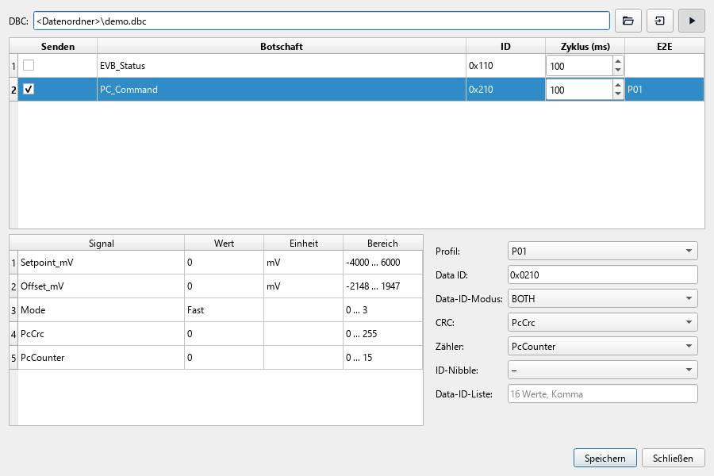
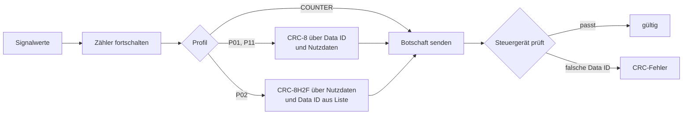

# Prüfling (UDS, XCP, Flashen, Restbus)

Ein **Prüfling** ist das Steuergerät, das du testest. LabControl erreicht ihn über das CAN-Interface, das es
ohnehin geöffnet hält:



- Gebaut und geprüft für Steuergeräte mit **neXtBSW** (eigene Basissoftware des Autors für S32K): ODX/PDX aus
  deren Diagnose-Export, A2L aus deren A2L-Generator, canflash, E2E-Angaben aus der `rte.yaml`.
- Andere Steuergeräte gehen, soweit ihre Dateien demselben Aufbau folgen – nicht geprüft.

!!! tip "Ohne Steuergerät ausprobieren"
    Im Simulationsmodus (Einstellungen → Allgemein, auch in der `.exe`) hängt ein **nachgebildetes Steuergerät**
    am simulierten CAN-Bus. Es antwortet auf UDS und XCP, Flashen wird nachgebildet – ohne weitere Einstellung.

## Einrichtung



Einstellungen → Geräte, Abschnitt **„Prüfling (UDS/XCP)“** (weiter unten). Die Angaben gelten für den ganzen
Rechner, nicht für den Ablauf – derselbe Ablauf läuft so auch an einem Platz mit anderem CAN-Interface.

| Feld | Bedeutung |
|---|---|
| **Name:** | Name von Kachel, Bericht und Netzwerk-Freigabe. Überschreibt keinen selbst vergebenen Kachelnamen. |
| **CAN-Interface:** | Interface des Prüflings. „automatisch“ = das einzige CAN-Interface. Zum Flashen ausdrücklich wählen. |
| **ODX/PDX:** | Diagnosebeschreibung (`.pdx`, `.odx-d`, `.odx`), z. B. Export von neXtBSW `tools/diaggen`. Leer in der Simulation = nachgebildetes Steuergerät. |
| **Schlüssel:** | Name der Schlüsseldatei fürs Entsperren, siehe [Schlüsseldatei](#schlusseldatei). |
| **A2L (XCP):** | A2L-Datei, z. B. von neXtBSW `tools/a2lgen`. Leer in der Simulation = nachgebildetes Steuergerät. |
| **Messliste (XCP):** | A2L-Namen für die zyklische Abfrage, getrennt durch Komma, Semikolon oder Leerzeichen. |
| **Abfragerate:** | 0,5–50 Hz, Vorgabe 10 Hz. |
| **Flashen (canflash):** | neXtBSW-Ordner mit `tools/canflash` und seiner `.venv`. |
| **Projekt (canflash):** | Projektname aus `<neXtBSW>/projects` (`canflash --ecu`): Speicher-Layout, Diagnose-Adressen, E2E-Angaben für den Restbus. |

- Statuszeile unter den Feldern: z. B. Zahl der Messgrößen, Parameter und CAN-IDs der A2L oder warum eine Datei
  nicht lesbar ist.
- Eingestellter Prüfling (in der Simulation immer) = Gerät mit Kachel, Eintrag in der Übersicht und Chip oben;
  verbunden, solange sein CAN-Interface verbunden ist.

### Schlüsseldatei

Für **Entsperren** (SecurityAccess) braucht LabControl einen Master-Schlüssel – nie in Einstellungen oder Ablauf,
sondern als eigene Datei:

```text
<gemeinsamer Ordner>/keys/<Name>.key
```

- Inhalt: **64 Hex-Zeichen** (32 Byte); Zeilen ab `#` sind Kommentare.
- `<Name>` = Eintrag im Feld **Schlüssel:** (Buchstaben, Ziffern, `_ . -`).
- Gemeinsamer Ordner = Netzlaufwerk (Einstellungen → Allgemein), sonst der lokale Datenordner. So nutzen PC und Pi
  denselben Schlüssel.
- LabControl schreibt den Schlüssel nie ins Log und speichert ihn nirgends sonst.
- Verfahren: das von neXtBSW. Andere Seed/Key-Verfahren kennt LabControl nicht.

!!! warning "Schlüssel schützen"
    Die `.key`-Datei gehört nicht in Git, Berichte oder Tickets. Wer sie hat, entsperrt jedes Steuergerät mit
    diesem Master-Schlüssel.

## UDS

### Kachel „Prüfling (UDS)“



Die Kachel (Bildmitte) zeigt **Session** und **zuletzt** ausgeführte Bedienung. Knöpfe sind Symbole, der Name
steht im Tooltip.

| Bedienelement | Wirkung |
|---|---|
| Auswahl Session + **Session wechseln** | Session aus dem ODX. Außer Default hält LabControl sie mit TesterPresent (alle 2 s). |
| **Entsperren (SecurityAccess)** | Entsperrt mit der Schlüsseldatei; die Kachel zeigt dann „entsperrt“. |
| Auswahl DID + **DID lesen** | Werte mit Einheiten aus dem ODX. |
| **Fehlerspeicher lesen** | DTCs mit Texten aus dem ODX. |
| **Fehlerspeicher löschen** | Alle Einträge, mit Rückfrage. |
| **Firmware über CAN flashen…** | Siehe [Flashen über CAN](#flashen-uber-can). |
| **Steuergerät zurücksetzen (Reset)** | ECU-Reset, mit Rückfrage. |

- Während ein Testablauf läuft, ist die Kachel gesperrt.
- Die Übersicht zeigt Session, Zahl der DTCs und letzte Bedienung.

### UDS-Schritte im Testablauf

Im [Testablauf-Editor](testablaeufe.md): Gerät **„Prüfling (UDS)“**, Aktion wählen, Einzelheiten über
**„UDS-Parameter…“**. Sessions, Sicherheitsstufen, DIDs (mit Elementen und Einheiten) und Routinen kommen zur
Auswahl aus dem ODX.

| Aktion | Parameter im Dialog |
|---|---|
| **Session wechseln** | Session: |
| **Entsperren** | Stufe: („automatisch“ = die einzige Stufe im ODX) |
| **DID lesen** | DID:, Element: (oder „erster Zahlenwert“) |
| **DID schreiben** | DID:, Werte: je Element, oder Roh (Hex): |
| **Fehlerspeicher lesen** | Statusmaske:, muss gesetzt sein:, darf nicht gesetzt sein:, „Fehlerspeicher muss leer sein“ |
| **Fehlerspeicher löschen** | Gruppe: (Vorgabe `0xFFFFFF` = alle) |
| **Routine** | Routine:, Schritt: (Start, Stopp, Ergebnis), Daten (Hex): |
| **Reset** | Art: hardReset (0x01), keyOffOnReset (0x02), softReset (0x03) |
| **Rohe Anfrage** | Anfrage (Hex):, z. B. `22 F1 86` |
| **Firmware flashen (CAN)** | Datei:, Warten auf Bootloader (s):, Steuergerät: – siehe [Flashen](#flashen-uber-can) |

Typische Folge für einen geschützten Dienst:



**Erwartung und Urteil.** Jeder UDS-Schritt außer Flashen hat eine **Erwartung:** **positive Antwort** (Vorgabe)
oder **negative Antwort (NRC)** mit Wert im Feld **NRC:**, z. B. `0x33` (Zugriff verweigert). So prüfst du auch,
dass etwas *nicht* geht.



- Exit-Codes gelten für die [Kommandozeile](automatisierung.md#exit-codes). Meldung ohne Prüfling: „Kein Prüfling
  (UDS) eingestellt“.
- Bricht ein Lauf ab, schaltet LabControl wie immer **ALLE AUS**.
- **DTC-Erwartungen** („Fehlerspeicher lesen“): `muss gesetzt sein:`, `darf nicht gesetzt sein:` (Codes durch
  Komma, z. B. `0x904001`) oder Speicher leer. Der Tooltip der Felder zeigt die DTCs aus dem ODX.
- **Werte weiterverwenden:** „DID lesen“ liefert den Wert eines Elements als Zahl (bei Wertetabellen den Rohwert)
  – für eine **Prüfung mit Bereich**, Anforderungen oder eine **Variable** (z. B. Startzähler, gemessene
  Versorgung für eine spätere Bedingung).

### Nachgebildetes Steuergerät

Im Simulationsmodus antwortet ohne Einstellung „LabControl SimECU“ mit eigenem ODX:

- Sessions Default und Extended (zurück nach 5 s ohne TesterPresent),
- Entsperren Stufe 1 mit festem, nur für die Simulation gedachtem Schlüssel,
- DIDs, u. a. Kennung, aktive Session, Versorgung, Startzähler, ein beschreibbarer Testwert,
- Fehlerspeicher mit zwei DTCs, eine Routine, ECU-Reset.

## XCP

XCP on CAN liest **Messgrößen** und schreibt **Parameter** im RAM des Steuergeräts. Adressen, CAN-IDs,
Byte-Reihenfolge und Grenzen kommen aus der A2L.

- Gelesen wird das A2L-Subset von neXtBSW `tools/a2lgen`: Messgrößen, Werte, Wertefelder, Umrechnungen (linear,
  rational, Wertetabellen), seit 0.64.4 auch **Kennlinien und Kennfelder**.
- Ohne A2L startet ein Ablauf mit XCP-Schritten nicht („Keine A2L beim Prüfling eingestellt (XCP)“).



**EPK-Abgleich.** Die EPK ist die Software-Kennung. Passt sie nicht, gelten die Adressen der A2L nicht für die
Software auf dem Steuergerät.

- Meldungen: „EPK passt nicht zur A2L“ oder „EPK an 0x… nicht lesbar – die A2L passt nicht zur Firmware auf dem
  Steuergerät“.
- Abhilfe: A2L aus demselben Build wie die Firmware eintragen.

### XCP-Schritte im Testablauf

Gerät **„Prüfling (XCP)“**, Parameter über **„XCP-Parameter…“** (Dialog „XCP-Schritt“). Der Dialog zeigt Art,
Größe bzw. Dimensionen und ob das Objekt „nur lesbar“ ist.

| Aktion | Felder | Wirkung |
|---|---|---|
| **Messgröße lesen** | Objekt:, Index: | Wert (bei Feldern der mit dem Index) für Prüfung und Variable |
| **Parameter schreiben** | Objekt:, Werte: | physikalische Werte (mehrere durch Leerzeichen), danach Zurücklesen |

!!! warning "Schreiben nur in den Grenzen der A2L"
    Schreiben geht nur aus der Oberfläche und aus Testabläufen, **nicht** über REST oder MCP. Ein Schreiben über
    mehrere CAN-Frames ist nicht atomar.

### Messliste und Kachel „Prüfling (XCP)“

Die Kachel (rechts im Bild oben) zeigt die Messliste aus den Einstellungen.

- **Messliste abfragen** startet die zyklische Abfrage, **Messliste stoppen** beendet sie.
- Anzeige: „misst *n* Größen mit *x* Hz“ und die aktuellen Werte. Ein Lesefehler beendet die Abfrage mit Meldung.
- Die Werte laufen auch in **Verlauf** und **Aufzeichnung** (Gerät `xcp:dut`).
- **Quelle für Bedingungen** (wenn/solange) und **„Überwachen … Ende“**: Feld = A2L-Name. Der Lauf schaltet die
  Abfrage für seine Dauer selbst ein, auch ohne Kachel.
- Zeitauflösung = Abfragerate (am Evalboard bei 10 Hz rund 110 ms).

### Kennlinien und Kennfelder

- Objekt `<Name>`: alle Werte in Speicher-Reihenfolge, Kennfeld spaltenweise (je X-Stützstelle die Werte über Y).
- Eigene Stützstellen als `<Name>_X`/`<Name>_Y`, gemeinsame als eigenes Objekt.
- Lesen, Schreiben (mit Grenzen und Zurücklesen) und Messliste wie bei einfachen Werten.

### Nachgebildeter XCP-Slave

Im Simulationsmodus mit eigener A2L: Messgrößen ändern sich mit der Zeit und sind schreibgeschützt, Parameter
sind beschreibbar. Ohne eigene Messliste fragt die Kachel drei Größen der Nachbildung ab.

## Flashen über CAN

LabControl flasht nicht selbst, sondern startet **canflash** aus dem neXtBSW-Ordner als Unterprozess. Bootloader-
Protokoll und Prüfung der Firmware bleiben so an einer Stelle.



**Voraussetzungen** (Einstellungen → Geräte → Prüfling):

1. **Flashen (canflash):** neXtBSW-Ordner mit `tools/canflash/canflash.py` und `.venv`.
2. **Projekt (canflash):** Projektname für Speicher-Layout und Adressen.
3. **CAN-Interface:** ausdrücklich gewählt, nicht „automatisch“.

Fehlt etwas, nennt LabControl den Grund vor dem Start, z. B. „neXtBSW-Ordner für canflash fehlt (Einstellungen →
Prüfling)“.

!!! note "Welches Interface geht?"
    canflash erwartet eine Kanalnummer: Vector-Kanäle rechnet LabControl um, andere gehen nur mit Nummer. Über
    SocketCAN (`can0`) am Pi meldet LabControl deshalb „Flashen über socketcan wird von canflash nicht
    unterstützt“; die Erweiterung von canflash ist in neXtBSW geplant.

**Drei Wege:**

| Weg | Bedienung |
|---|---|
| Kachel | **„Firmware über CAN flashen…“** in „Prüfling (UDS)“, Datei wählen (`.hex`, `.srec`, `.s19`, `.mot`), Rückfrage bestätigen |
| Testablauf | Aktion **„Firmware flashen (CAN)“** am Gerät „Prüfling (UDS)“ |
| Kommandozeile | `main.py flash <datei> [--wait S] [--ecu NAME]`, siehe [Automatisierung](automatisierung.md#flash-firmware-uber-can) |

Felder des Ablaufschritts:

- **Datei:** die Firmware.
- **Warten auf Bootloader (s):** 0–300 s; so lange wartet canflash nach Reset oder Aus-Ein auf den Bootloader
  (z. B. wenn ein Schritt davor das Netzteil aus- und einschaltet).
- **Steuergerät:** Projektname, wenn er von den Einstellungen abweicht (leer = Vorgabe).
- Keine Erwartung, nur Erfolg oder Fehlschlag. Danach z. B. mit „DID lesen“ prüfen, ob die neue Software läuft.

**Während des Flashens:**

- Kanal-Freigabe: LabControl schließt den sonst ständig offenen Kanal, canflash öffnet ihn; danach öffnet
  LabControl ihn wieder (früher musste LabControl dafür beendet werden).
- Fortschritt in Log, Kachel und als Meldung; das Log enthält Dateiname und SHA-256.
- **Stop** beendet canflash; spätestens nach 600 s bricht LabControl ab.
- Simulationsmodus ohne neXtBSW-Ordner: nur nachgebildet (Datei wird gelesen, Fortschritt in zehn Schritten).

### J-Link

Mit einem SEGGER J-Link flasht LabControl auch über SWD/JTAG; es ruft dafür den J-Link Commander auf.

- Einrichtung: Einstellungen → Geräte → **J-Link** („J-Link verwenden“, Zielbaustein:, Schnittstelle:, Takt:,
  Seriennummer:, J-Link Commander:).
- **Kachel J-Link** (links im Bild oben): Verbindung prüfen, Reset, Anhalten, Starten, Firmware flashen.
- **Testablauf:** Gerät „J-Link“ mit denselben Aktionen; in Läufen ohne Fenster (Kommandozeile) noch nicht.
- Dateien: HEX, SREC, ELF. `.bin` wird abgelehnt (Startadresse fehlt).
- Zeitlimit je Bedienung 30 s, Flashen 180 s.

!!! note "J-Link EDU"
    Die EDU-Lizenz zeigt einmal je 24 Stunden einen Bestätigungsdialog, der den Commander anhält. Läuft eine
    Bedienung ins Zeitlimit, den Dialog am Rechner bestätigen.

## Restbus aus DBC

Viele Steuergeräte erwarten Botschaften anderer Busteilnehmer, sonst melden sie Timeouts. Der **Restbus** sendet
diese Botschaften zyklisch aus der DBC, auf Wunsch mit AUTOSAR-E2E-Schutz.



### Restbus öffnen und einrichten

Jedes CAN-Interface hat seinen eigenen Restbus. Die **CAN-Kachel** in der Steuerung hat dafür:

- **Restbus starten / Restbus stoppen** (Umschalter; Tooltip nennt die Zahl der Botschaften),
- **„Restbus…“** – öffnet die Restbus-Ansicht.

Die Ansicht von oben nach unten:

1. **DBC:** leer = DBC des CAN-Interfaces (Einstellungen → CAN-Bus); eigene wählbar.
2. Botschaften: **Senden** (Häkchen), **Botschaft**, **ID**, **Zyklus (ms)**, **E2E**. Zyklus aus
   `GenMsgCycleTime`, sonst 100 ms; änderbar 10–60 000 ms.
3. Signale der markierten Botschaft: **Signal**, **Wert**, **Einheit**, **Bereich**. Werte physikalisch, bei
   Wertetabellen auch als Name; außerhalb des DBC-Bereichs abgelehnt.
4. Rechts: E2E-Angaben der markierten Botschaft.
5. **Speichern** übernimmt Auswahl, Zyklen und E2E in die Einstellungen des Interfaces.

- Knöpfe oben rechts: DBC wählen, **„E2E aus dem neXtBSW-Projekt übernehmen“**, **Restbus starten**.
- **Werte live:** Läuft der Restbus, gehen geänderte Werte sofort auf den Bus, ohne Speichern.
- Startwerte aus der DBC (Startwert, sonst 0 innerhalb der Grenzen).

### E2E-Schutz

Vor jedem Senden einer geschützten Botschaft:



| Feld | Bedeutung |
|---|---|
| **Profil:** | ohne, **P01**, **P02**, **P11** oder **COUNTER** (nur Zähler, ohne CRC) |
| **Data ID:** | Data ID der Botschaft (P01/P11) |
| **Data-ID-Modus:** | **BOTH**, **ALT**, **LOW** oder **NIBBLE** (P11 nur BOTH und NIBBLE) |
| **CRC:** | DBC-Signal für die Prüfsumme |
| **Zähler:** | DBC-Signal für den Zähler |
| **ID-Nibble:** | DBC-Signal für das obere Nibble der Data ID (Modus NIBBLE) |
| **Data-ID-Liste:** | bei P02: 16 Werte, durch Komma getrennt |

- Eigene Umsetzung nach den AUTOSAR-Profilen 1, 2 und 11.
- **Übernahme aus neXtBSW:** Mit neXtBSW-Ordner und Projekt in den Prüfling-Einstellungen liest **„E2E aus dem
  neXtBSW-Projekt übernehmen“** die Angaben aus `<neXtBSW>/projects/<Projekt>/rte.yaml`
  (`can.qualifiers.<Botschaft>.e2e`) und überträgt sie auf gleichnamige Botschaften. Gelesen wird mit dem Python
  des neXtBSW-Ordners.

### Restbus im Testablauf

Gerät **CAN-Bus**; Botschaften und E2E stehen in den Einstellungen des Interfaces, nicht im Ablauf.

| Aktion | Wirkung |
|---|---|
| **Restbus starten** | startet den eingerichteten Restbus dieses Interfaces |
| **Restbus stoppen** | stoppt ihn |
| **Restbus-Signal setzen** | Botschaft:, Signal:, Wert: – Wert auch aus einem Parameter der Variante |

!!! warning "ALLE AUS stoppt den Restbus"
    Der Restbus kann den Prüfling ansteuern, deshalb stoppt **ALLE AUS** jeden Restbus. Nach dem Verbinden eines
    Interfaces steht er, bis du ihn startest.

## Stand der Prüfung

Alles ist in der Simulation geprüft. Am Evalboard S32K144 mit neXtBSW (Vector-Interface):

| Bereich | Am Evalboard bestätigt | Nur in der Simulation |
|---|---|---|
| UDS | Session-Wechsel, DID lesen, Fehlerspeicher lesen, erwartete NRC 0x33 | Entsperren, DID schreiben |
| XCP | EPK-Abgleich, Lesen, Schreiben mit Zurücklesen, Messliste als Quelle für Überwachen | Kennlinien, Kennfelder |
| Flashen über CAN | Firmware über einen Ablauf geflasht, Kanal nach 0,1 s wieder verbunden, UDS antwortete wieder | – |
| Restbus, E2E | P01 aus der `rte.yaml` vom Steuergerät als gültig erkannt (über XCP gegengelesen), falsche Data ID ergab CRC-Fehler | P02, P11, COUNTER; Prüfsummen einmalig gegen ein Referenzmodell gegengerechnet |

## Siehe auch

- [Testabläufe](testablaeufe.md) – Editor, Prüfungen, Variablen, Überwachen-Block, Varianten
- [Automatisierung](automatisierung.md) – `main.py run` und `main.py flash`, REST, MCP
- [Geräte einrichten](geraete.md) – CAN-Interfaces und DBC
