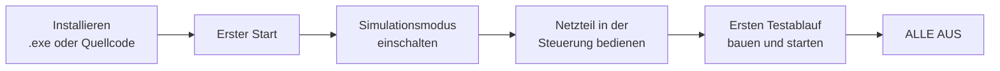
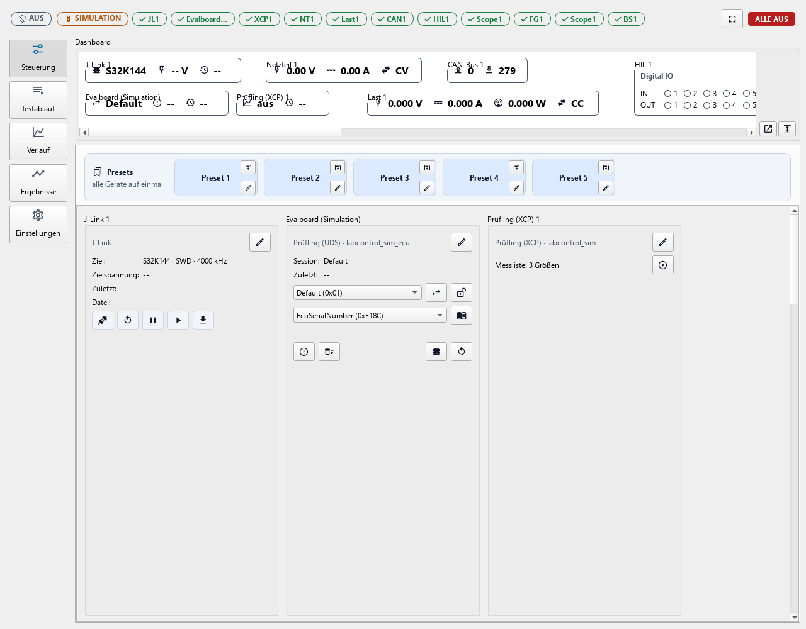
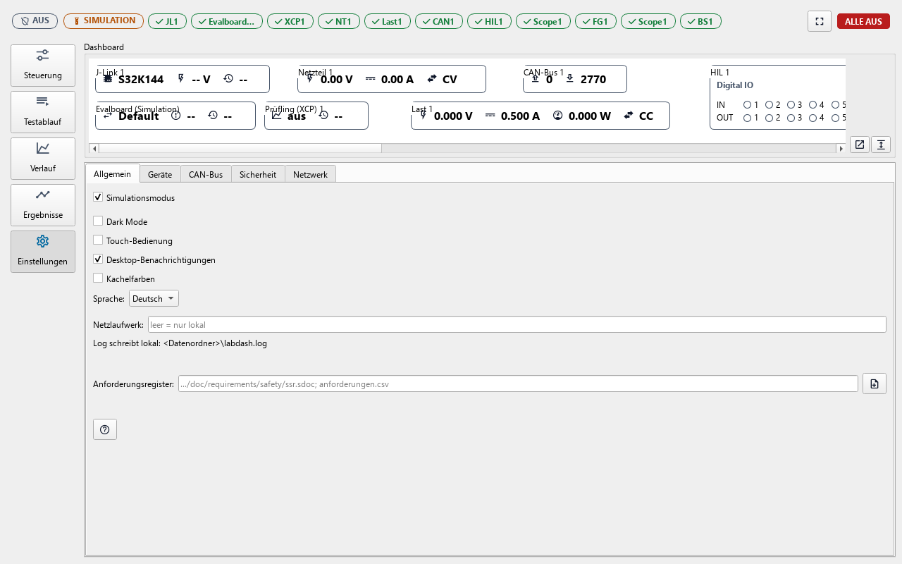
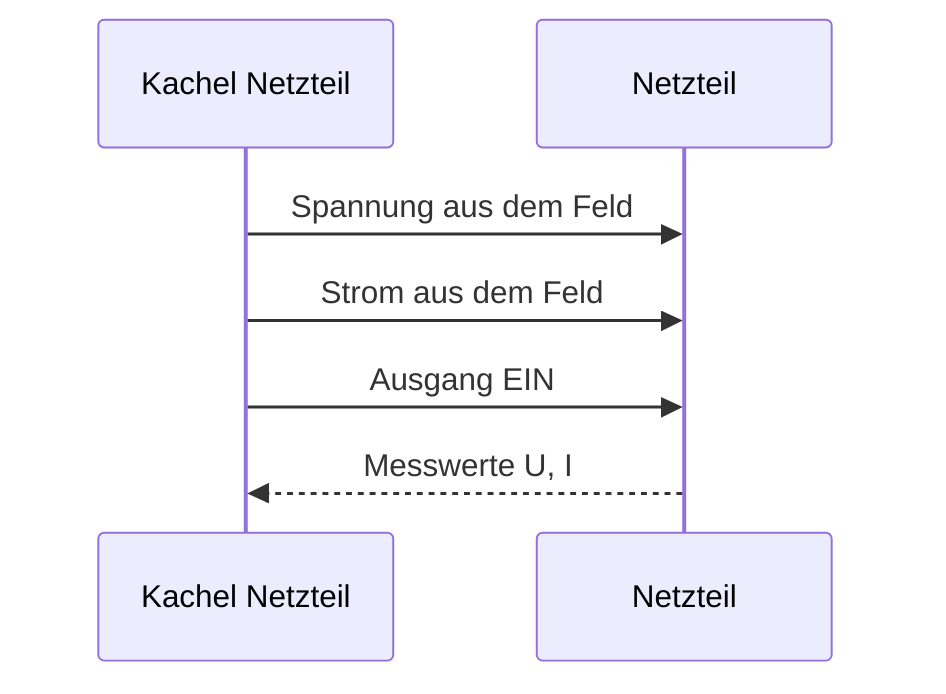
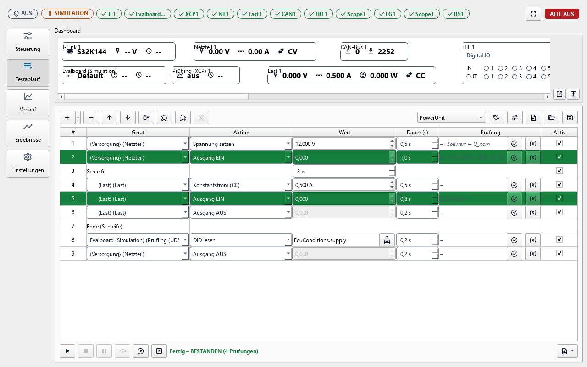
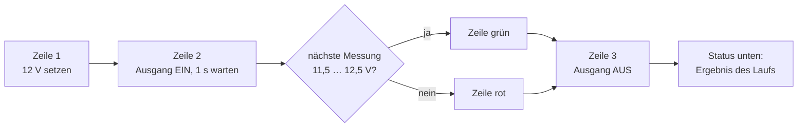
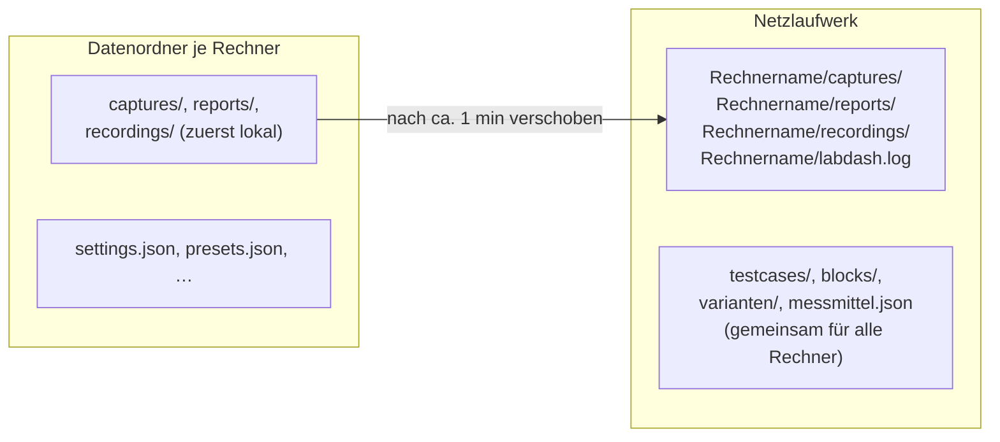

# Schnellstart

In wenigen Minuten von der Installation zum ersten Testablauf – auf Wunsch ganz ohne Hardware.



## Installation

| Weg | Für wen | Simulationsmodus |
|---|---|---|
| `.exe` aus dem GitHub-Release „latest“ | Windows, keine Python-Installation nötig | ja |
| Quellcode mit Python | Windows und Linux, eigene Änderungen | ja |

Manche Geräte brauchen zusätzlich Software des Herstellers, z. B. die Vector XL Driver Library oder die SEGGER
J-Link Software. Was welches Gerät braucht: [Geräte einrichten](geraete.md).

### Windows: fertige .exe

Jede Release-Version (z. B. **„LabControl v1.0.0“**) steht mit ihrer `.exe` unter **Releases** auf GitHub. Den
Entwicklungsstand aus `master` gibt es zusätzlich als Vorabversion **„LabControl (latest master build)“**
(Tag `latest`).

1. Auf der GitHub-Seite des Projekts **Releases** öffnen und die oberste Release-Version
   (Markierung **Latest**) wählen.
2. `LabControl_v<Version>.exe` herunterladen (eine Datei, keine Installation).
3. Die `.exe` in einen **eigenen Ordner** legen, z. B. `LabControl` in deinen Dokumenten.
4. Per Doppelklick starten. Erst kommt ein Startbild, dann das Hauptfenster.

!!! tip "Eigener Ordner für die .exe"
    Die `.exe` legt Einstellungen, Protokoll, Abläufe und Aufzeichnungen **neben sich** ab. Für eine neue
    Version ersetzt du nur die `.exe` im selben Ordner; deine Daten bleiben.

### Aus dem Quellcode (Windows)

Voraussetzung: **Python 3.12** (damit baut auch GitHub die `.exe`) und Git.

```
git clone <Adresse des Repositorys>
cd LabControl
python -m venv .venv
.venv\Scripts\activate
pip install -r requirements.txt
python lab_gui/main.py
```

- `requirements.txt` enthält alles Nötige, u. a. PySide6 (Oberfläche), pyserial (USB), python-can und cantools
  (CAN, DBC), asammdf (MF4), pyvisa-py (Netzwerk-Oszilloskop ohne NI-VISA), can-isotp und udsoncan (UDS).
- PyInstaller brauchst du nur, um die `.exe` selbst zu bauen: [Für Entwickler](entwickler.md).

### Linux und Raspberry Pi

- Start aus dem Quellcode wie oben mit `python lab_gui/main.py`.
- Für den Pi gibt es Skripte für Python-Umgebung, Autostart, Vollbild und CAN: [Raspberry Pi und Verbund](pi-verbund.md).

## Erster Start



| Bereich | Inhalt |
|---|---|
| links | Navigation: **Steuerung**, **Testablauf**, **Verlauf**, **Ergebnisse**, **Einstellungen** |
| oben | Sicherheits-Chip (Schild-Symbol), je Gerät ein Chip, ganz rechts der rote Knopf **ALLE AUS** |
| darunter | Dashboard-Streifen mit den aktuellen Messwerten aller Geräte |

- **Geräte suchen:** LabControl findet USB-Geräte selbst und versucht es alle 3 Sekunden erneut, solange eines
  nicht erreichbar ist. Ohne Gerät zeigt das Dashboard eine graue Kachel **„Kein Gerät verbunden“**.
- **Nur eine Instanz:** Ein zweiter Start meldet **„LabControl läuft bereits.“** und beendet sich. So öffnen nie
  zwei Programme dieselben Geräte.
- **Eingebautes Handbuch:** Knopf mit dem Fragezeichen in **Einstellungen → Allgemein**.
- Alles Weitere zum Hauptfenster: [Bedienung](bedienung.md).

## Simulationsmodus einschalten



1. Links auf **Einstellungen** klicken, oben den Reiter **Allgemein** wählen.
2. Häkchen **Simulationsmodus** setzen.
3. Kurz danach erscheinen die simulierten Geräte in der Leiste oben und im Dashboard; oben in der Leiste steht
   deutlich **SIMULATION**.

- Geht in der `.exe` genauso wie aus dem Quellcode; bleibt nach einem Neustart erhalten.
- Simulierte Geräte: „Netzteil 1“, „Last 1“, „CAN-Bus 1“, „HIL 1“, „Funktionsgenerator 1“, „Batterie-Simulator 1“,
  zwei Oszilloskope, ein J-Link und ein Steuergerät (UDS, XCP).

!!! warning "Echte Geräte bleiben aktiv"
    Der Simulationsmodus ergänzt simulierte Geräte; echte werden weiter gefunden und auch von ALLE AUS, Presets
    und Testabläufen geschaltet. Zum gefahrlosen Ausprobieren steckst du echte Geräte vorher ab.

## Erstes Gerät steuern

Beispiel: das simulierte Netzteil. Mit einem echten HCS-3xxx geht es genauso.

1. Links auf **Steuerung** klicken und zur Kachel **Netzteil 1** scrollen (Untertitel „Labornetzteil (HCS-34xx)“).
2. **Spannung:** `12` eintragen, auf den Haken daneben klicken (Tooltip „Setzen“).
3. **Strom:** `0,5` eintragen, wieder auf den Haken klicken.
4. Bei **Ausgang:** auf **EIN** klicken. Die Kachel zeigt EIN farbig.
5. Im Dashboard zeigt „Netzteil 1“ jetzt Spannung und Strom.
6. Bei **Ausgang:** auf **AUS** klicken.

Sollwerte darfst du auch bei ausgeschaltetem Ausgang setzen. **EIN** schickt immer zuerst die Feldwerte:



!!! tip "Messwerte als Kurve"
    Unter **Verlauf** fügst du mit **Signal hinzufügen** die Netzteil-Spannung einem Diagramm hinzu, siehe
    [Bedienung](bedienung.md#verlauf-und-aufzeichnung).

## Ersten Testablauf bauen und starten



Ziel: Netzteil auf 12 V, einschalten, Spannung prüfen, ausschalten.

| Zeile | Gerät | Aktion | Wert | Dauer (s) | Prüfung |
|---|---|---|---|---|---|
| 1 | Netzteil (automatisch) | Spannung setzen | 12 V | 0,5 | – |
| 2 | Netzteil (automatisch) | Ausgang EIN | – | 1,0 | Spannung 11,5 … 12,5 V |
| 3 | Netzteil (automatisch) | Ausgang AUS | – | – | – |

1. Links auf **Testablauf** klicken. Ist die Tabelle nicht leer: oben **Neuer Ablauf** (Blatt mit Plus).
2. Zeile 1 wie in der Tabelle ausfüllen.
3. **+** klicken (fügt einen Aktionsschritt ein) und Zeile 2 ausfüllen.
4. In Zeile 2, Spalte **Prüfung**, den Knopf mit dem Haken im Kreis klicken (Tooltip „Prüfung…“). Im Dialog
   **Prüfung definieren**:
    - **Prüfung aktiv** anhaken,
    - **Messgröße:** Spannung, **Minimum:** 11,5 V, **Maximum:** 12,5 V,
    - **OK**.
5. Noch einmal **+** und Zeile 3 ausfüllen.
6. Unten links **Start** (Abspielen-Symbol) klicken.



Eine verletzte Prüfung färbt die Zeile rot; der Lauf geht weiter, außer der Schritt verlangt ausdrücklich den
Abbruch (siehe [Testabläufe](testablaeufe.md)).

Am Ende steht unten **„Fertig – BESTANDEN (1 Prüfungen)“**. Danach:

- **Report…** (unten rechts): Bericht als HTML öffnen oder als PDF exportieren.
- **Speichern…** (Diskette): Ablauf als JSON-Datei ablegen.
- **Ergebnisse** (links): alle Läufe dieses Ablaufs.

!!! note "Gerät „automatisch“"
    „Netzteil (automatisch)“ nimmt zur Laufzeit das einzige verbundene Netzteil. Sind mehrere verbunden, bricht
    der Schritt mit einer Meldung ab; dann wählst du das Gerät mit Namen.

!!! tip "Am Ende ALLE AUS"
    Neue Abläufe haben die Eigenschaft **„Am Ende ALLE AUS“** vorbelegt (Dialog „Eigenschaften des Ablaufs“).
    Dann schaltet auch ein normal beendeter Lauf am Ende alles ab, siehe [ALLE AUS](bedienung.md#alle-aus).

Schleifen, Bedingungen, Varianten, Bausteine und mehr: [Testabläufe](testablaeufe.md).

## ALLE AUS

Der rote Knopf **ALLE AUS** oben rechts schaltet sofort alle Ausgänge ab – auch microHIL-PWM, Restbus und im
Verbund die Geräte des Partners. Ein laufender Testablauf bricht mit „ALLE AUS – Ablauf abgebrochen“ ab. Was genau
je Gerät passiert: [Bedienung](bedienung.md#alle-aus).

!!! warning "Vor jedem Umbau: ALLE AUS"
    Drücke ALLE AUS, bevor du Kabel umsteckst oder an den Prüfling greifst. **Stop** im Testablauf und ein
    fehlgeschlagener Schritt schalten ebenfalls alles ab.

!!! warning "Beim Beenden werden Netzteile freigegeben"
    Beim Schließen setzt LabControl jedes HCS-3xxx auf **1 V, 0 A, Ausgang EIN**, damit es von Hand bedienbar ist.
    Wer danach am Gerät den Strom aufdreht, legt sofort Spannung an ([Handbedienung](bedienung.md#handbedienung-hcs-netzteil)).

## Wo liegen die Daten?

Alles liegt in einem **Datenordner**. Wo der ist, hängt vom Start ab:

| Start | Datenordner |
|---|---|
| `.exe` (Windows) | der Ordner, in dem die `.exe` liegt |
| Quellcode unter Windows | `lab_gui/` im Repository |
| Quellcode unter Linux, Raspberry Pi | `~/.local/share/labcontrol` (bzw. `$XDG_DATA_HOME/labcontrol`) |
| jede Plattform mit Umgebungsvariable `LABCONTROL_DATA_DIR` | der dort angegebene Ordner, z. B. auf einer USB-SSD |

| Datei oder Ordner | Inhalt |
|---|---|
| `settings.json` | alle Einstellungen, auch Grenzwerte, Kachelfarben und der Freigabe-Token |
| `device_labels.json` | Namen der Geräte |
| `presets.json` | die fünf Presets der Steuerung |
| `timeline_layout.json` | Diagramme und Signale im Verlauf |
| `labdash.log`, `share_access.log` | Protokoll und (falls eingeschaltet) Zugriffsprotokoll der Netzwerk-Freigabe |
| `testcases/`, `blocks/`, `varianten/` | Testabläufe, Bausteine, Varianten |
| `reports/` | Berichte und Ergebnisse der Läufe (`run_<id>.json/.xml/.html`) |
| `recordings/` | Aufzeichnungen aus dem Verlauf (CSV, MF4) |
| `captures/` | Oszilloskop-Erfassungen (CSV) |
| `labcontrol.lock` | Sperre gegen eine zweite Instanz |

!!! warning "settings.json nicht weitergeben"
    `settings.json` enthält den Token der Netzwerk-Freigabe im Klartext. Gib die Datei nicht weiter und lege sie
    nicht in ein öffentliches Repository.

### Gemeinsamer Ordner (Netzlaufwerk)

Für PC und Pi oder zentrale Ergebnisse trägst du in **Einstellungen → Allgemein → Netzlaufwerk:** einen Ordner
ein (leer = nur lokal).



- **Gemeinsam:** `testcases/`, `blocks/`, `varianten/`, `messmittel.json`. Laden- und Speichern-Dialoge zeigen
  dorthin, wenn das Netzlaufwerk erreichbar ist.
- **Je Rechner** (Unterordner mit dem Rechnernamen): Erfassungen, Berichte, Aufzeichnungen, Protokoll. Sie
  entstehen zuerst lokal und werden etwa eine Minute später verschoben; ein hängendes Netzlaufwerk hält die
  Bedienung so nie auf.
- **Nicht erreichbar:** Alles bleibt lokal und wird nachgeschoben. Höchstens 200 MB warten lokal; darüber werden
  die ältesten wartenden Dateien gelöscht (steht im Protokoll).
- **Anzeige:** Unter dem Feld steht, wohin gerade geschrieben wird und wie viele Dateien warten.
- **Vorrang:** Die Umgebungsvariable `LABCONTROL_NETWORK_DIR` gilt vor dem Feld; das Feld ist dann gesperrt.
- **Beispiele:** am PC ein Freigabepfad wie `\\<Server>\<Freigabe>\LABCONTROL`, am Pi ein eingehängter Ordner.
  Für den Pi gibt es ein Skript, das ein SMB-Laufwerk einhängt und einträgt: [Raspberry Pi und Verbund](pi-verbund.md).
