# Testabläufe

Ein Testablauf ist eine gespeicherte Folge von Schritten: Sollwerte setzen, schalten, warten, messen, prüfen.
LabControl färbt jede Prüfung grün oder rot und schreibt am Ende einen Bericht. Starten kannst du im Fenster, am
Touch-Display des Pi, über die Kommandozeile oder über REST/MCP (siehe [Automatisierung](automatisierung.md)).

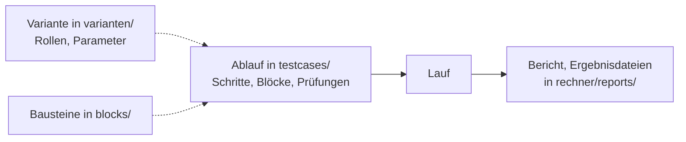

Die Ordner liegen im gemeinsamen Ordner (Netzlaufwerk, sonst lokal).

## Der Editor

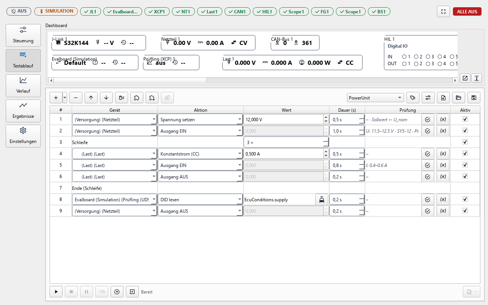

Reiter **Testablauf**: jede Zeile ein Schritt, ausgeführt von oben nach unten. Blöcke rücken ihren Inhalt ein.

| Spalte | Inhalt |
|---|---|
| **#** | Zeilennummer, roter Punkt eines Haltepunkts, Unternummern eines Bausteins (4.1, 4.2 …) |
| **Gerät** | Zielgerät, eine Rolle ⟨…⟩ aus einer Variante oder „… (automatisch)“; bei Blöcken deren Name, z. B. „Ende (Schleife)“ |
| **Aktion** | abhängig von der Geräteart (siehe [Aktionen je Gerät](#aktionen-je-gerat)) |
| **Wert** | Sollwert mit Einheit; je nach Aktion Kanal, Datei, Signal- oder UDS-Parameter; bei Schleifen die Anzahl („3 ד) |
| **Dauer (s)** | Wartezeit **nach** dem Schritt; bei Arbiträrsignal die Signallaufzeit, bei „Warten“ die Wartezeit |
| **Prüfung** | Kurzfassung (z. B. `U: 11.5–12.5 V`), Anforderungs-IDs, Werte aus Parametern; Knöpfe **Prüfung…** und **Werte aus Parametern…** |
| **Aktiv** | abgewählt = übersprungen; ein abgewählter Blockanfang überspringt den ganzen Block |

Werkzeugleiste (Symbole, Name im Tooltip):

| Knopf (Tooltip) | Wirkung |
|---|---|
| **Zeile hinzufügen** (+) | neuer Aktionsschritt hinter der markierten Zeile; der Pfeil daneben bietet **Aktionsschritt**, **Schleife (n×) … Ende**, **Solange … Ende**, **Wenn … Ende**, **Überwachen … Ende**, **Sonst**, **Ende**, **Variable setzen**, **Variable erhöhen**, **Warten** (Blöcke gleich mit „Ende“) |
| **Zeile entfernen** (−), **Nach oben**, **Nach unten** | markierte Zeile entfernen bzw. verschieben; mit der Maus: Zeile an der Nummer (#) greifen und ziehen |
| **Alle Zeilen löschen** | leert den Ablauf nach Rückfrage, nicht rückgängig zu machen |
| **Baustein speichern…**, **Baustein einfügen…**, **Verknüpfung zum Baustein lösen** | siehe [Bausteine](#bausteine) |
| Auswahlliste rechts, **Varianten bearbeiten…** | Variante für den nächsten Lauf oder „(keine Variante)“, siehe [Varianten](#varianten-und-parametersatze) |
| **Eigenschaften des Ablaufs…** | siehe [Eigenschaften](#eigenschaften-des-ablaufs) |
| **Neuer Ablauf**, **Laden…**, **Speichern…** | aktuellen Ablauf nach Rückfrage schließen; Ablauf-Datei (`*.json`) öffnen bzw. speichern |

- Ohne geladenen Ablauf zeigt der Editor „Noch kein Testablauf“ und den Ordner `testcases/`.
- Wurde die Datei seit dem Öffnen woanders geändert (z. B. am Pi), fragt **Speichern…**: **Überschreiben**,
  **Als Kopie speichern** oder **Abbrechen**.
- **Gerät „… (automatisch)“** nimmt das einzige verbundene Gerät dieser Art. Sind mehrere verbunden, endet der Lauf
  mit Fehler („Mehrere Geräte des Typs … verbunden – bitte Zielgerät in der Testcase-Zeile auswählen“).
- Ein gespeichertes Gerät, das gerade fehlt, steht als „… (nicht verbunden)“ in der Zeile.

### Aktionen je Gerät

Wertebereiche = Grenzen des Eingabefelds; zusätzlich gelten die Grenzwerte aus Einstellungen → Sicherheit (siehe
[Geräte einrichten](geraete.md)).

| Gerät | Aktion | Wert |
|---|---|---|
| **Last** | Konstantstrom (CC) / -spannung (CV) / -widerstand (CR) / -leistung (CW) | 0–40 A / 0–150 V / 0–7500 Ohm / 0–300 W |
| **Netzteil** | Spannung setzen / Strom setzen | 1–60 V (unter 1 V ignoriert das HCS-Netzteil den Wert) / 0–40 A |
| **Last**, **Netzteil** | Ausgang EIN, Ausgang AUS; Arbiträrsignal | – (beim Netzteil bleiben die Sollwerte); Signal über **Signal definieren…** |
| **microHIL** | Digitalausgang EIN/AUS / Relais EIN/AUS / Analogausgang setzen | Kanal 1–8 / Kanal 1–4 / Kanal 1–2, 0–12210 mV |
| | Digitaleingang lesen / Analogeingang lesen | Kanal 1–8, liefert 0/1 / Kanal 1–4, liefert mV |
| **Oszilloskop** (PicoScope) | Maximum (Spitzenwert), Minimum (Spitzenwert), Spitze-Spitze (Vpp), Effektivwert (RMS) | Kanal A/B, Bereich 20 mV–20 V, liefert mV |
| **Funktionsgenerator** | Frequenz / Amplitude / Offset / Tastverhältnis / Phase setzen | Kanal 1–2; 0,01 Hz–15 MHz / 0–20 V / −9,99…+9,99 V / 0–100 % / 0–360° (Kanal 2 gegen 1) |
| | Wellenform Sinus, Rechteck, Puls, Dreieck, DC; Ausgang EIN/AUS | Kanal 1–2 |
| **Batterie-Simulator** | Fernsteuerung EIN/AUS, Ausgang EIN/AUS, Alle Zellen EIN/AUS, FAIL zurücksetzen | – |
| | Zellspannung setzen / Alle Zellspannungen setzen | Zelle 1–14, 0–5 V / 0–5 V |
| | Zelle EIN, Zelle AUS, Zellspannung lesen / Stapelspannung lesen | Zelle 1–14 (lesen liefert V) / liefert V |
| **CAN-Bus** | CAN-Frame senden; Restbus starten, Restbus stoppen, Restbus-Signal setzen | über **CAN-Frame definieren…** (ID, Datenbytes, 29-Bit); Restbus siehe [Prüfling](pruefling.md) |
| **J-Link** | Firmware flashen, Reset, Anhalten, Starten, Verbindung prüfen | Firmware-Datei bei „Firmware flashen“ |
| **Prüfling (UDS)** | Session wechseln, Entsperren, DID lesen, DID schreiben, Fehlerspeicher lesen, Fehlerspeicher löschen, Routine, Reset, Rohe Anfrage, Firmware flashen (CAN) | über **UDS-Parameter…** |
| **Prüfling (XCP)** | Messgröße lesen, Parameter schreiben | über **XCP-Parameter…** |

- **Batterie-Simulator:** „Fernsteuerung EIN“ → Sollwerte und Zellen → „Ausgang EIN“. Über dem Grenzwert je Zelle
  lehnt der Treiber den Wert ab.
- **UDS, XCP, Restbus, Flashen:** siehe [Prüfling](pruefling.md). Ein UDS-Schritt hat eine eigene Erwartung
  (positive Antwort oder bestimmter NRC); eine Abweichung zählt wie eine verletzte Prüfung.

## Kontrollfluss

| Schritt | Wirkung |
|---|---|
| **Schleife** | wiederholt den Inhalt bis „Ende“ n-mal (Anzahl in Spalte Wert) |
| **Solange** | wiederholt, solange die Bedingung gilt; geprüft vor jedem Durchlauf |
| **Wenn** / **Sonst** | Inhalt, wenn die Bedingung gilt, sonst den Teil nach „Sonst“ (optional) |
| **Überwachen** | Zeitprüfung über alle Schritte bis „Ende“ (siehe [Zeitprüfungen](#zeitprufungen-uberwachen)) |
| **Ende** | schließt den zuletzt geöffneten Block, z. B. „Ende (Schleife)“ |
| **Variable setzen** / **Variable erhöhen** | setzt eine Variable bzw. addiert einen Wert; die Dauer wartet danach |
| **Warten** | wartet die Dauer ab, ohne Gerät |

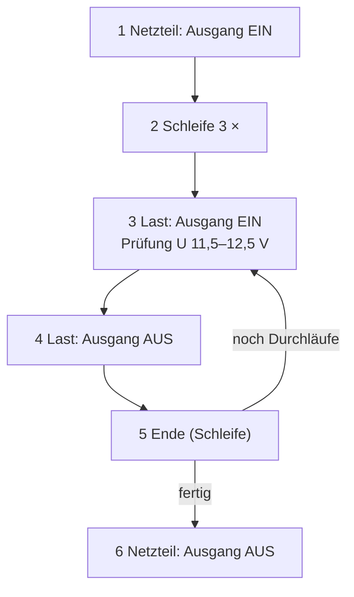

- Blöcke dürfen verschachtelt sein. Fehlt ein „Ende“ oder steht „Sonst“ außerhalb von „Wenn“, ist die Zeile rot
  umrandet und **Start** gesperrt; der Tooltip nennt den Fehler („Struktur unvollständig: …“).
- Variablen entstehen durch „Variable setzen“, durch Lese-Aktionen mit **In Variable speichern:** (siehe
  [Prüfungen](#prufungen)) und durch die Parameter einer Variante.

### Bedingungen

Knopf **Bedingung…** in einer Solange- oder Wenn-Zeile:

| Feld | Bedeutung |
|---|---|
| **Quelle:** | **Messwert**, **Zeit** oder **Variable** |
| **Gerät:** | bei Messwert: Last, Netzteil, microHIL, CAN-Bus oder Prüfling (XCP) – „automatisch“, ein bestimmtes Gerät oder eine Rolle |
| **Messgröße:** / **Signal:** | Last/Netzteil: Spannung (V), Strom (A), Leistung (W); microHIL: Analogwert (mV) oder Zustand (0/1) mit **Kanal:**; CAN-Bus: `Nachricht.Signal` aus der DBC, z. B. `EngineData.RPM`; Prüfling (XCP): Messgröße aus der A2L |
| **Referenz:** / **Variable:** | bei Zeit: **seit Blockstart** oder **seit Teststart** (s); bei Variable: ihr Name |
| **Vergleich:** / **Wert:** | <, ≤, >, ≥, =, ≠ gegen eine Zahl |
| **Max. Durchläufe:** | nur Solange: Schutz vor Endlosschleife, Vorgabe 1000, 0 = unbegrenzt; Grenze erreicht = Lauf endet mit Fehler |

Fehlt ein Messwert, ist er älter als 2 s oder ist die Variable nicht gesetzt, bricht der Lauf ab, statt mit alten
Werten zu rechnen.

## Prüfungen

**Prüfung…** in der Spalte Prüfung öffnet **Prüfung definieren**. Prüfbar sind Schritte an Last und Netzteil
sowie alle Lese-Aktionen (microHIL, Oszilloskop, Batterie-Simulator, „DID lesen“, „Messgröße lesen“).

| Feld | Bedeutung |
|---|---|
| **Prüfung aktiv** | schaltet die Prüfung ein |
| **Messgröße:** | Last/Netzteil: Spannung, Strom oder Leistung (Netzteil aus U·I); Lese-Aktionen liefern genau einen Wert |
| **Minimum:** / **Maximum:** | erlaubter Bereich; Minimum > Maximum sperrt OK |
| **Bei Verletzung abbrechen** | Verletzung beendet den Lauf (mit ALLE AUS); ohne Haken wird sie nur gezählt |
| **In Variable speichern:** | nur Lese-Aktionen: Wert zusätzlich in diese Variable, auch ohne aktive Prüfung |
| **Anforderungen:** | Anforderungs-IDs, die die Prüfung nachweist, z. B. `SSR-012(a), SYS-150` |

Wann gemessen wird:

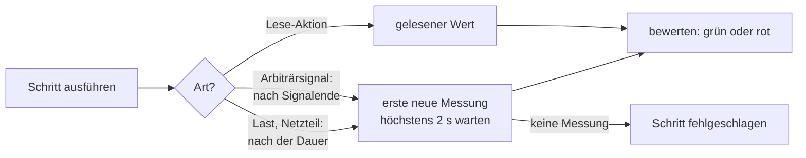

### Anforderungen

- Der Dialog vervollständigt IDs aus dem Anforderungsregister (Einstellungen → Allgemein →
  **Anforderungsregister:**): StrictDoc (`.sdoc`), CSV- und Markdown-Tabellen (Spalte 1 ID, Spalte 2 Titel). IDs
  ohne Registereintrag gehen trotzdem.
- Anforderungen aus den [Eigenschaften des Ablaufs](#eigenschaften-des-ablaufs) gelten für alle Prüfungen und
  sind nur bestanden, wenn der Ablauf vollständig durchlief.
- Abdeckung über alle Läufe: `python lab_gui/main.py coverage` (Optionen `--results`, `--register`, `--csv`,
  `--md`, siehe [Automatisierung](automatisierung.md)).

| Urteil je Anforderung | Wann |
|---|---|
| bestanden | mindestens eine Prüfung lief, alle bestanden |
| nicht bestanden | mindestens eine Prüfung verletzt |
| nicht geprüft | keine Prüfung mit dieser ID lief |

## Bausteine

Ein Baustein ist ein benannter Zeilenbereich in einer eigenen Datei unter `blocks/` des gemeinsamen Ordners,
z. B. „Versorgung ein“, ein Lastprofil oder ein Fehler am microHIL.

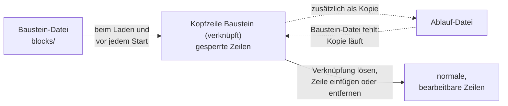

- **Baustein speichern…** (erste Zeile markiert): **Name:**, **Von Zeile:**, **Bis Zeile:**, Dateiname. Ein
  Bereich mit unvollständigem Block lässt sich nicht speichern.
- **Baustein einfügen…** setzt ihn verknüpft hinter die markierte Zeile. Änderungen an der Baustein-Datei wirken
  in allen Abläufen, die ihn verwenden.
- Kopfzeile: Name, Schrittzahl, als Dauer die Summe aller Schritte, Farbe nach dem Gesamtergebnis seiner
  Prüfungen. Ab zwei Zeilen eingeklappt; die Spalte # klappt auf.
- Fehlt die Datei, meldet die Statuszeile „Baustein „…“ nicht lesbar (…) – gespeicherte Kopie verwendet“.
- Verknüpfte Bausteine sind in der Simulation geprüft (Mock-verifiziert).

## Arbiträrsignal und Spannungsprofile

**Arbiträrsignal** an Last oder Netzteil gibt eine Folge von Sollwerten aus, jeder Wert ein einzelnes Kommando –
die Geräte sind keine Signalgeneratoren. Dialog: **Signal definieren…**; Laufzeit = **Dauer (s)** der Zeile.

| Feld | Bedeutung |
|---|---|
| **Signalform:** | Sinus, Rechteck, Dreieck, Sägezahn, Rampe |
| **Zielgröße:** | Last: CC, CV, CR, CW; Netzteil: Spannung setzen, Strom setzen |
| **Offset (Mitte):** / **Amplitude (±):** | Signal zwischen Offset − Amplitude und Offset + Amplitude |
| **Start:** / **Ziel:** | nur Rampe: linear über die Dauer, am Ende genau der Zielwert |
| **Frequenz:** / **Tastgrad:** | 0,001–50 Hz (nicht bei Rampe) / nur Rechteck, 1–99 % |
| **Update-Intervall:** | Mindestabstand zweier Sollwerte (Senden zu Senden), 0–5000 ms; „Auto (≥ 100 ms)“ = so schnell das Gerät quittiert, mindestens 100 ms |

- Vorschau im Dialog; Warnung bei zu wenigen Stützstellen pro Periode und bei Spitzenwerten über OVP/OCP des
  Netzteils (solche Werte lehnt das Netzteil ab, der Schritt bricht ab).
- Gerät am Verbund-Partner (siehe [Raspberry Pi und Verbund](pi-verbund.md)): mindestens 220 ms Abstand, weil der
  Partner höchstens 5 Fernbefehle pro Sekunde annimmt.
- Spannungsprofile (Einbruch, Treppe, Startprofil) baust du aus „Spannung setzen“, Rampe, „Ausgang AUS“,
  Schleifen und Bausteinen.
- Bericht: je Arbiträrsignal **Soll gegen Ist** (Ist vom selben Gerät) und Tabelle „Sollwertverläufe“ (Zahl der
  Sollwerte, Start → Ziel, Abstände min/mittel/max). Rampe und Soll/Ist sind an einem Netzteil am Pi mit
  laufendem Steuergerät geprüft (Hardware-verifiziert).

## Zeitprüfungen (Überwachen)

Ein Block **Überwachen … Ende** prüft einen Messwert, während die Schritte im Block laufen. Dialog:
**Überwachung…** in der Kopfzeile; Quelle wie bei einer Messwert-Bedingung.

| Art: | Felder | Bestanden, wenn … |
|---|---|---|
| **Im Band bleiben** | Minimum:, Maximum: | der Wert während des ganzen Blocks im Band bleibt |
| **Erreichen innerhalb** | Vergleich:, Wert:, Innerhalb: | der Wert die Schwelle spätestens nach der Frist erreicht; gemessen wird die Zeit bis dahin, also die Reaktionszeit, wenn der Auslöser der erste Schritt im Block ist |
| **CAN-Lücken** | CAN-ID:, Größte Lücke: | die Botschaft nie länger als die Lücke ausbleibt |

- Verletzung = nicht bestandene Prüfung; mit **Bei Verletzung abbrechen** endet der Lauf sofort.
- Auflösung = Takt der Quelle: Netzteil und Last etwa 0,5 s, Geräte am Verbund-Partner etwa 1 s, ein beobachteter
  microHIL-Kanal 100 ms (während des Blocks). Der Bericht nennt sie je Prüfung.
- Ist die Auflösung gröber als die halbe Frist bei „Erreichen innerhalb“, gilt die Prüfung als verletzt.
- Dieselbe Auswertung läuft auf Aufzeichnungen (CSV/MF4) und Oszilloskop-Erfassungen mit der Auflösung der Datei;
  CAN-Lücken nur live (Details in [Automatisierung](automatisierung.md)):

```
python lab_gui/main.py timing aufzeichnung.csv --list
python lab_gui/main.py timing aufzeichnung.csv --channel "Netzteil 1/Spannung" --band 11.5:12.5
python lab_gui/main.py timing erfassung.csv --channel A --reach ">= 11.5" --within 0.2 --from 1.0
```

## Varianten und Parametersätze

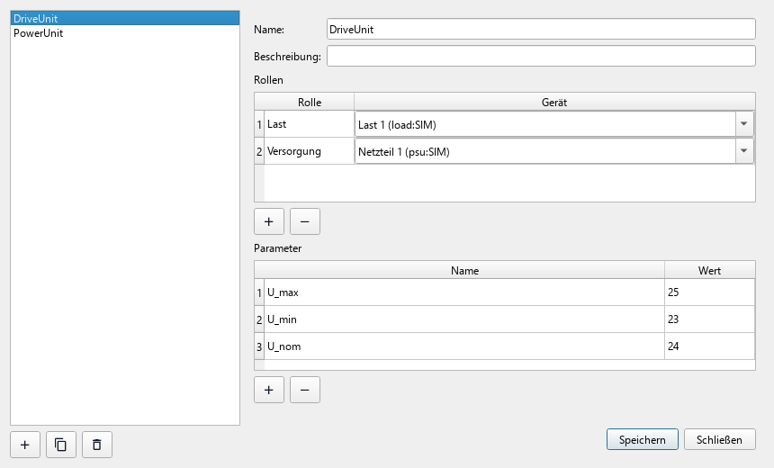

Eine Variante legt fest, welches Gerät welche **Rolle** spielt und welche **Parameter** gelten. So läuft derselbe
Ablauf z. B. für PowerUnit (12 V) und DriveUnit (24 V).

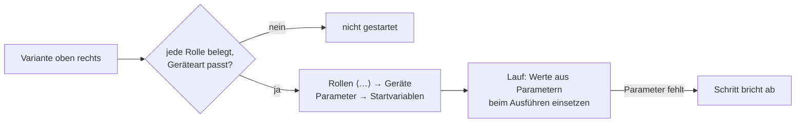

1. **Varianten bearbeiten…**: links **Neue Variante**, **Variante kopieren**, **Variante löschen**; rechts
   **Name:**, **Beschreibung:**, Tabellen **Rollen** (Rolle → Gerät) und **Parameter** (Name → Wert).
   **Speichern** legt die Datei in `varianten/` ab.
2. In der Spalte **Gerät** eine Rolle wählen, z. B. „⟨Versorgung⟩ (Netzteil)“ (Rollen aller Varianten; auch in
   Bedingungen und Überwachen-Blöcken).
3. **Werte aus Parametern…**: für **Sollwert:**, **Dauer:**, **Prüfung min:** oder **Prüfung max:** einen
   Parameternamen eintragen, z. B. `U_nom`. Die Spalte Prüfung zeigt „Sollwert ← U_nom“.
4. Oben rechts die Variante für den nächsten Lauf wählen (bleibt gespeichert).

Bericht und `run-result.json` nennen Variante und Parameter. Mehrere Läufe mit wechselnden Varianten oder
Parametern: `run --matrix` mit einer CSV-Datei (siehe [Automatisierung](automatisierung.md)).

## Eigenschaften des Ablaufs

| Feld im Dialog „Eigenschaften des Ablaufs“ | Bedeutung |
|---|---|
| **Beschreibung** | Freitext, steht oben im Bericht |
| **Anforderungen** | Anforderungs-IDs des ganzen Ablaufs, z. B. `SSR-12, SSR-13` |
| **Netzteil und Last gleichzeitig (Quelle/Senke)** | hebt für diesen Ablauf die Verriegelung Netzteil/Last auf, z. B. um eine Batterie nachzubilden; der Bericht vermerkt das (nur in der Simulation geprüft) |
| **Am Ende ALLE AUS** | auch ein normal beendeter Lauf aus dem Fenster oder über REST/MCP schaltet am Ende alle eigenen Geräte ab; für neue Abläufe vorbelegt, bei bestehenden aus (siehe [Am Ende des Laufs](#am-ende-des-laufs)) |

Verriegelung Netzteil/Last (Einstellungen → Sicherheit → **Verriegelung Netzteil/Last im Testablauf**):

- Paare aus Netzteil und Last. Im Ablauf wird „Ausgang EIN“ abgelehnt, solange das andere Gerät des Paares an
  oder sein Zustand unbekannt ist; der Lauf endet mit Fehler und ALLE AUS.
- Gilt nur für Geräte dieses Rechners und nur im Testablauf, nicht für Kacheln oder Netzwerkbefehle.

!!! warning "Freigabe Quelle/Senke"
    Setze die Freigabe nur, wenn dein Aufbau Netzteil und Last gleichzeitig verträgt.

## Ablauf ausführen

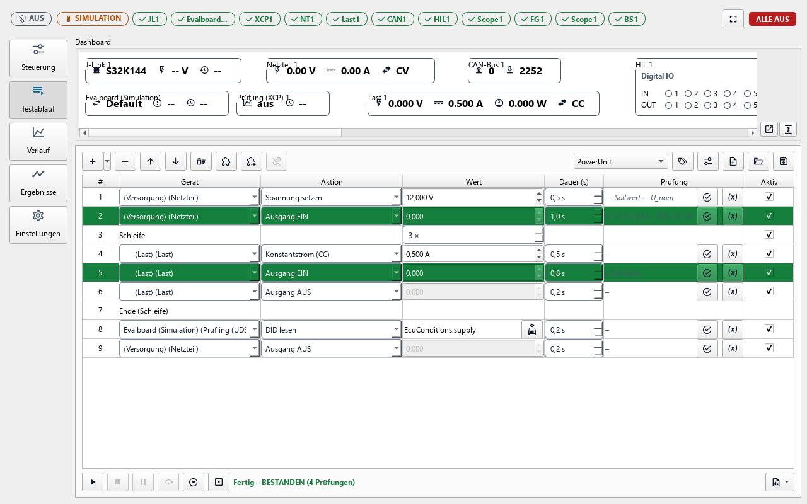

Leiste unter der Tabelle: **Start**, **Stop**, **Anhalten**, **Einzelschritt**, **Haltepunkt an der markierten
Zeile an/aus**, **Ab der markierten Zeile starten**, Statuszeile. **Report…** rechts unten öffnet den Bericht.

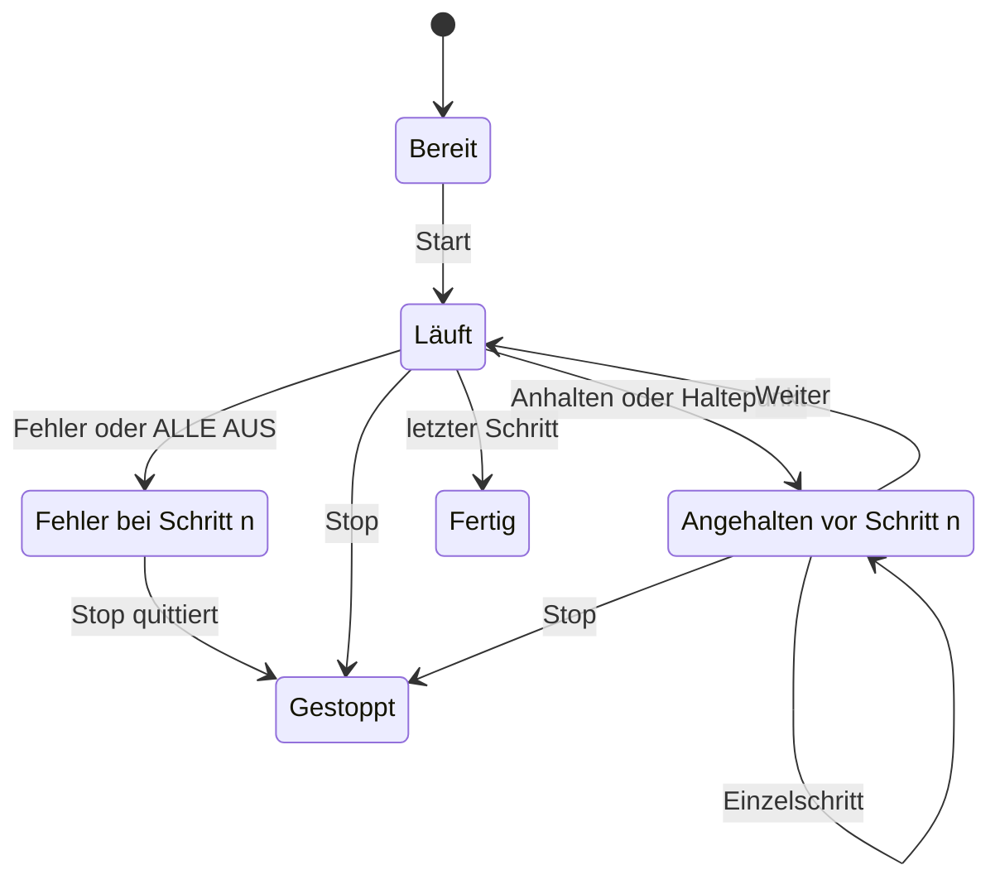

- **Kein Start** bei unvollständiger Struktur, unpassender Variante oder nicht quittierter
  Sicherheitsabschaltung („Testlauf gesperrt: Sicherheitsabschaltung zuerst quittieren“).
- Im Lauf: aktuelle Zeile blinkt grün, Prüfzeilen werden grün oder rot; Statuszeile „Schritt n/m: Gerät – Aktion
  (…)“, in Schleifen „(Durchlauf i/n)“; Tabelle und Werkzeugleiste gesperrt.
- Zum Fehler führen u. a. Gerätefehler, Verriegelung, veraltete Messwerte, **Bei Verletzung abbrechen**,
  die Sicherheitsabschaltung (Grenzwerte, Watchdog) und **ALLE AUS** oben rechts.

| Status am Ende | Bedeutung |
|---|---|
| Fertig – BESTANDEN (n Prüfungen) | alle Prüfungen bestanden |
| Fertig – NICHT bestanden (x/n Prüfungen fehlgeschlagen) | mindestens eine Prüfung verletzt, Lauf aber durchgelaufen |
| Fertig | Ablauf ohne Prüfungen |
| Fehler bei Schritt n/m: … — mit Stop quittieren | abgebrochen, Zeile rot; **Stop** quittiert |
| Gestoppt | du hast **Stop** gedrückt |

### Am Ende des Laufs

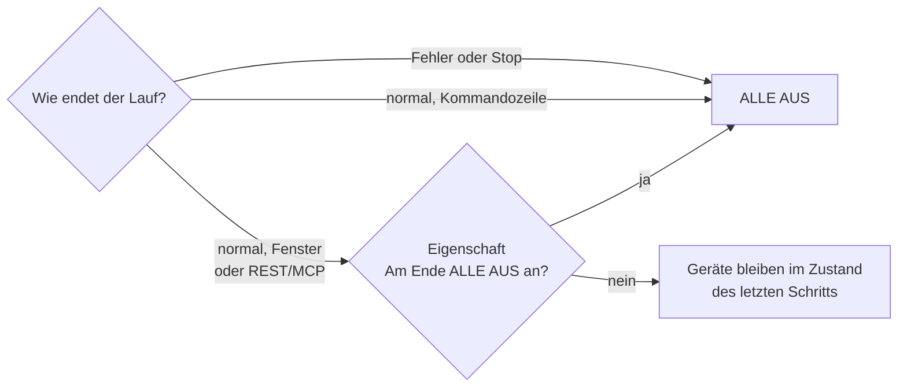

- Bei Fehler und Stop wirkt ALLE AUS sofort auf die Geräte dieses Rechners.
- ALLE AUS setzt am microHIL auch die PWM-Kanäle auf 0 (Mock-verifiziert, am microHIL noch nicht geprüft).
- Die Eigenschaft „Am Ende ALLE AUS“ ist in der Simulation geprüft (Mock-verifiziert).

!!! warning "Wenn „Am Ende ALLE AUS“ aus ist"
    Nach einem normalen Lauf aus dem Fenster oder über REST/MCP bleibt dann eingeschaltet, was der letzte Schritt
    hinterlassen hat.
    Schalte die Eigenschaft ein oder beende den Ablauf mit „Ausgang AUS“-Schritten.

## Debuggen

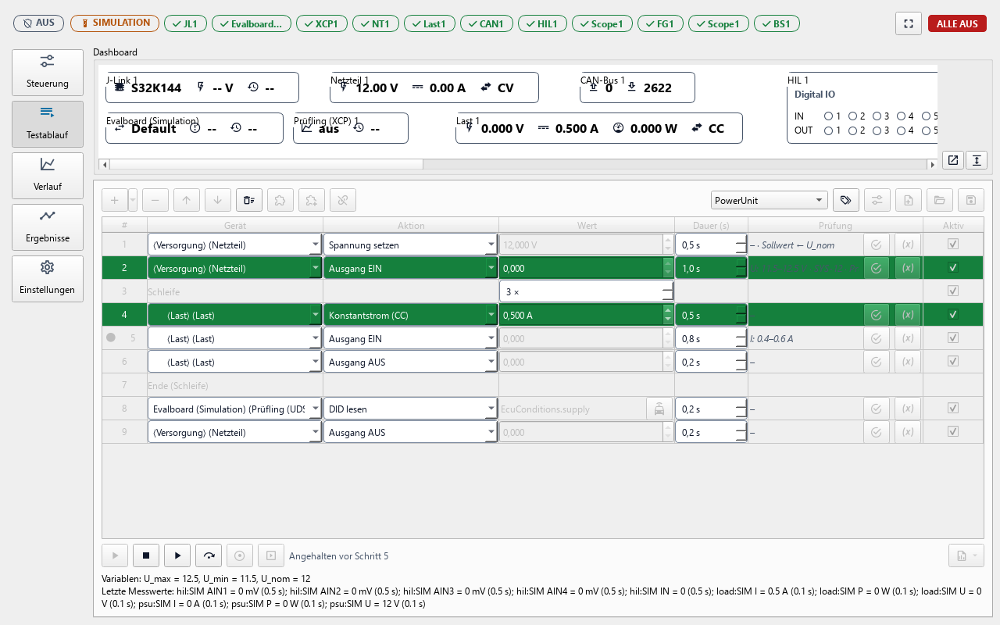

| Knopf | Wirkung |
|---|---|
| **Anhalten** / **Weiter** | hält an der nächsten Schrittgrenze; eine laufende Wartezeit hält sofort und läuft nach „Weiter“ mit dem Rest weiter; ein Arbiträrsignal läuft erst zu Ende |
| **Einzelschritt** | führt den nächsten Schritt aus und hält wieder an |
| **Haltepunkt an der markierten Zeile an/aus** | roter Punkt in Spalte #, der Lauf hält **vor** dieser Zeile |
| **Ab der markierten Zeile starten** | startet dort, die Zeilen davor laufen nicht |

- Pause: Statuszeile „Angehalten vor Schritt n“, darunter Variablen und letzte Messwerte mit Alter.
- Haltepunkte gelten nur in der laufenden Sitzung (nicht in der Datei) und nur für Läufe aus dem Fenster, nie für
  REST, MCP oder Kommandozeile.
- „Ab der markierten Zeile starten“ geht nur auf oberster Ebene, nicht innerhalb eines Blocks.
- In der Pause bleiben die Geräte, wie sie sind. Grenzwerte, Watchdog und Überwachen-Blöcke laufen weiter; Stop
  und ALLE AUS wirken wie sonst.
- Debuggen ist in der Simulation geprüft (Mock-verifiziert).

## Bericht und Ergebnisdateien

Berichtsordner: `<Netzlaufwerk>/<rechner>/reports/`, ohne Netzlaufwerk lokal `reports/`.

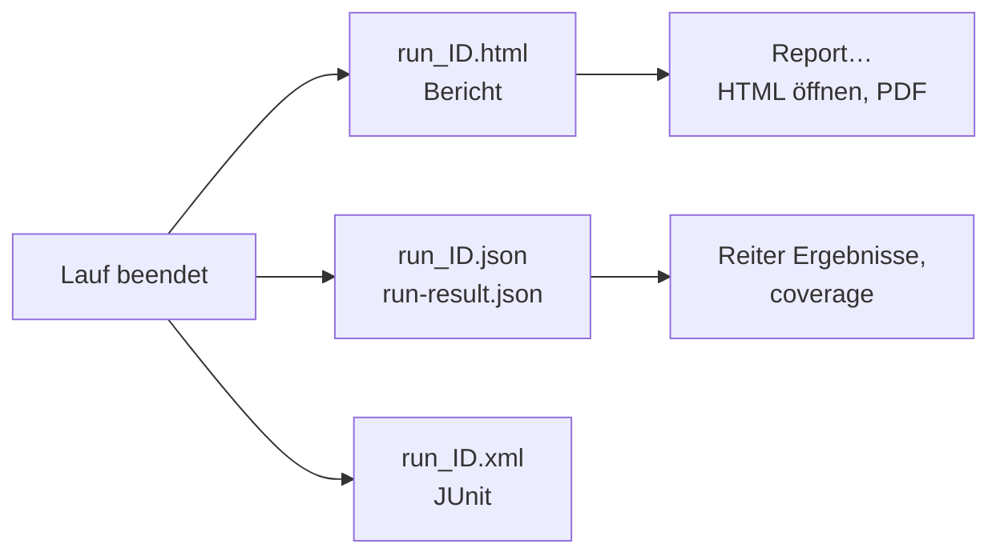

- **Report…** bietet **Report öffnen (HTML)** und **Als PDF exportieren…**.
- `run-result.json`: dieselben Inhalte maschinenlesbar (u. a. `outcome`, `exit_code`, `checks`, `devices`,
  `interlock`, `instruments`, `requirements`, `setpoints`, `timing_checks`, `warnings`); Grundlage für den Reiter
  **Ergebnisse** ([Bedienung](bedienung.md)) und `coverage` ([Automatisierung](automatisierung.md)).
- JUnit: je Prüfschritt ein Testfall, Anforderungen als `property`.

| Abschnitt im Bericht | Inhalt |
|---|---|
| Kopf | Ablaufname, Ergebnis (BESTANDEN, NICHT BESTANDEN, ABGEBROCHEN oder FEHLER bei Schritt n) |
| Übersicht | Beschreibung, Start, Ende, Dauer, Geräte, Anforderungen, Variante, Parameter, Verriegelung |
| Messmittel | Typ, Seriennummer, Firmware, Inventarnummer, Kalibrierdatum und Fälligkeit; abgelaufene Kalibrierung = nur Warnung |
| Anforderungen | Urteil je ID, gelaufene und verletzte Prüfungen, Schritte |
| Schritt-Ergebnisse | je Prüfschritt: Prüfung, Ausführungen, Ergebnis, Messwerte |
| Zeitprüfungen / Sollwertverläufe | Ergebnis, Messwert, Auflösung, Meldung / Arbiträrsignale mit Abständen min/mittel/max |
| Zeitverlauf / Messverlauf | Ereignisse mit Zeit / Diagramme, u. a. Soll gegen Ist und Kurvenausschnitte der Überwachen-Blöcke |

## Am Touch-Display ausführen

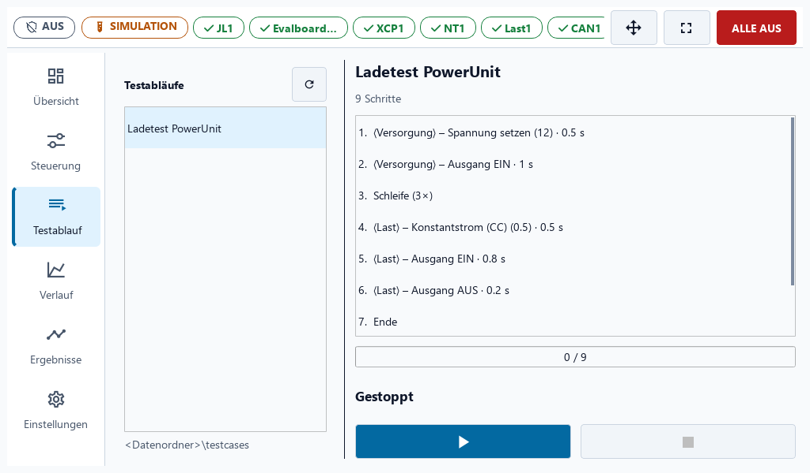

Im Touch-Profil (z. B. Pi mit 1024×600-Display) zeigt der Reiter **Testablauf** eine Ausführen-Ansicht statt des
Editors. Bearbeitet und gespeichert wird am PC.

1. Links unter **Testabläufe** einen Ablauf antippen (aus `testcases/`; **Liste neu einlesen** lädt neu). Rechts
   erscheinen Name, Zahl der Schritte und die Schritte als Text.
2. Großen **Start**-Knopf tippen: aktueller Schritt markiert, Balken zeigt den Fortschritt („4 / 9“), Status groß
   darunter (Fehler rot, bestanden grün).
3. **Stop** bricht ab und quittiert auch einen Schrittfehler.

Gleiche Prüfungen und Sicherheitsabschaltung wie im Editor; keine Haltepunkte, kein Bericht in dieser Ansicht.

## Dateiformat

- JSON, Format 3, sobald ein Schritt `params`, `requirements` oder `link` trägt oder der Ablauf Eigenschaften
  (`meta`) hat; sonst Format 2, damit ältere Versionen die Datei lesen.
- Unbekannte Felder bleiben beim Laden und Speichern erhalten.

Gekürztes Beispiel (die App schreibt je Schritt alle Felder):

```json
{"format": "labor-testcase", "version": 3,
 "steps": [
  {"step_type": "action", "device_kind": "psu", "device_id": "role:Versorgung", "action": "PSU_VOLT",
   "value": 12.0, "duration": 0.5, "enabled": true, "params": {"refs": {"value": "U_nom"}}},
  {"step_type": "action", "device_kind": "psu", "device_id": "role:Versorgung", "action": "PSU_OUT_ON",
   "duration": 1.0, "check_enabled": true, "check_field": "voltage", "check_min": 11.5, "check_max": 12.5,
   "requirements": ["SYS-12"]},
  {"step_type": "loop", "loop_count": 3, "link": {"block": "lastpuls.json", "name": "Lastpuls", "count": 3}},
  {"step_type": "action", "device_kind": "load", "device_id": "load:SIM", "action": "OUT_ON", "duration": 0.8},
  {"step_type": "end"}],
 "devices": {"load:SIM": {"kind": "load", "label": "Last 1"}},
 "meta": {"description": "Ladetest mit drei Lastpulsen", "requirements": ["SYS-10"]}}
```

| Eintrag | Bedeutung |
|---|---|
| `steps` | Schritte in Reihenfolge; `device_id` leer = „automatisch“, `role:<Name>` = Rolle einer Variante |
| `params` | Parameter neuer Aktionen (UDS, XCP, Restbus, Überwachen) und `refs` (Werte aus Parametern: `value`, `duration`, `check_min`, `check_max`, `cond_value`) |
| `requirements` | Anforderungs-IDs der Prüfung dieses Schritts |
| `link` | nur am ersten Schritt eines verknüpften Bausteins: Datei relativ zu `blocks/`, Name, Schrittzahl; die Schritte folgen als Kopie |
| `devices` | Art und Name jedes Geräts; kennt der andere Rechner eine ID nicht, nimmt LabControl das Gerät gleicher Art und gleichen Namens |
| `meta` | Eigenschaften des Ablaufs, u. a. `description`, `requirements`, `source_sink`, `all_off_at_end` |
| Baustein-Datei in `blocks/` | `"format": "labor-testcase-block"`, mit `name` |
| Varianten-Datei in `varianten/` | `{"name", "description", "roles": {Rolle: Geräte-ID}, "vars": {Name: Zahl}}` |
