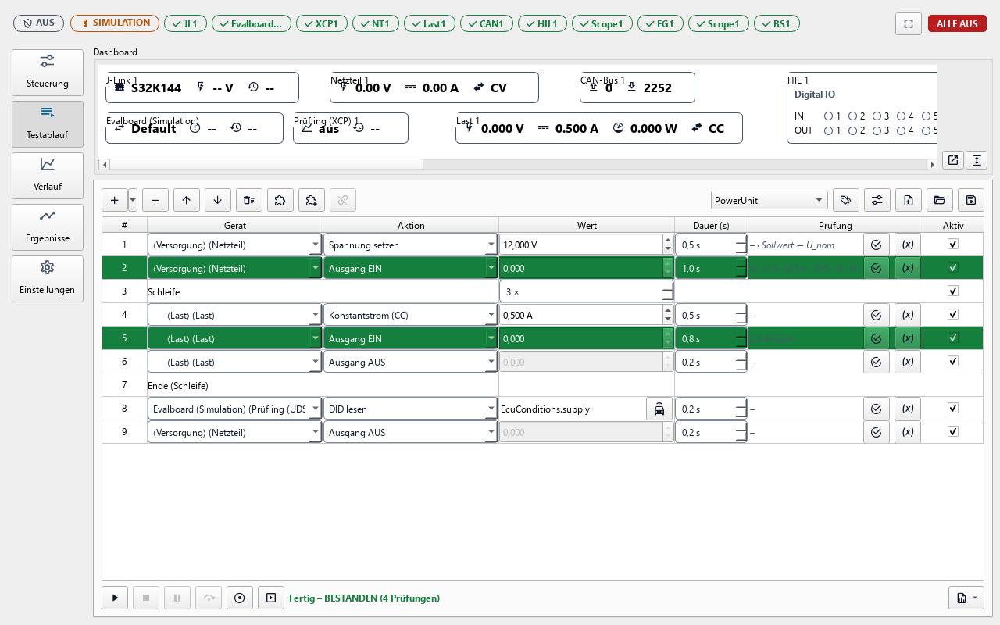

# LabControl

**LabControl** steuert Laborgeräte – Netzteile, elektronische Lasten, Oszilloskope, Funktionsgeneratoren,
I/O-Boxen und CAN-Geräte – aus einer Oberfläche heraus, am PC und auf einem Raspberry Pi mit Touch-Display.
Dazu kommen Testabläufe mit Prüfungen und Bericht, Diagnose am Steuergerät (UDS, XCP), Restbus aus DBC und eine
Kommandozeile für automatische Läufe.

- **[Dokumentation auf Deutsch](de/index.md)**
- *English documentation will follow. The user interface itself can already be switched to English.*

