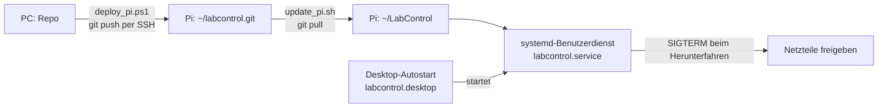

# LabControl auf dem Raspberry Pi

Stand 10.11.2026: Raspberry Pi 5 (2 GB), Raspberry Pi OS 13 (trixie, 64 Bit, Desktop),
7-Zoll-HDMI-Display 1024 × 600 mit USB-Touch. Plan und Entscheidungen PI-1 bis PI-14 stehen im
Plan-Artefakt „LabControl auf dem Raspberry Pi“.



| Datei | Zweck |
|---|---|
| `setup_pi.sh` | Einrichtung am Pi: Python-Umgebung, Dienst, Autostart, SD-Karte schonen, Gerätegruppen |
| `labcontrol.service` | systemd-Benutzerdienst, Neustart nur nach Absturz, 20 s zum Freigeben beim Beenden |
| `labcontrol-autostart.desktop` | startet den Dienst beim (automatischen) Anmelden am Desktop |
| `update_pi.sh` | am Pi: neuen Stand holen, bei Bedarf Pakete, Dienst neu starten |
| `deploy_pi.ps1` | am PC: Stand per SSH zum Pi schieben und `update_pi.sh` aufrufen |
| `slim_sd.sh` | nur für 8-GB-Karten: Browser, Compiler, fremde Firmware usw. entfernen (PI-14) |

## Erstinstallation

1. SD-Karte mit dem Raspberry Pi Imager: „Raspberry Pi OS (64-bit)“, Benutzer, SSH mit
   öffentlichem Schlüssel (`%USERPROFILE%\.ssh\labpi_ed25519.pub`), automatische Anmeldung.
2. Am PC, einmalig das Bare-Repo am Pi anlegen und den Stand übertragen:
   ```
   ssh -i %USERPROFILE%\.ssh\labpi_ed25519 labcontrol@<pi> "git init -q --bare ~/labcontrol.git"
   powershell -File tools\pi\deploy_pi.ps1 -PiHost <pi>     # legt beim ersten Mal ~/LabControl an
   ssh -i %USERPROFILE%\.ssh\labpi_ed25519 labcontrol@<pi> "bash ~/LabControl/tools/pi/setup_pi.sh"
   ```
3. Bei 8-GB-Karte: `bash ~/LabControl/tools/pi/slim_sd.sh`, dann neu starten.

## Betrieb

- Updates vom PC: `powershell -File tools\pi\deploy_pi.ps1`
- Zustand und Protokoll am Pi: `systemctl --user status labcontrol`, `journalctl --user -u labcontrol`
- Daten (Einstellungen, Log, Erfassungen): `~/.local/share/labcontrol`, abweichend über `LABCONTROL_DATA_DIR`
- Fensterzustand: `LABCONTROL_WINDOW=maximized|fullscreen` im Dienst (heute `maximized`;
  Vollbild kommt mit dem Touch-Profil, damit man es in der App auch wieder verlassen kann)
- Fenster schließen beendet den Dienst ohne Neustart; nach einem Absturz startet er nach 5 s neu
  (höchstens 5-mal in 10 min). Ein Neustart schaltet keine Geräte ein.
