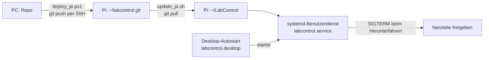

# LabControl auf dem Raspberry Pi

Stand 10.11.2026: Raspberry Pi 5 (2 GB), Raspberry Pi OS 13 (trixie, 64 Bit, Desktop),
7-Zoll-HDMI-Display 1024 × 600 mit USB-Touch. Plan und Entscheidungen PI-1 bis PI-14 stehen im
Plan-Artefakt „LabControl auf dem Raspberry Pi“.



| Datei | Zweck |
|---|---|
| `setup_pi.sh` | Einrichtung am Pi: Python-Umgebung, Dienst, Autostart, SD-Karte schonen, Gerätegruppen |
| `labcontrol.service` | systemd-Benutzerdienst, Neustart nur nach Absturz, 20 s zum Freigeben beim Beenden |
| `labcontrol-autostart.desktop` | startet den Dienst beim (automatischen) Anmelden am Desktop |
| `update_pi.sh` | am Pi: neuen Stand holen, bei Bedarf Pakete, Dienst neu starten |
| `deploy_pi.ps1` | am PC: Stand per SSH zum Pi schieben und `update_pi.sh` aufrufen |
| `slim_sd.sh` | nur für 8-GB-Karten: Browser, Compiler, fremde Firmware usw. entfernen (PI-14) |
| `kiosk_pi.sh` | Kiosk: beim Booten nur das LabControl-Logo, kein Desktop/keine Leiste, dann die App im Vollbild; `--undo` nimmt alles zurück |
| `netzlaufwerk_pi.sh` | SMB-Netzlaufwerk per systemd-Automount einhängen (Passwort verdeckt abgefragt, nur in `/etc/labcontrol/smb-credentials`) und in LabControl eintragen |
| `branding/` | Logo und Boot-Bild (`make_branding.py` am PC erzeugt `splash.png`, `logo*.svg`), Plymouth-Theme `labcontrol` |

## Erstinstallation

1. SD-Karte mit dem Raspberry Pi Imager: „Raspberry Pi OS (64-bit)“, Benutzer, SSH mit
   öffentlichem Schlüssel (`%USERPROFILE%\.ssh\labpi_ed25519.pub`), automatische Anmeldung.
2. Am PC, einmalig das Bare-Repo am Pi anlegen und den Stand übertragen:
   ```
   ssh -i %USERPROFILE%\.ssh\labpi_ed25519 labcontrol@<pi> "git init -q --bare ~/labcontrol.git"
   powershell -File tools\pi\deploy_pi.ps1 -PiHost <pi>     # legt beim ersten Mal ~/LabControl an
   ssh -i %USERPROFILE%\.ssh\labpi_ed25519 labcontrol@<pi> "bash ~/LabControl/tools/pi/setup_pi.sh"
   ```
3. Bei 8-GB-Karte: `bash ~/LabControl/tools/pi/slim_sd.sh`, dann neu starten.
4. Kiosk (Boot-Logo statt Desktop): `bash ~/LabControl/tools/pi/kiosk_pi.sh`, dann `sudo reboot`.
   Desktop für Wartung zurück: `bash ~/LabControl/tools/pi/kiosk_pi.sh --undo`, neu starten.
   Bekannt: bei der Übergabe vom Boot-Logo an labwc ist der Bildschirm etwa 0,1 s schwarz (kurzes Flackern).
   wlroots setzt beim Start immer erst einen leeren Puffer, swaybg kann sein Bild erst danach liefern;
   gemessen 11.11.2026 mit `drm.debug=0x14`, `labwc -d` und `WAYLAND_DEBUG=1` (kein Moduswechsel, 1024×600
   bleibt). Ohne Änderung an labwc/wlroots nicht vermeidbar.

## Betrieb

- Updates vom PC: `powershell -File tools\pi\deploy_pi.ps1`
- Zustand und Protokoll am Pi: `systemctl --user status labcontrol`, `journalctl --user -u labcontrol`
- Daten (Einstellungen, Log, Erfassungen): `~/.local/share/labcontrol`, abweichend über `LABCONTROL_DATA_DIR`
- Fensterzustand: `LABCONTROL_WINDOW=maximized|fullscreen` im Dienst, seit 0.32.1 `fullscreen` (Kiosk);
  verlassen und wieder einschalten über den Vollbild-Knopf in der Touch-Leiste
- Ausschalten: Knopf mit Ein/Aus-Symbol in der Touch-Leiste (Herunterfahren oder Neu starten, mit Rückfrage);
  LabControl gibt vorher die Netzteile frei
- CAN: PCAN-USB erscheint als `can0`, eine udev-Regel aus `setup_pi.sh` fährt ihn beim Einstecken mit
  500 kbit/s hoch. In LabControl: Schnittstelle `socketcan`, Kanal `can0` (Einstellungen → CAN).
  Andere Bitrate: Regel `/etc/udev/rules.d/80-labcontrol-can.rules` anpassen.
- Fenster schließen beendet den Dienst ohne Neustart; nach einem Absturz startet er nach 5 s neu
  (höchstens 5-mal in 10 min). Ein Neustart schaltet keine Geräte ein.
- **Nachtlauf** (seit 0.59.0): `bash ~/LabControl/tools/pi/nightly_pi.sh <ablauf.json> [HH:MM]` richtet einen
  systemd-Timer ein (Standard 02:00), `--now` startet ihn einmal sofort, `--off` schaltet ihn ab. Der Lauf geht
  über den laufenden Kiosk; dafür müssen dort Netzwerk-Freigabe und „Claude (MCP) darf steuern“ an sein.
  Ergebnis: Exit-Code im Journal (`journalctl --user -u labcontrol-nightly`), Bericht, JUnit und
  `run-result.json` als `run_<id>.*` im Berichtsordner (Netzlaufwerk `<netz>/raspberrypi/reports/`).
